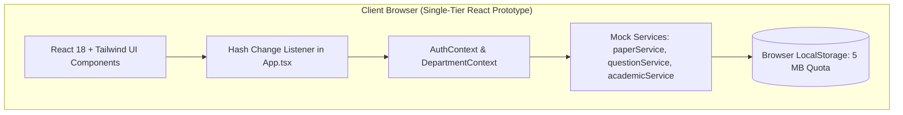
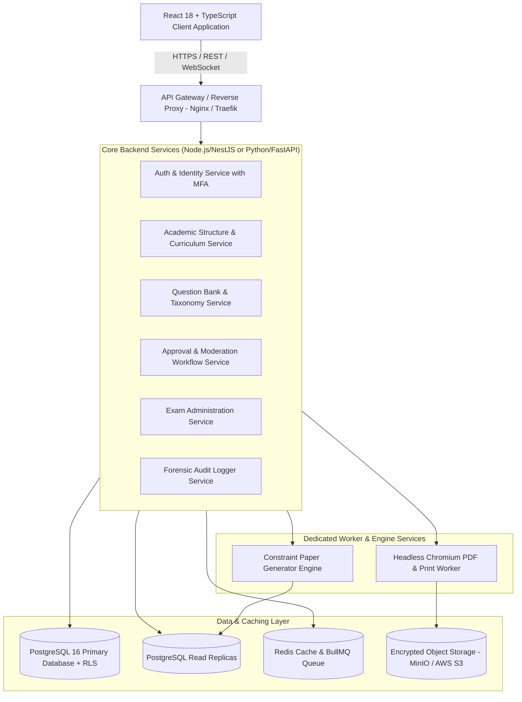

# Project Analysis Summary: University Question Paper Management & Generation System

**Lead Software Architect, Product Analyst, Technical Project Manager, Database Architect & Senior Full-Stack Engineer**  
**Date:** September 24, 2026 | **Project:** QPMS Enterprise Modernization | **Phase:** Phase 0 Baseline Discovery

---

## Executive Summary
This document provides the definitive architectural summary of the comprehensive discovery, technical inspection, and documentation initialization phase for the **University-level Multi-Institution Question Paper Management & Generation System (QPMS)**.

The project has established a 43-document engineering baseline in `/docs/`, codified 10 foundational Architectural Decision Records (ADRs), designed a 17-table physical PostgreSQL schema with Row-Level Security, formulated a deterministic constraint-satisfaction generation engine, specified an enterprise OpenAPI REST standard, and defined an actionable 14-phase implementation backlog.

---

## 1. Current Project State

The existing repository (`/home/mohammad-ali/Projects/mj_question_paper_genrator`) represents a **client-side Single Page Application (SPA) prototype**:
- **Technology Stack:** React 18.3.1, TypeScript 5.4.5, Vite 5.2.13, Tailwind CSS 3.4.4, Lucide React icons.
- **Backend & Database:** **None.** All data is held in in-memory JavaScript objects within `src/mock/` and persisted to browser `localStorage` under keys such as `qpms_papers_v1` and `qpms_questions_v1`.
- **Authentication & Security:** Hardcoded mock personas in `src/mock/academicData.ts` (e.g., Dr. Rahul Patel, Prof. Sunita Sharma, Dr. V. K. Mehta). No real password verification, no JWTs, no session tokens, no MFA.
- **Routing:** Hand-rolled browser hash listener in `src/App.tsx` matching hash regexes (`#dashboard`, `#questions`, `#generator`).
- **Testing & DevOps:** **Zero test files** in the codebase; no test runners in `package.json`; no Dockerfiles; no CI/CD configuration; no environment files (`.env`).
- **Build Status:** Verified working build (`npm run build` succeeds cleanly in 3.24s with zero TypeScript compilation errors, producing a 399.5 KB JavaScript bundle and 36.6 KB CSS bundle).

---

## 2. Existing Architecture



### Limitations of Existing Architecture
1. **Security Vulnerability:** Because all data and logic reside in browser memory, any user can open Developer Tools and view, tamper with, or leak unapproved and confidential examination questions.
2. **Data Loss & Concurrency Failure:** `localStorage` has a hard 5 MB quota and cannot support multi-user collaboration, real-time reviews, or concurrent faculty authoring.
3. **Fragile Academic Modeling:** Rigid hierarchy (`Program -> Semester -> Subject`) cannot model multi-year curriculum schemes (e.g., Regulation 2022 vs. NEP 2025 scheme).
4. **Simulated Generation & Print:** The paper generator relies on basic client array filters and alerts simulated PDF downloads via `window.print()`, offering zero dynamic watermarking or security.

---

## 3. Proposed Architecture

The proposed enterprise architecture is a **Stateless Modular Monolith / Microservices-Ready Distributed System**:



### Key Architectural Pillars
1. **Multi-Tenancy with Row-Level Security (RLS):** Single database deployment supporting 50+ autonomous institutions with hardware-level isolation enforced via PostgreSQL kernel RLS on `institution_id`.
2. **Decoupled Heavy Compute:** Memory-intensive server-side Chromium PDF generation and algorithmic backtracking solvers run in dedicated worker pods isolated from user-facing API nodes.
3. **Stateless Scalability:** Core API nodes store zero local state; sessions reside in short-lived HttpOnly JWTs with refresh token families tracked in Redis.

---

## 4. Major Findings

1. **Strong UI/UX Foundations:** The frontend code exhibits clean component modularity, thoughtful academic design tokens, and an intuitive 8-stage generator stepper that should be preserved.
2. **Correct Department Isolation Flow:** The prototype already models the critical 3-way login flow (0 departments blocked, 1 department auto-resolved, >1 departments prompted to select), providing a solid UX blueprint for backend authorization.
3. **Missing Secrecy Barrier:** In high-stakes examinations, papers must become read-only and encrypted once approved. The existing app leaves papers accessible and editable at all times.
4. **Lookback Avoidance is Purely Visual:** While checkboxes exist for "Exclude previous papers" and "Prevent similar questions", no true lookback relational queries or semantic deduplication algorithms were actually implemented.

---

## 5. Critical Gaps

| Severity | Gap Area | Current State | Target Enterprise State |
| :--- | :--- | :--- | :--- |
| **CRITICAL** | **Backend Architecture** | No server; client-side execution only. | Node.js/NestJS REST API adhering to OpenAPI 3.1. |
| **CRITICAL** | **Persistence & Multi-Tenancy** | In-memory arrays & 5 MB localStorage. | PostgreSQL 16+ with Row-Level Security (RLS). |
| **CRITICAL** | **Authentication & Security** | Dropdown of mock user personas. | OAuth2 / OIDC, JWT in HttpOnly cookies, TOTP MFA. |
| **CRITICAL** | **Secrecy & Paper Custody** | Papers unencrypted, accessible to all. | AES-256 envelope encryption; time-locked CoE vault. |
| **CRITICAL** | **Automated Testing & CI** | Zero test files in repository. | Full testing pyramid (Unit, Integration, Property, E2E). |
| **HIGH** | **Paper Generation Engine** | Static client-side array filter. | Server-side Backtracking CSP solver with heuristics. |
| **HIGH** | **PDF Print Engine** | Browser `window.print()` and alerts. | Headless Chromium worker with dynamic watermarking. |
| **HIGH** | **Audit Trail** | Inline string comments. | Partitioned append-only table with Merkle hash chaining. |
| **HIGH** | **Curriculum Modeling** | Fixed single-tier hierarchy. | Bridge tables supporting coexisting curriculum schemes. |

*(See [docs/GAP_ANALYSIS.md](file:///home/mohammad-ali/Projects/mj_question_paper_genrator/docs/GAP_ANALYSIS.md) for all 23 identified gaps).*

---

## 6. Major Risks & Mitigations

1. **Examination Paper Leak (Catastrophic Impact):**
   - *Mitigation:* Time-gated decryption APIs (locked until $T - 120$ minutes), envelope encryption in secrecy vaults, mandatory MFA for exam officers, and dynamic forensic watermarking on every page.
2. **Generator Solver Combinatorial Explosion (High Impact):**
   - *Mitigation:* Linear-time $O(N)$ candidate pre-stratification, forward-checking to prune non-viable branches, a hard 3-second solver timeout, and automated deficit diagnostics.
3. **Cross-Tenant / Cross-Department Data Contamination (Critical Impact):**
   - *Mitigation:* Database kernel Row-Level Security (RLS) driven by JWT claims, and active department scope validation on every API request.
4. **Historical Reproduction & Legal Non-Repudiation Failure (High Impact):**
   - *Mitigation:* Absolute prohibition of in-place edits on approved questions, frozen JSON manifests in `paper_snapshots` with SHA-256 checksums, and append-only audit tables with WORM storage.

*(See [docs/RISKS.md](file:///home/mohammad-ali/Projects/mj_question_paper_genrator/docs/RISKS.md) for the complete Risk Register).*

---

## 7. Key Architectural Decisions (ADR Summary)

| ADR ID | Decision Title | Core Architectural Choice |
| :--- | :--- | :--- |
| **ADR-001** | Multi-Institution Architecture | Shared PostgreSQL database with Row-Level Security (RLS) and federated board exam grants. |
| **ADR-002** | Academic Hierarchy Model | Decouple Courses from Programs via `CurriculumScheme` and `CurriculumCourse` bridge tables. |
| **ADR-003** | Question Versioning Strategy | Normalized dual-table model (`question_roots` + `question_versions`); editing approved items generates $vN+1$. |
| **ADR-004** | Paper Versioning Strategy | Relational mapping for queries + frozen JSON manifest with SHA-256 checksum for 10-year archival. |
| **ADR-005** | Authentication Strategy | Short-lived JWTs (15 min) in HttpOnly cookies + Redis refresh token rotation + TOTP MFA. |
| **ADR-006** | Authorization Strategy | Hybrid RBAC + Scoped ABAC Context (Action permission verified against active department ownership). |
| **ADR-007** | Database Strategy | PostgreSQL 16+ as unified relational & JSONB engine with partitioned audit tables. |
| **ADR-008** | Paper Generation Strategy | Deterministic Constraint Satisfaction Problem (CSP) solver with backtracking and deficit diagnostics. |
| **ADR-009** | PDF Generation Strategy | Server-side headless Chromium worker with dynamic forensic watermarks and authenticity QR tags. |
| **ADR-010** | Audit Logging Strategy | Append-only PostgreSQL table with SHA-256 Merkle hash chaining and WORM S3 archival. |

*(See [docs/ARCHITECTURE_DECISIONS.md](file:///home/mohammad-ali/Projects/mj_question_paper_genrator/docs/ARCHITECTURE_DECISIONS.md) and individual ADR files in `docs/adr/`).*

---

## 8. Recommended Development Order (14-Phase Phasing)

```text
Phase 0  ──► Architecture, Inspection & Documentation Initialization [COMPLETED]
Phase 1  ──► Database DDL & Backend API Gateway Foundation
Phase 2  ──► Authentication, RBAC & Department Scope Resolution
Phase 3  ──► Academic Hierarchy & Curriculum Scheme Versioning
Phase 4  ──► Question Bank Architecture, KaTeX Math & 14+ Question Types
Phase 5  ──► Question Moderation Workflow & Version Bumping
Phase 6  ──► Visual Blueprint Designer & Sectional Choice Modeling
Phase 7  ──► Algorithmic Constraint Paper Generation Engine (CSPs & Sets A-D)
Phase 8  ──► Examination Session Management & Timetables
Phase 9  ──► Server-Side PDF & Print Engine with Dynamic Watermarking
Phase 10 ──► Forensic Audit Logging, Secrecy Vault & Security Hardening
Phase 11 ──► Comprehensive End-to-End Testing & Institutional Pilot
Phase 12 ──► Production Multi-AZ Kubernetes Deployment & CI/CD
Phase 13 ──► Production Optimization, Redis Caching & 10-Year Archival
```

*(See [docs/ROADMAP.md](file:///home/mohammad-ali/Projects/mj_question_paper_genrator/docs/ROADMAP.md) for milestone schedules and deliverables).*

---

## 9. Immediate Next Steps

1. **Stakeholder Alignment on Open Questions:** Review [docs/OPEN_QUESTIONS.md](file:///home/mohammad-ali/Projects/mj_question_paper_genrator/docs/OPEN_QUESTIONS.md) (specifically Q1 on federated board question sharing and Q5 on backend stack selection: Node.js/NestJS vs Python/FastAPI).
2. **Execute Phase 1 Foundation:**
   - Initialize the backend application directory (`/server` or `/backend`).
   - Create the `docker-compose.yml` local infrastructure stack (PostgreSQL 16, Redis 7).
   - Apply the DDL migration script from [docs/DATABASE_DESIGN.md](file:///home/mohammad-ali/Projects/mj_question_paper_genrator/docs/DATABASE_DESIGN.md).
   - Establish database connection pooling and base health check endpoints.
3. **Execute Phase 2 Authentication:**
   - Implement the `users` and `user_department_roles` tables.
   - Deploy `POST /api/v1/auth/login` and `POST /api/v1/auth/switch-department`.
   - Connect the existing React frontend auth pages (`LoginPage`, `SelectDepartmentPage`, `NoDepartmentPage`) to live endpoints.

---

## 10. Open Questions Requiring User / Stakeholder Input

1. **Q1: Federated Board Question Sharing:** Should affiliated colleges be permitted to import questions from a shared university board pool while keeping internal question pools private? *(Recommended: Yes, via an `is_board_shared` flag).*
2. **Q2: Student Mock Tests Scope:** Is the core system exclusively for high-stakes institutional exam custody, or should a student practice portal be included? *(Recommended: Defer student self-service to Phase 13).*
3. **Q3: Automated Evaluator Answer-Key PDFs:** Should the PDF engine automatically synthesize a companion answer-key PDF with marking rubrics alongside every exam paper? *(Recommended: Yes, in Phase 9).*
4. **Q4: Cloud vs. Air-Gapped Hosting:** Should deployment scripts support air-gapped on-premise university data centers in addition to AWS/GCP? *(Recommended: Yes, via cloud-agnostic Docker containers).*
5. **Q5: Backend Technology Stack:** Node.js/NestJS (unified TypeScript stack) vs. Python/FastAPI? *(Recommended: Node.js/NestJS for core services with shared TypeScript contracts).*

*(See [docs/OPEN_QUESTIONS.md](file:///home/mohammad-ali/Projects/mj_question_paper_genrator/docs/OPEN_QUESTIONS.md) for detailed tradeoffs).*

---

## 11. Documentation Index

The complete single source of truth is established in `/docs/`:

```text
docs/
├── README.md                           # Master Portal & Stakeholder Navigation Matrix
├── PROJECT_OVERVIEW.md                 # Product Vision, Personas & Boundaries
├── REQUIREMENTS.md                     # Requirements Baseline & MoSCoW Framework
├── FUNCTIONAL_REQUIREMENTS.md          # Exhaustive Modules FR-01 to FR-12
├── NON_FUNCTIONAL_REQUIREMENTS.md      # Latency Budgets, NFRs & Retention
│
├── ARCHITECTURE.md                     # High-Level Architecture & C4 Topologies
├── ARCHITECTURE_DECISIONS.md           # ADR Index & Governance Rules
│   └── adr/
│       ├── ADR-001-multi-institution-architecture.md
│       ├── ADR-002-academic-hierarchy-model.md
│       ├── ADR-003-question-versioning-strategy.md
│       ├── ADR-004-question-paper-versioning-strategy.md
│       ├── ADR-005-authentication-strategy.md
│       ├── ADR-006-authorization-strategy.md
│       ├── ADR-007-database-strategy.md
│       ├── ADR-008-question-generation-strategy.md
│       ├── ADR-009-pdf-generation-strategy.md
│       └── ADR-010-audit-logging-strategy.md
│
├── DOMAIN_MODEL.md                     # DDD Aggregates, Contexts & Domain Events
├── DATA_MODEL.md                       # Logical Relational Model & Entity Dictionary
├── DATABASE_DESIGN.md                  # Physical PostgreSQL 16+ DDL (17 Tables) & RLS
├── ERD.md                              # Entity Relationship Diagrams (Mermaid)
│
├── AUTHENTICATION_AUTHORIZATION.md     # Auth Protocols & Dept Scope Resolution
├── ROLES_PERMISSIONS.md                # 12-Role Functional Permission Matrix
├── SECURITY.md                         # STRIDE Threat Model & Secrecy Vault
│
├── QUESTION_BANK.md                    # Taxonomy, Bloom's Levels & KaTeX Equations
├── QUESTION_LIFECYCLE.md               # Question State Machine & Version Bumping
├── QUESTION_TYPES.md                   # 15 Question Types: Schemas & Rubrics
│
├── QUESTION_PAPER_GENERATION.md        # Mathematical CSP Solver & Diagnostics
├── QUESTION_PAPER_LIFECYCLE.md         # Paper State Machine & Secrecy Handover
├── PAPER_BLUEPRINT.md                  # Visual Blueprinting & Arithmetic Validation
│
├── EXAM_MANAGEMENT.md                  # Exam Sessions, Timetables & Center Quotas
├── WORKFLOW.md                         # Multi-Party Academic Sequence Workflows
├── AUDIT_LOGGING.md                    # Append-Only Audit Table & Hash Chaining
├── VERSIONING.md                       # Bitemporal Versioning & Frozen Manifests
│
├── API_SPECIFICATION.md                # REST / OpenAPI 3.1 Endpoint Contracts
├── API_CONVENTIONS.md                  # Envelopes, Error Codes & HTTP Standards
│
├── FRONTEND_ARCHITECTURE.md            # React 18 Component Audit & Target Stack
├── UI_UX_GUIDELINES.md                 # Design Tokens, Serif Print Fonts & WCAG
├── SCREEN_MAP.md                       # 14 Application Screens & Modal Overlays
│
├── MULTILINGUAL.md                     # Bilingual Papers & Google Noto Fonts
├── PDF_GENERATION.md                   # Headless Chromium Worker & Watermarking
│
├── TESTING_STRATEGY.md                 # Testing Pyramid & Property-Based Invariant Tests
├── DEPLOYMENT.md                       # Docker Containers & Kubernetes Topology
├── DEVOPS.md                           # GitHub Actions CI/CD & Disaster Recovery
│
├── PERFORMANCE.md                      # Latency Budgets & O(1) Candidate Bucketing
├── SCALABILITY.md                      # 5-Year Growth Model & WORM Archival Tiering
│
├── GAP_ANALYSIS.md                     # Categorized Audit of 23 Technical Debt Items
├── RISKS.md                            # Comprehensive Architectural Risk Register
├── ASSUMPTIONS.md                      # Explicit Technical & Product Assumptions
├── OPEN_QUESTIONS.md                   # Architectural Tradeoffs Requiring Alignment
│
├── ROADMAP.md                          # 14-Phase Implementation Milestone Schedule
├── IMPLEMENTATION_PLAN.md              # Engineering Backlog, WBS, DoD & Traceability
└── CHANGELOG.md                        # Documentation Version History
```

---

## Conclusion
Phase 0 (Discovery, Inspection & Documentation Initialization) is **complete and verified**. The repository now contains an authoritative, production-grade architectural foundation that eliminates ambiguity, mitigates security and operational risks, and provides a clear, actionable engineering roadmap for building the enterprise University Question Paper Management & Generation System.
