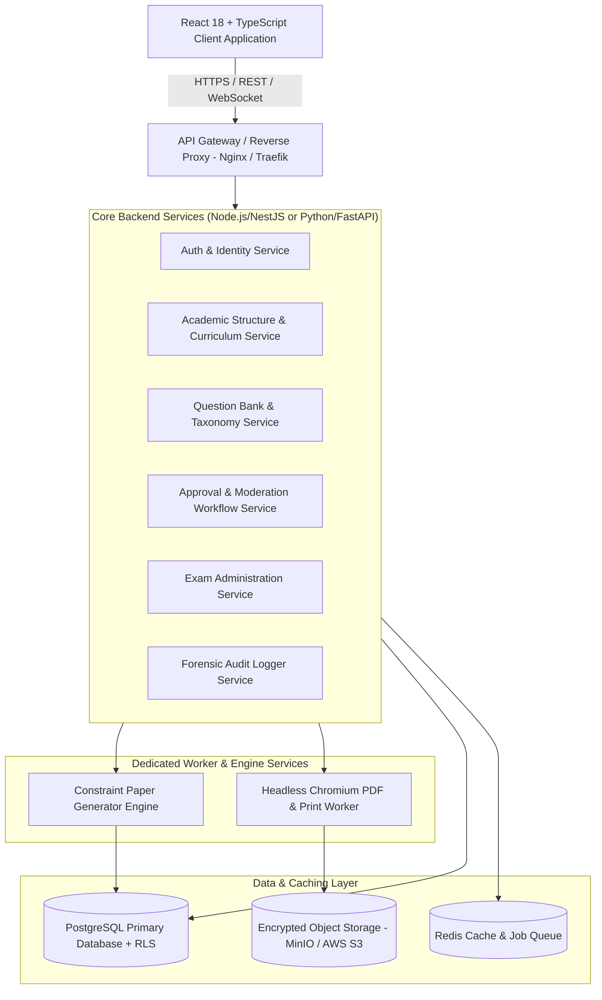
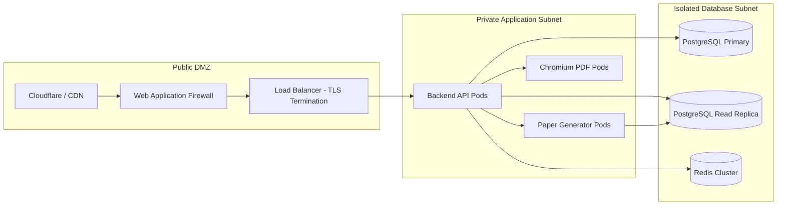

# System Architecture Specification: QPMS

## Purpose
This document specifies the technical system architecture for the **University Question Paper Management & Generation System**. It describes the system components, layering, runtime topology, data flow, communication protocols, and architectural patterns.

## Scope
The architecture covers the complete stack: client frontend, API gateway, core backend application services, constraint-satisfaction generation engine, document export workers, relational storage, caching layer, and security boundaries.

---

## 1. High-Level Architectural Pattern: Modular Monolith / Microservices-Ready

### Architectural Principles
1. **Separation of Concerns:** Clear boundaries between presentation (React SPA), business orchestration (REST API), heavy compute (Paper Generator Engine), document rendering (PDF Worker), and persistence (PostgreSQL).
2. **Tenant Isolation by Design:** Multi-tenancy enforced at the database layer using PostgreSQL Row-Level Security (RLS) driven by validated tenant claims from session tokens.
3. **Stateless Backend Tier:** Application API nodes are fully stateless, enabling horizontal auto-scaling during peak examination submission windows.
4. **Asynchronous Heavy Processing:** PDF compilation and complex multi-set permutation runs are dispatched to asynchronous job queues managed via Redis (BullMQ / Celery).

---

## 2. Component Architecture & Subsystems

### 2.1 Presentation Tier (Frontend SPA)
- **Framework:** React 18 with TypeScript and Vite 5.
- **Styling:** Vanilla Tailwind CSS with curated academic design tokens.
- **Routing:** Browser history routing with deep links for question views and paper generation wizards.
- **State Management:** Context API for session and active department resolution, combined with React Query / SWR for server state caching and optimistic updates.
- **Accessibility:** Radix UI / headless accessible primitives ensuring WCAG 2.1 AA compliance.

### 2.2 Application Backend Tier
- **API Standard:** RESTful JSON APIs adhering strictly to OpenAPI 3.1 specifications.
- **Authentication & Guards:** JWT validation middleware with HttpOnly secure cookie extraction and automated department scope verification.
- **Business Domain Services:**
  - *Academic Service:* Manages institution profiles, departments, program versions, courses, units, and learning outcomes.
  - *Question Service:* Handles question creation, version bumping, taxonomy tags, and LaTeX rendering support.
  - *Workflow Service:* Orchestrates transition state machines for questions and papers, enforcing role-based guard conditions.
  - *Paper Generation Service:* Validates blueprint schemas and interfaces with the constraint-satisfaction solver.
  - *Exam Service:* Connects approved papers with official academic exam sessions and centers.

### 2.3 Constraint-Satisfaction Paper Generation Engine
- **Engine Role:** Solves the combinatorial multi-objective optimization problem:
  - Match blueprint sectional counts and marks.
  - Balance syllabus unit coverage across all selected modules.
  - Satisfy difficulty distribution percentages (Easy / Medium / Hard).
  - Satisfy cognitive Bloom levels (Remember $\rightarrow$ Create).
  - Exclude questions used within the configured lookback window (1-5 years).
  - Eliminate internal semantic duplicates.
  - Generate orthogonal Set A, Set B, Set C, and Set D permutations.

### 2.4 Server-Side PDF & Print Engine
- **Headless Worker:** Node.js with Puppeteer / Playwright executing isolated Chromium instances.
- **Print Template:** Server-side rendered HTML/CSS tailored to standard A4/Legal print dimensions.
- **Security Features:** Automated insertion of dynamic user watermarks, verification QR codes, and page numbering before PDF compression and encryption.

### 2.5 Data & Storage Tier
- **Relational Database:** PostgreSQL 16+ featuring:
  - Multi-tenancy Row-Level Security (RLS).
  - B-tree, GIN (JSONB queries), and GiST indexes.
  - Partitioning on audit and question log tables.
- **Cache & Message Broker:** Redis 7+ for session blacklisting, rate limiting, and BullMQ task queues.
- **Document Storage:** S3-compatible encrypted object storage for question diagram images, syllabus materials, and rendered exam PDF archives.

---

## 3. Runtime & Network Topology

---

## Current State vs. Proposed State

* **Current State:** Monolithic client-side React single-page application running completely in the user's browser. All business logic, mock data filtering, and generation simulations are executed on the client without a server backend or database.
* **Proposed State:** A clean, decoupled multi-tier architecture with a stateless API gateway, dedicated constraint-satisfaction generation workers, server-side Chromium PDF rendering, and a hardened PostgreSQL database with Row-Level Security.

## Decisions
1. Choose PostgreSQL 16+ as the single primary database engine for both relational and JSONB pedagogical metadata.
2. Separate the CPU-intensive PDF rendering into isolated worker pods to prevent API thread starvation.

## Open Questions
* Refer to [OPEN_QUESTIONS.md](file:///home/mohammad-ali/Projects/mj_question_paper_genrator/docs/OPEN_QUESTIONS.md) Q5 regarding technology stack preference for the backend (Node.js/TypeScript NestJS vs. Python/FastAPI).

## Related Documents
- [ARCHITECTURE_DECISIONS.md](file:///home/mohammad-ali/Projects/mj_question_paper_genrator/docs/ARCHITECTURE_DECISIONS.md)
- [DATABASE_DESIGN.md](file:///home/mohammad-ali/Projects/mj_question_paper_genrator/docs/DATABASE_DESIGN.md)
- [QUESTION_PAPER_GENERATION.md](file:///home/mohammad-ali/Projects/mj_question_paper_genrator/docs/QUESTION_PAPER_GENERATION.md)
- [PDF_GENERATION.md](file:///home/mohammad-ali/Projects/mj_question_paper_genrator/docs/PDF_GENERATION.md)
