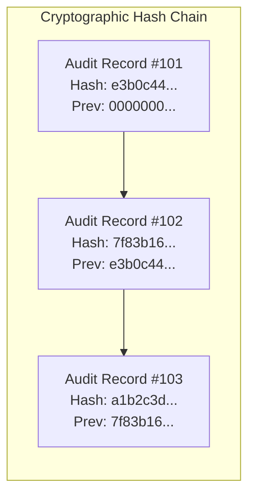

# Forensic Audit Logging Architecture: QPMS

## Purpose
This document specifies the data models, cryptographic chaining mechanisms, event schemas, and non-repudiation policies governing the Forensic Audit Logging Subsystem of the **University Question Paper Management & Generation System**.

## Scope
Covers the capture, hashing, storage, querying, and verification of all auditable events across user authentication, question bank authoring, paper generation, approval workflows, secret custody locking, and physical PDF exports.

---

## 1. Cryptographic Hash Chaining (Merkle-Style Tamper Evidence)

To prevent rogue database administrators or compromised accounts from silently altering or deleting audit records, the QPMS implements an **Append-Only Cryptographic Hash Chain**:



### 1.1 Hash Formula
For each new audit entry $k$:
$$\text{Payload}_k = \text{tenant\_id} \,\|\, \text{actor\_id} \,\|\, \text{action} \,\|\, \text{entity\_id} \,\|\, \text{timestamp} \,\|\, \text{diff\_json}$$
$$\text{CurrentHash}_k = \text{SHA256}(\text{PreviousHash}_{k-1} \,\|\, \text{Payload}_k)$$

### 1.2 Verification Routine
A background integrity cron worker runs nightly:
1. Sequentially reads audit records for each tenant.
2. Re-computes $\text{SHA256}(\text{PrevHash} + \text{Payload})$.
3. If calculated hash $\neq$ stored `current_hash`, the worker immediately flags a **CRITICAL SECURITY ALERT** indicating that an audit record was modified, inserted, or deleted out of sequence.

---

## 2. Auditable Events Taxonomy

Every high-stakes action emits a structured audit record:

| Event Identifier | Triggering Operation | Captured Metadata & Payload |
| :--- | :--- | :--- |
| `AUTH_LOGIN_SUCCESS` | User logs in successfully. | IP address, User-Agent, MFA method used, active department ID. |
| `AUTH_LOGIN_FAILED` | Incorrect password or invalid MFA code. | Attempted email, client IP address, failure reason. |
| `QBANK_QUESTION_CREATE` | Faculty drafts new question. | Question ID, Course ID, Unit ID, initial marks, text preview. |
| `QBANK_VERSION_BUMP` | Faculty edits an Approved question. | New Version Number ($vN+1$), diff of text/marks/options. |
| `QBANK_QUESTION_APPROVE`| HOD or Reviewer approves question. | Approver ID, Question ID, Version Number, approval timestamp. |
| `QBANK_QUESTION_REJECT` | Reviewer rejects question. | Reviewer ID, Question ID, Version Number, mandatory rejection feedback. |
| `PAPER_GENERATION_RUN` | Solver generates paper sets. | Course ID, Blueprint ID, candidate pool count, lookback years. |
| `PAPER_QUESTION_SWAP` | Setter swaps an individual question. | Paper ID, replaced Question Version ID, new Question Version ID. |
| `PAPER_HOD_APPROVAL` | HOD signs off on compiled paper. | HOD ID, Paper ID, Set names, total marks, sign-off remarks. |
| `PAPER_SECRECY_LOCK` | CoE seals paper in vault. | CoE ID, Paper ID, generated SHA-256 manifest hash, key ID. |
| `PAPER_DECRYPT_PRINT` | Print Officer prints paper PDF. | Officer ID, Paper ID, Center Code, IP address, Copy number, Watermark string. |

---

## 3. Database Schema & Storage Configuration

```sql
CREATE TABLE audit_logs (
    id UUID DEFAULT gen_random_uuid(),
    institution_id UUID NOT NULL,
    department_id UUID,
    actor_user_id UUID,
    actor_role VARCHAR(50),
    action VARCHAR(100) NOT NULL,
    entity_type VARCHAR(50) NOT NULL,
    entity_id VARCHAR(100) NOT NULL,
    client_ip VARCHAR(45),
    user_agent TEXT,
    payload_diff JSONB,
    previous_hash VARCHAR(64),
    current_hash VARCHAR(64) NOT NULL,
    created_at TIMESTAMPTZ NOT NULL DEFAULT NOW(),
    PRIMARY KEY (id, created_at)
) PARTITION BY RANGE (created_at);

-- Performance Indexes
CREATE INDEX idx_audit_tenant_action ON audit_logs(institution_id, action);
CREATE INDEX idx_audit_entity ON audit_logs(entity_type, entity_id);
CREATE INDEX idx_audit_actor ON audit_logs(actor_user_id);
```

---

## Current State vs. Proposed State

* **Current State:** Zero audit trail tables or files exist in the repository. The prototype only tracks brief inline strings in the question version history array.
* **Proposed State:** A non-repudiable, partitioned PostgreSQL audit logging subsystem reinforced with SHA-256 hash chaining, WORM storage replication, and nightly cryptographic verification routines.

## Decisions
1. Enforce append-only rules via PostgreSQL database triggers that permanently block `UPDATE` and `DELETE` on the `audit_logs` table.
2. Require every paper print or PDF export action to log the client's IP address, authenticated user ID, and watermark signature.

## Open Questions
- None.

## Related Documents
- [SECURITY.md](file:///home/mohammad-ali/Projects/mj_question_paper_genrator/docs/SECURITY.md)
- [ADR-010-audit-logging-strategy.md](file:///home/mohammad-ali/Projects/mj_question_paper_genrator/docs/adr/ADR-010-audit-logging-strategy.md)
- [NON_FUNCTIONAL_REQUIREMENTS.md](file:///home/mohammad-ali/Projects/mj_question_paper_genrator/docs/NON_FUNCTIONAL_REQUIREMENTS.md)
