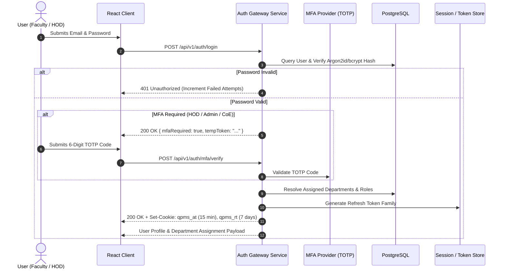
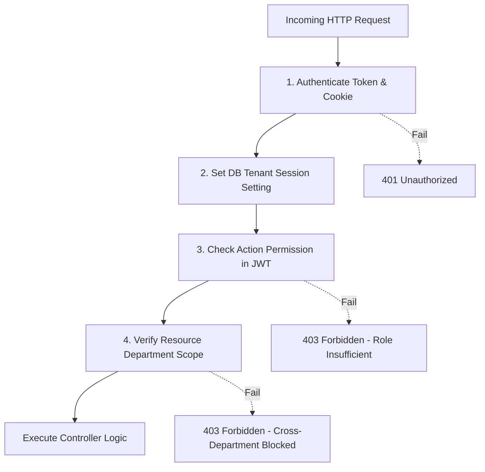

# Authentication & Authorization Architecture: QPMS

## Purpose
This document specifies the authentication protocol, session lifecycle, token security, multi-factor authentication (MFA), and authorization guard architecture for the **University Question Paper Management & Generation System**.

## Scope
Covers user login flows, session management, token storage, active department context resolution, Single Sign-On (SAML/OIDC), and role/permission enforcement across API gateways and UI routes.

---

## 1. Authentication Lifecycle & Protocol Flow

### 1.1 Credential & Session Flow


### 1.2 Department Resolution Logic (Requirement #6 Enforcement)
Upon successful credential validation, the system executes the critical department context resolution logic:

1. **Zero Department Assignment:**
   - Server payload returns `status: "NO_DEPARTMENT"`.
   - Client router blocks access to all academic modules and renders the dedicated [NoDepartmentPage.tsx](file:///home/mohammad-ali/Projects/mj_question_paper_genrator/src/components/auth/NoDepartmentPage.tsx).
2. **Exactly One Department Assignment:**
   - Server payload automatically selects the single department as `activeDepartmentId`.
   - Access token claims bind directly to this department scope.
   - Client navigates immediately to the Dashboard.
3. **Multiple Department Assignments:**
   - Server payload returns `status: "REQUIRES_SELECTION"` along with the list of assigned departments.
   - Client renders the modal or page [SelectDepartmentPage.tsx](file:///home/mohammad-ali/Projects/mj_question_paper_genrator/src/components/auth/SelectDepartmentPage.tsx).
   - Once selected, the client invokes `POST /api/v1/auth/switch-department`, which re-issues an access cookie bound to the selected department context.

---

## 2. JWT Claims Schema & Cookie Security

### 2.1 Access Token JWT Claims
```json
{
  "sub": "u-sunita-9921",
  "iss": "qpms-auth-service",
  "aud": "qpms-platform",
  "iat": 1774348800,
  "exp": 1774349700,
  "tenant_id": "inst-apex",
  "active_dept_id": "dept-cs",
  "roles": ["hod", "teacher"],
  "permissions": [
    "qbank:question:create",
    "qbank:question:approve",
    "paper:blueprint:configure",
    "paper:generator:execute",
    "paper:approval:sign"
  ]
}
```

### 2.2 Cookie Configuration Flags
```http
Set-Cookie: qpms_at=<JWT_ACCESS_TOKEN>; Path=/api; Max-Age=900; HttpOnly; Secure; SameSite=Strict
Set-Cookie: qpms_rt=<JWT_REFRESH_TOKEN>; Path=/api/v1/auth; Max-Age=604800; HttpOnly; Secure; SameSite=Strict
```

---

## 3. Authorization Guards Architecture

### 3.1 Backend Middleware Pipeline
Every incoming API request passes through a multi-stage authorization pipeline:
1. **Cookie & Signature Verification:** Validates that `qpms_at` is present, unexpired, and signed with the active asymmetric private key (RS256).
2. **Tenant Context Injection:** Extracts `tenant_id` and executes `SET LOCAL app.current_tenant_id = :tenant_id` within the PostgreSQL transaction.
3. **Role & Permission Guard:** Verifies that the user's role grants the requested action (e.g., `qbank:question:approve`).
4. **Scope & Resource Boundary Check:** Verifies that the requested resource (e.g., Question `Q-1024`) belongs to the user's `active_dept_id`. Cross-department access attempts are aborted with `403 Forbidden`.



---

## Current State vs. Proposed State

* **Current State:** The existing prototype has zero server-side authentication. It relies on a local state hook in `src/contexts/AuthContext.tsx` reading plain JSON user objects from localStorage.
* **Proposed State:** Enterprise-grade OAuth2/JWT authentication backend with HttpOnly cookies, refresh token family rotation, multi-factor authentication, and database-level tenant isolation.

## Decisions
1. Store access and refresh tokens exclusively in HttpOnly cookies, completely eliminating client-side JavaScript access to token strings.
2. Require users teaching across multiple departments to explicitly select an active department context to ensure zero cross-contamination of exam questions.

## Open Questions
- None.

## Related Documents
- [ROLES_PERMISSIONS.md](file:///home/mohammad-ali/Projects/mj_question_paper_genrator/docs/ROLES_PERMISSIONS.md)
- [SECURITY.md](file:///home/mohammad-ali/Projects/mj_question_paper_genrator/docs/SECURITY.md)
- [ADR-005-authentication-strategy.md](file:///home/mohammad-ali/Projects/mj_question_paper_genrator/docs/adr/ADR-005-authentication-strategy.md)
- [ADR-006-authorization-strategy.md](file:///home/mohammad-ali/Projects/mj_question_paper_genrator/docs/adr/ADR-006-authorization-strategy.md)
