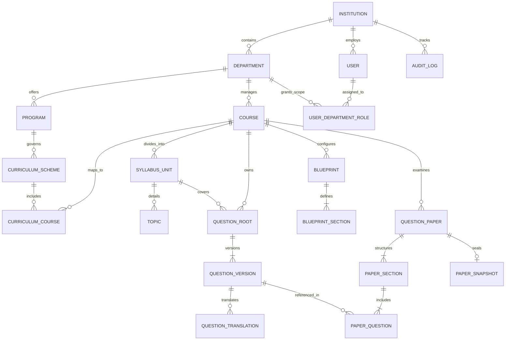

# Logical Data Model Specification: QPMS

## Purpose
This document defines the logical data model for the **University Question Paper Management & Generation System**. It specifies the entities, attributes, primary keys, foreign keys, relationships, cardinality, and constraints bridging the domain model to the physical database design.

## Scope
Covers all relational entities across Multi-Tenancy, Academic Hierarchy, Identity & Roles, Question Bank, Blueprinting, Question Papers, and Audit Trails.

---

## 1. Entity-Relationship Overview

---

## 2. Logical Entity Dictionary

### 2.1 Multi-Tenancy & Academic Organization

#### `institutions`
- `id` (UUID, PK) — Unique institutional identifier.
- `code` (VARCHAR(30), Unique) — Official institutional code (e.g., `GTAU-MAIN`, `AITS-042`).
- `name` (VARCHAR(255)) — Official legal name.
- `type` (ENUM) — `University`, `AutonomousCollege`, `AffiliatedCollege`, `Polytechnic`, `Board`.
- `status` (ENUM) — `active`, `suspended`, `inactive`.
- `created_at`, `updated_at` (TIMESTAMP)

#### `departments`
- `id` (UUID, PK) — Unique department identifier.
- `institution_id` (UUID, FK $\rightarrow$ `institutions.id`)
- `code` (VARCHAR(30)) — Department code (e.g., `CSE`, `AIDS`, `EE`).
- `name` (VARCHAR(255)) — Name (e.g., `Department of Computer Science & Engineering`).
- `hod_user_id` (UUID, Nullable FK $\rightarrow$ `users.id`) — Assigned Head of Department.
- `status` (ENUM) — `active`, `inactive`.
- *Constraints:* UNIQUE(`institution_id`, `code`)

#### `programs`
- `id` (UUID, PK)
- `department_id` (UUID, FK $\rightarrow$ `departments.id`)
- `code` (VARCHAR(30)) — Program code (e.g., `BCA`, `BTECH-CSE`).
- `name` (VARCHAR(255)) — Degree title (e.g., `Bachelor of Computer Applications`).
- `duration_years` (INT) — Total program duration (e.g., 3, 4).
- `term_type` (ENUM) — `Semester`, `Trimester`, `Annual`.
- `status` (ENUM) — `active`, `inactive`.

#### `curriculum_schemes`
- `id` (UUID, PK)
- `program_id` (UUID, FK $\rightarrow$ `programs.id`)
- `code` (VARCHAR(50)) — Scheme regulatory code (e.g., `BCA-REG-2024`).
- `name` (VARCHAR(255)) — Scheme title (e.g., `2024 NEP Revised Scheme`).
- `start_academic_year` (VARCHAR(20)) — Effective starting year (e.g., `2024-25`).
- `status` (ENUM) — `active`, `deprecated`.

#### `courses` (Subjects)
- `id` (UUID, PK)
- `institution_id` (UUID, FK $\rightarrow$ `institutions.id`)
- `department_id` (UUID, FK $\rightarrow$ `departments.id`)
- `code` (VARCHAR(30)) — Course code (e.g., `CS-301`).
- `name` (VARCHAR(255)) — Title (e.g., `Data Structures`).
- `credits` (INT) — Academic credit weight.
- `default_language` (VARCHAR(30)) — Default delivery language (e.g., `English`).
- `status` (ENUM) — `active`, `inactive`.
- *Constraints:* UNIQUE(`department_id`, `code`)

#### `curriculum_courses` (Bridge Table)
- `id` (UUID, PK)
- `curriculum_scheme_id` (UUID, FK $\rightarrow$ `curriculum_schemes.id`)
- `course_id` (UUID, FK $\rightarrow$ `courses.id`)
- `term_number` (INT) — Semester or term index (e.g., Semester 3).
- `is_elective` (BOOLEAN) — Mandatory core vs elective course.

#### `syllabus_units`
- `id` (UUID, PK)
- `course_id` (UUID, FK $\rightarrow$ `courses.id`)
- `unit_number` (INT) — Sequential unit index (e.g., 1, 2, 3, 4, 5).
- `name` (VARCHAR(255)) — Unit title (e.g., `Unit 2 — Linked Lists & Dynamic Allocation`).
- `weightage_percent` (DECIMAL(5,2)) — Standard curriculum marks weightage (e.g., 20.00%).

---

### 2.2 Identity, Roles & Context

#### `users`
- `id` (UUID, PK)
- `institution_id` (UUID, FK $\rightarrow$ `institutions.id`)
- `email` (VARCHAR(255), Unique)
- `password_hash` (VARCHAR(255))
- `name` (VARCHAR(255))
- `mfa_enabled` (BOOLEAN)
- `status` (ENUM) — `active`, `suspended`.

#### `user_department_roles`
- `id` (UUID, PK)
- `user_id` (UUID, FK $\rightarrow$ `users.id`)
- `department_id` (UUID, FK $\rightarrow$ `departments.id`)
- `role_name` (ENUM) — `university_admin`, `institution_admin`, `hod`, `coordinator`, `teacher`, `reviewer`, `exam_cell`.
- `is_primary` (BOOLEAN) — Primary default department on login.
- *Constraints:* UNIQUE(`user_id`, `department_id`, `role_name`)

---

### 2.3 Question Bank Entities

#### `question_roots`
- `id` (UUID, PK)
- `institution_id` (UUID, FK $\rightarrow$ `institutions.id`)
- `department_id` (UUID, FK $\rightarrow$ `departments.id`)
- `course_id` (UUID, FK $\rightarrow$ `courses.id`)
- `unit_id` (UUID, FK $\rightarrow$ `syllabus_units.id`)
- `current_approved_version_id` (UUID, Nullable)
- `created_at` (TIMESTAMP)

#### `question_versions`
- `id` (UUID, PK)
- `question_root_id` (UUID, FK $\rightarrow$ `question_roots.id`)
- `version_number` (INT) — Incremental version sequence (1, 2, 3...).
- `type` (ENUM) — `mcq`, `true_false`, `fill_blank`, `short`, `long`, `numerical`, `coding`, `case_study`, etc.
- `text` (TEXT) — Markdown & LaTeX formatted question prompt.
- `answer` (TEXT) — Model answer, solution, or marking guide.
- `marks` (INT) — Standard mark value.
- `difficulty` (ENUM) — `Easy`, `Medium`, `Hard`.
- `bloom_level` (ENUM) — `Remember`, `Understand`, `Apply`, `Analyze`, `Evaluate`, `Create`.
- `options` (JSONB) — Structured options for MCQs (key, text).
- `correct_option` (VARCHAR(10)) — E.g., `A`, `B`, `C`, `D`.
- `status` (ENUM) — `Draft`, `Submitted`, `UnderReview`, `Approved`, `Rejected`, `Archived`.
- `rejection_reason` (TEXT, Nullable)
- `created_by_user_id` (UUID, FK $\rightarrow$ `users.id`)
- `approved_by_user_id` (UUID, Nullable FK $\rightarrow$ `users.id`)
- `created_at`, `updated_at`, `approved_at` (TIMESTAMP)
- *Constraints:* UNIQUE(`question_root_id`, `version_number`)

---

### 2.4 Question Paper & Generation Entities

#### `blueprints`
- `id` (UUID, PK)
- `institution_id` (UUID, FK $\rightarrow$ `institutions.id`)
- `department_id` (UUID, FK $\rightarrow$ `departments.id`)
- `course_id` (UUID, FK $\rightarrow$ `courses.id`)
- `title` (VARCHAR(255))
- `total_marks` (INT)
- `duration_minutes` (INT)

#### `blueprint_sections`
- `id` (UUID, PK)
- `blueprint_id` (UUID, FK $\rightarrow$ `blueprints.id`)
- `section_order` (INT)
- `title` (VARCHAR(255)) — E.g., `SECTION A: Objective Fundamentals`.
- `instructions` (TEXT)
- `question_type` (ENUM)
- `total_questions_to_attempt` (INT)
- `total_questions_in_section` (INT)
- `marks_per_question` (INT)

#### `question_papers`
- `id` (UUID, PK) — Operational ID (e.g., `QP-2026-001`).
- `institution_id` (UUID, FK $\rightarrow$ `institutions.id`)
- `department_id` (UUID, FK $\rightarrow$ `departments.id`)
- `course_id` (UUID, FK $\rightarrow$ `courses.id`)
- `academic_year` (VARCHAR(20)) — E.g., `2025-26`.
- `term_name` (VARCHAR(50)) — E.g., `Semester 3 Regular Examinations`.
- `paper_code` (VARCHAR(50)) — Official university exam code.
- `set_name` (ENUM) — `A`, `B`, `C`, `D`.
- `total_marks` (INT)
- `duration_str` (VARCHAR(50)) — E.g., `3 Hours`.
- `status` (ENUM) — `draft`, `generated`, `submitted`, `approved`, `locked`, `published`, `archived`.
- `created_by_user_id` (UUID, FK $\rightarrow$ `users.id`)
- `created_at`, `locked_at` (TIMESTAMP)

#### `paper_questions`
- `id` (UUID, PK)
- `paper_id` (UUID, FK $\rightarrow$ `question_papers.id`)
- `section_id` (UUID)
- `question_version_id` (UUID, FK $\rightarrow$ `question_versions.id`)
- `display_order` (INT)
- `assigned_marks` (INT)

#### `paper_snapshots`
- `id` (UUID, PK)
- `paper_id` (UUID, Unique FK $\rightarrow$ `question_papers.id`)
- `manifest_payload` (JSONB) — Completely serialized frozen paper with all questions, options, and solutions.
- `sha256_hash` (VARCHAR(64)) — Cryptographic integrity checksum.
- `digital_signature` (TEXT) — Asymmetric key signature from CoE/HOD.
- `sealed_at` (TIMESTAMP)

---

## Current State vs. Proposed State

* **Current State:** The data model existed only as informal TypeScript interfaces in `src/types/index.ts`. No database foreign keys, unique constraints, or relational normalization existed.
* **Proposed State:** A rigorous, 3NF normalized relational schema with explicit primary/foreign keys, unique constraints, and strict data type definitions ready for PostgreSQL physical implementation.

## Decisions
1. Bridge `programs` and `courses` via `curriculum_schemes` and `curriculum_courses` to support multi-year scheme versioning.
2. Direct all paper item references to `question_versions.id` rather than `question_roots.id` to guarantee historical immutability.

## Open Questions
- None.

## Related Documents
- [DOMAIN_MODEL.md](file:///home/mohammad-ali/Projects/mj_question_paper_genrator/docs/DOMAIN_MODEL.md)
- [DATABASE_DESIGN.md](file:///home/mohammad-ali/Projects/mj_question_paper_genrator/docs/DATABASE_DESIGN.md)
- [ERD.md](file:///home/mohammad-ali/Projects/mj_question_paper_genrator/docs/ERD.md)
