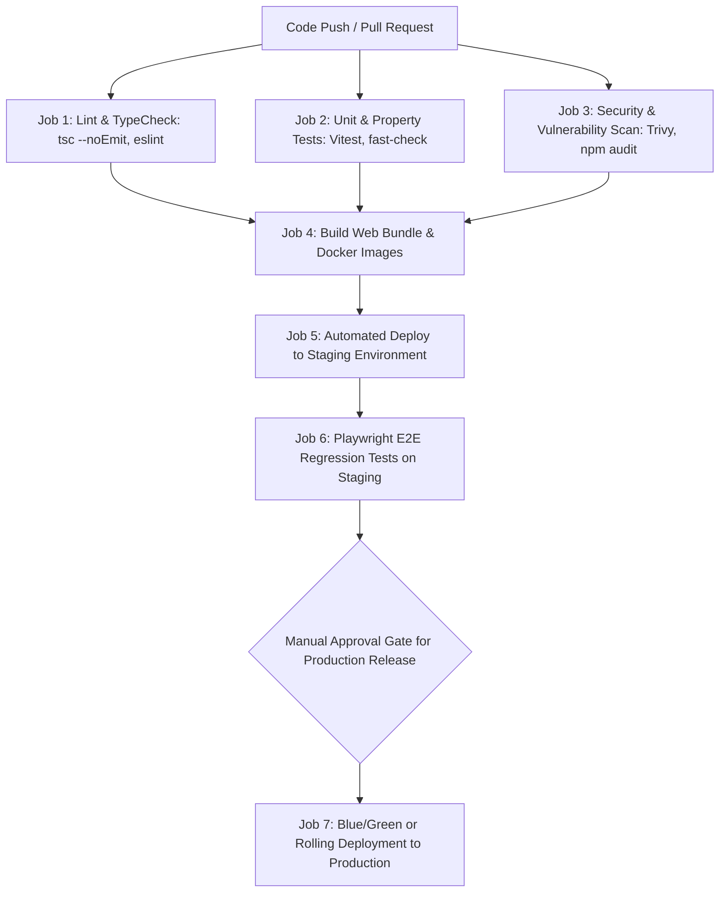
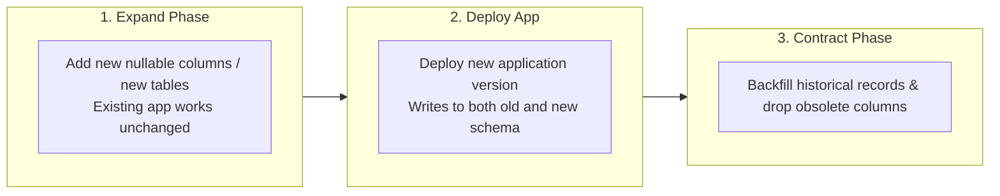

# DevOps, CI/CD & Reliability Engineering: QPMS

## Purpose
This document specifies the Continuous Integration and Continuous Deployment (CI/CD) pipelines, database migration strategies, monitoring and observability frameworks, secret management, and disaster recovery procedures for the **University Question Paper Management & Generation System**.

## Scope
Covers GitHub Actions CI workflows, automated testing gates, zero-downtime deployment strategies, Prometheus/Grafana monitoring, backup automation, and rollback protocols.

---

## 1. Automated CI/CD Pipeline (GitHub Actions)

### CI/CD Invariants
1. **No Direct Commits to Main:** All code enters via pull requests requiring at least one senior peer review approval and green CI checks.
2. **Deterministic Builds:** All builds use locked dependency versions via `package-lock.json` with `npm ci`.
3. **Automated Database Migrations:** Schema migrations run as a Kubernetes `pre-install`/`pre-upgrade` job before new application pods receive user traffic.

---

## 2. Database Migration Strategy & Zero-Downtime Releases

To guarantee zero downtime during university examination cycles, migrations follow the **Expand-Contract (Parallel Run) Pattern**:

- Migrations are managed via a version-controlled tool (Prisma Migrate / Flyway / Liquibase).
- Every migration file has an accompanying down-migration script tested automatically in staging before production execution.

---

## 3. Observability, Monitoring & Alerting

### 3.1 Metrics Stack: Prometheus & Grafana
Key metrics tracked with automated threshold alerts:
1. **API Latency ($P_{95}$, $P_{99}$):** Alert if $P_{95} > 500$ ms for 5 consecutive minutes.
2. **HTTP 5xx Error Rate:** Alert if error rate exceeds 0.5% of total requests.
3. **Paper Generation Duration:** Alert if solver execution exceeds 3,000 ms.
4. **PDF Queue Backlog:** Alert if pending print jobs in Redis BullMQ exceed 50 items.
5. **Database Connection Pool Exhaustion:** Alert if connection utilization exceeds 80%.

### 3.2 Centralized Logging: OpenTelemetry & Elastic / Loki
All application logs are formatted as structured JSON containing:
`timestamp`, `level`, `tenantId`, `userId`, `action`, `traceId`, `spanId`, `message`.
Trace IDs propagate from the frontend API client through backend services to database queries, enabling instantaneous distributed tracing.

---

## 4. Disaster Recovery & Backup Plan

1. **Continuous Point-in-Time Recovery (PITR):**
   - PostgreSQL Write-Ahead Logs (WAL) continuously streamed to encrypted offsite object storage (AWS S3 Glacier / MinIO).
   - Recovery Point Objective (RPO): $\le$ 15 minutes.
2. **Automated Daily Backups:**
   - Full database snapshot executed daily at 02:00 UTC.
   - Retained for 30 days locally, and archived monthly for 10-year statutory compliance.
3. **Quarterly Disaster Recovery Simulation:**
   - The DevOps engineering team executes an automated drill restoring the production database from snapshot into an isolated sandbox to verify recovery time within the 1-hour RTO SLA.

---

## Current State vs. Proposed State

* **Current State:** Zero CI/CD pipelines, no automated testing workflows, no monitoring or logging agents, and no database backup automation exist in the project repository.
* **Proposed State:** A complete enterprise DevOps pipeline with GitHub Actions CI/CD, Prometheus/Grafana monitoring, OpenTelemetry distributed tracing, and automated WAL disaster recovery.

## Decisions
1. Implement Blue/Green or Rolling deployments to guarantee zero interruption during active examination windows.
2. Enforce the Expand-Contract pattern for all PostgreSQL schema migrations.

## Open Questions
- None.

## Related Documents
- [DEPLOYMENT.md](file:///home/mohammad-ali/Projects/mj_question_paper_genrator/docs/DEPLOYMENT.md)
- [TESTING_STRATEGY.md](file:///home/mohammad-ali/Projects/mj_question_paper_genrator/docs/TESTING_STRATEGY.md)
- [NON_FUNCTIONAL_REQUIREMENTS.md](file:///home/mohammad-ali/Projects/mj_question_paper_genrator/docs/NON_FUNCTIONAL_REQUIREMENTS.md)
