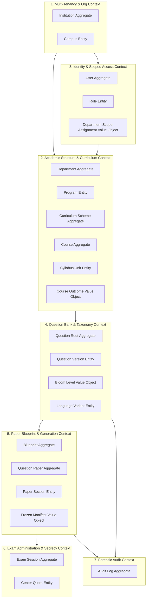

# Domain Model Specification: QPMS

## Purpose
This document specifies the Domain-Driven Design (DDD) model for the **University Question Paper Management & Generation System**. It identifies the bounded contexts, aggregate roots, entities, value objects, domain events, and ubiquitous language governing the platform.

## Scope
Covers the entire academic examination domain: Institutional Hierarchy, Curriculum Scheme, User & Scope Context, Question Bank, Paper Blueprint, Generation Engine, Exam Session, and Forensic Audit.

---

## 1. Ubiquitous Language Dictionary

| Term | Domain Definition |
| :--- | :--- |
| **Institution** | Autonomous educational entity (University, Affiliated College, Polytechnic Institute) possessing isolated administrative sovereignty. |
| **Department** | Academic operational unit (e.g., Computer Science & Engineering) managing specific subject areas, question pools, and faculty members. |
| **Program** | Degree or diploma course of study (e.g., B.Tech in Artificial Intelligence, Bachelor of Computer Applications) spanning multiple terms. |
| **Curriculum Scheme** | An official, time-bounded regulatory syllabus framework (e.g., "Regulation 2024 CBCS Scheme") governing course offerings for batches of students. |
| **Course / Subject** | A distinct academic subject of instruction (e.g., "Data Structures - CS-301") containing defined syllabus units and learning outcomes. |
| **Syllabus Unit / Module**| A major topical division of a course curriculum carrying a specific percentage weightage in examination evaluation. |
| **Course Learning Outcome (CLO/CO)**| A measurable statement of knowledge or skill students are expected to acquire, mapped to Bloom's cognitive taxonomy levels. |
| **Question Bank** | Curated departmental repository of reusable questions classified by subject, unit, cognitive taxonomy, difficulty, and language. |
| **Question Root** | The permanent, unchanging conceptual identity of a question across its evolutionary lifespan. |
| **Question Version** | An immutable snapshot of a question's wording, options, diagrams, answer key, marks, and difficulty at a specific point in time. |
| **Blueprint** | A structured mathematical template specifying the sectional breakdown, question counts, marks, difficulty ratios, and unit coverage for an exam. |
| **Question Paper** | A compiled, ordered sequence of question versions structured into sections for a specific examination cycle. |
| **Paper Set (Set A, B, C, D)** | Parallel examination papers sharing identical blueprint criteria and difficulty weights, but featuring randomized question sequences or disjoint items. |
| **Locked Paper** | An approved question paper cryptographically sealed against further modification and restricted to Controller of Examination custody. |

---

## 2. Bounded Contexts Map

---

## 3. Aggregate Roots & Entity Specifications

### 3.1 Academic Structure Context
- **Course (Aggregate Root):**
  - *Attributes:* `id`, `institution_id`, `department_id`, `code`, `name`, `credits`, `status`.
  - *Entities:* `SyllabusUnit` (ordered list of units with percentage weightage).
  - *Value Objects:* `CourseLearningOutcome` (code, description, Bloom level).
  - *Invariants:*
    - The sum of unit weightages must equal 100% if weightage enforcement is enabled.
    - Course code must be unique within an institution.

### 3.2 Question Bank Context
- **QuestionRoot (Aggregate Root):**
  - *Attributes:* `id`, `institution_id`, `department_id`, `course_id`, `current_version_id`, `created_at`.
  - *Entities:* `QuestionVersion` (immutable snapshot), `QuestionTranslation` (localized scripts).
  - *Value Objects:* `CognitiveTaxonomy` (Bloom level: Remember, Understand, Apply, Analyze, Evaluate, Create), `DifficultyLevel` (Easy, Medium, Hard).
  - *Invariants:*
    - An approved `QuestionVersion` cannot be modified. Any update must create a new version with status `DRAFT`.
    - Every question must be bound to exactly one syllabus unit and course.

### 3.3 Paper Blueprint & Generation Context
- **Blueprint (Aggregate Root):**
  - *Attributes:* `id`, `institution_id`, `department_id`, `course_id`, `total_marks`, `duration_minutes`.
  - *Entities:* `BlueprintSection` (section title, instructions, choices, question count, marks per question).
  - *Invariants:*
    - Sum of sectional compulsory marks must equal `total_marks`.
- **QuestionPaper (Aggregate Root):**
  - *Attributes:* `id`, `institution_id`, `department_id`, `course_id`, `academic_year`, `term_code`, `status`, `active_set`.
  - *Entities:* `PaperSection`, `PaperQuestion` (references `QuestionVersion`).
  - *Value Objects:* `PaperSnapshot` (cryptographically sealed JSON manifest).
  - *Invariants:*
    - A paper in status `LOCKED` cannot be updated or regenerated.
    - Lookback window rules must be evaluated prior to paper approval.

---

## 4. Key Domain Events

| Domain Event | Emitting Aggregate | Trigger Condition | Downstream Consumers |
| :--- | :--- | :--- | :--- |
| `QuestionSubmittedEvent` | `QuestionRoot` | Faculty submits draft question for peer review. | Notification Service, Reviewer Dashboard. |
| `QuestionApprovedEvent` | `QuestionRoot` | HOD or Reviewer marks question version approved. | Question Bank Cache, Paper Generation Candidate Pool. |
| `QuestionRejectedEvent` | `QuestionRoot` | Reviewer rejects question with mandatory remarks. | Author Notification, Rejection Audit Logger. |
| `PaperGenerationStartedEvent` | `QuestionPaper` | Faculty initiates algorithmic paper synthesis. | Constraint Solver Worker. |
| `PaperGeneratedEvent` | `QuestionPaper` | Engine successfully satisfies blueprint constraints. | Paper Preview Interface, History Log. |
| `PaperApprovedEvent` | `QuestionPaper` | Department board approves compiled paper. | Snapshot Signing Worker, Audit Logger. |
| `PaperLockedEvent` | `QuestionPaper` | Controller of Examinations seals paper for exam. | Field Encryption Service, CoE Custody Vault. |
| `PaperPrintedEvent` | `QuestionPaper` | Authorized personnel decrypts and prints paper PDF. | High-Priority Forensic Security Audit Logger. |

---

## Current State vs. Proposed State

* **Current State:** The domain model is partially represented across scattered TypeScript interfaces in `src/types/index.ts` with no formal aggregate boundaries, no domain events, and no encapsulated business invariants.
* **Proposed State:** A formal Domain-Driven Design model with strict aggregate boundaries, explicit business invariants, and asynchronous domain events powering decoupled services.

## Decisions
1. Treat `QuestionVersion` as an immutable entity governed by the `QuestionRoot` aggregate root.
2. Encapsulate all mathematical blueprint validation logic inside the `Blueprint` aggregate root.

## Open Questions
- None.

## Related Documents
- [DATA_MODEL.md](file:///home/mohammad-ali/Projects/mj_question_paper_genrator/docs/DATA_MODEL.md)
- [DATABASE_DESIGN.md](file:///home/mohammad-ali/Projects/mj_question_paper_genrator/docs/DATABASE_DESIGN.md)
- [QUESTION_LIFECYCLE.md](file:///home/mohammad-ali/Projects/mj_question_paper_genrator/docs/QUESTION_LIFECYCLE.md)
- [QUESTION_PAPER_LIFECYCLE.md](file:///home/mohammad-ali/Projects/mj_question_paper_genrator/docs/QUESTION_PAPER_LIFECYCLE.md)
