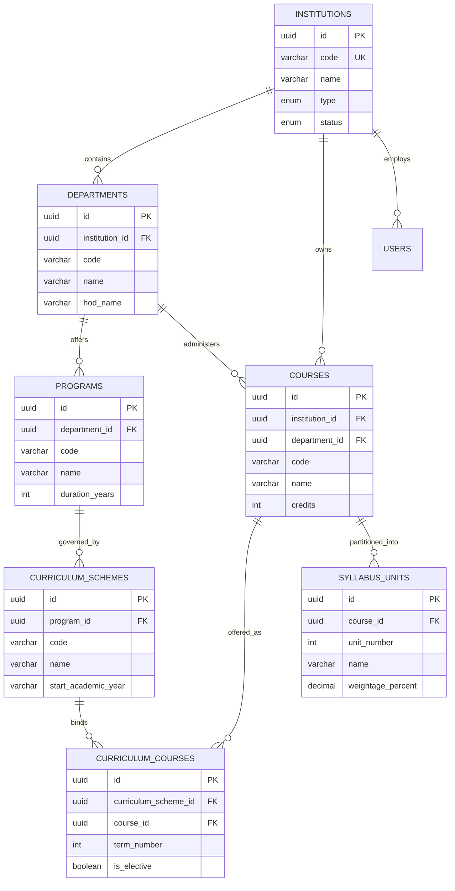
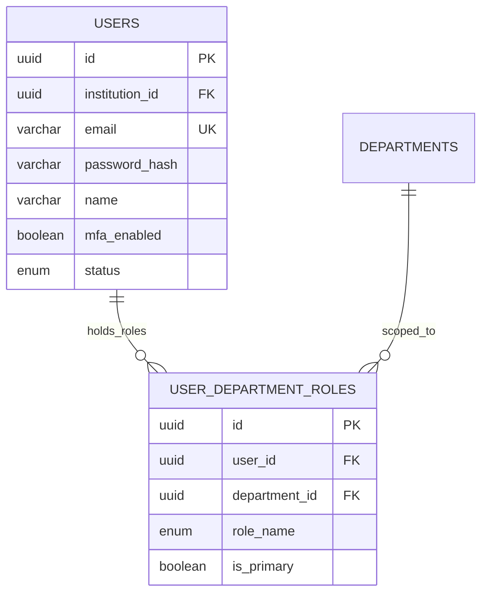
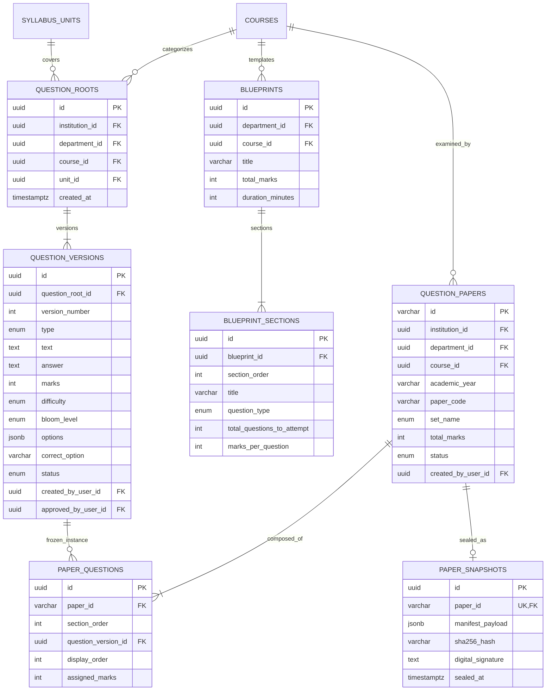

# Entity Relationship Diagram (ERD): QPMS

## Purpose
This document provides visual Entity Relationship Diagrams (ERDs) illustrating the relational models, cardinality, foreign key mappings, and table boundaries for the **University Question Paper Management & Generation System**.

## Scope
Visualizes the core modules: Institutional & Academic Structure, Identity & Scopes, Question Bank Versioning, Paper Blueprinting, Paper Generation, and Audit Logging.

---

## 1. Core Academic Hierarchy & Multitenancy ERD

---

## 2. Identity, Role Scope & Department Access ERD

---

## 3. Question Bank Versioning & Paper Generation ERD

---

## Current State vs. Proposed State

* **Current State:** No visual or documented Entity Relationship Diagrams exist in the project repository.
* **Proposed State:** Comprehensive Mermaid ERDs visually mapping all entities, cardinalities, keys, and foreign relationship constraints.

## Decisions
1. Use Mermaid syntax for all ER diagrams to allow direct rendering in GitHub/GitLab markdown viewers.

## Open Questions
- None.

## Related Documents
- [DATA_MODEL.md](file:///home/mohammad-ali/Projects/mj_question_paper_genrator/docs/DATA_MODEL.md)
- [DATABASE_DESIGN.md](file:///home/mohammad-ali/Projects/mj_question_paper_genrator/docs/DATABASE_DESIGN.md)
- [DOMAIN_MODEL.md](file:///home/mohammad-ali/Projects/mj_question_paper_genrator/docs/DOMAIN_MODEL.md)
