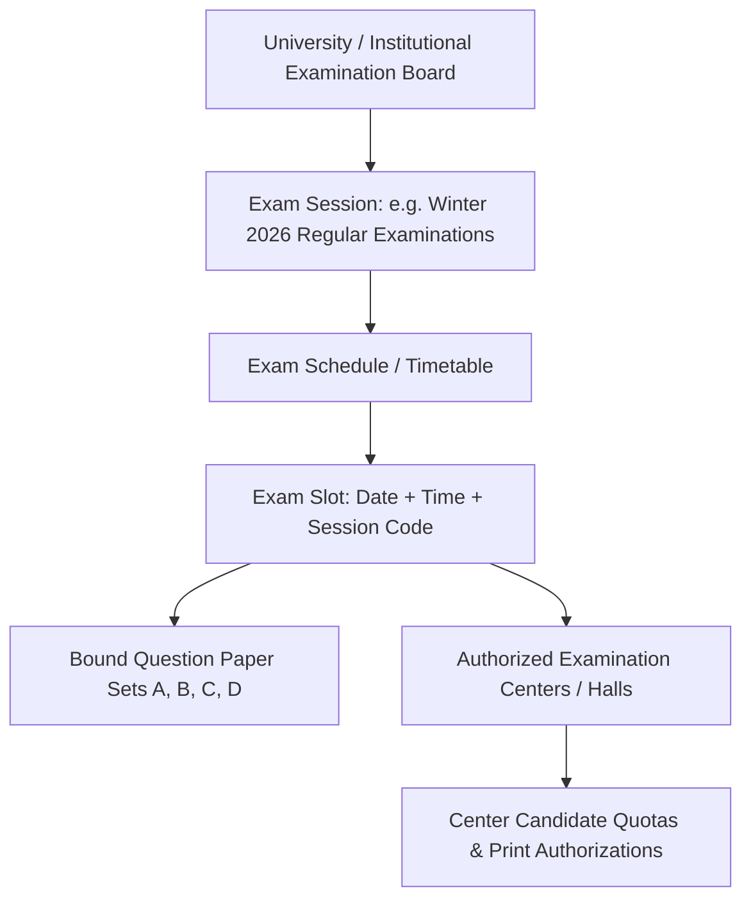

# Examination Management & Administration Specification: QPMS

## Purpose
This document specifies the data models, scheduling interfaces, exam center allocations, paper code management, and session administration capabilities of the **University Question Paper Management & Generation System**.

## Scope
Covers examination sessions (Regular, Supplementary, Midterm, End-Semester), academic scheduling, paper code assignment, set distribution, and examination center custody.

---

## 1. Examination Domain Hierarchy



---

## 2. Exam Types & Categories

The platform supports diverse examination configurations:

| Exam Type Category | Typical Duration | Marks Range | Sets Required | Custody Mode |
| :--- | :--- | :--- | :--- | :--- |
| **Internal Assessment / Continuous Evaluation** | 1 to 1.5 Hours | 20 to 30 Marks | Single Set (or A/B) | Departmental custody (HOD managed). |
| **Midterm Examination** | 1.5 to 2 Hours | 30 to 50 Marks | Sets A and B | Departmental custody. |
| **End-Semester / Final Theory Examination** | 3 Hours | 70 to 100 Marks | Sets A, B, C, and D | Controller of Examinations (CoE) vault custody. |
| **Supplementary / Remedial Examination** | 3 Hours | 70 to 100 Marks | Dedicated Reserve Set | CoE custody with distinct lookback checks. |
| **Practical / Viva Voce Examination** | Varies | 25 to 50 Marks | Task Bank Slips | Departmental laboratory examiners. |

---

## 3. Examination Session Data Model

```sql
CREATE TABLE exam_sessions (
    id UUID PRIMARY KEY DEFAULT gen_random_uuid(),
    institution_id UUID NOT NULL REFERENCES institutions(id) ON DELETE CASCADE,
    code VARCHAR(50) UNIQUE NOT NULL, -- E.g. 'EXAM-WINTER-2026'
    name VARCHAR(255) NOT NULL, -- E.g. 'Winter 2026 Regular End-Semester Examinations'
    academic_year VARCHAR(20) NOT NULL, -- E.g. '2025-26'
    start_date DATE NOT NULL,
    end_date DATE NOT NULL,
    status VARCHAR(30) NOT NULL DEFAULT 'SCHEDULED' -- 'SCHEDULED', 'ACTIVE', 'CONCLUDED'
);

CREATE TABLE exam_timetables (
    id UUID PRIMARY KEY DEFAULT gen_random_uuid(),
    session_id UUID NOT NULL REFERENCES exam_sessions(id) ON DELETE CASCADE,
    course_id UUID NOT NULL REFERENCES courses(id) ON DELETE CASCADE,
    exam_date DATE NOT NULL,
    start_time TIME NOT NULL,
    end_time TIME NOT NULL,
    official_paper_code VARCHAR(50) NOT NULL, -- E.g. 'CS301-REG-W26'
    active_paper_id VARCHAR(50) REFERENCES question_papers(id)
);
```

---

## 4. Secrecy & Exam Day Operational Protocols

1. **Center Allocation & Quotas:**
   - Exam Cell specifies how many physical question paper copies each exam center is authorized to print based on confirmed candidate registration numbers $+ 5\%$ buffer.
2. **Pre-Exam Decryption Window:**
   - 120 minutes prior to `start_time`, authorized center print officers receive an automated notification and unlock token.
3. **Decryption & Watermarking:**
   - Center Print Officer logs in with MFA.
   - The system validates that the center is authorized for that paper code.
   - The PDF is generated with the officer's name, IP, center code, and dynamic timestamp watermarked on every page.
4. **Post-Exam Reconciliation:**
   - Center officer records total copies printed, total distributed, and any damaged copies, closing the custody audit trail.

---

## Current State vs. Proposed State

* **Current State:** The existing prototype has no examination session models, no timetables, no paper code registries, and no exam center quotas. Papers are generated as standalone items without binding to official exam timetables.
* **Proposed State:** A complete examination administration module connecting generated papers to official academic sessions, timetables, course codes, and secure center print quotas.

## Decisions
1. Bind every generated final paper to an official `exam_timetable` record with a distinct paper code before allowing transition to `LOCKED` status.
2. Enforce center-specific print quotas to prevent unauthorized over-printing of examination papers.

## Open Questions
- None.

## Related Documents
- [QUESTION_PAPER_LIFECYCLE.md](file:///home/mohammad-ali/Projects/mj_question_paper_genrator/docs/QUESTION_PAPER_LIFECYCLE.md)
- [SECURITY.md](file:///home/mohammad-ali/Projects/mj_question_paper_genrator/docs/SECURITY.md)
- [AUDIT_LOGGING.md](file:///home/mohammad-ali/Projects/mj_question_paper_genrator/docs/AUDIT_LOGGING.md)
