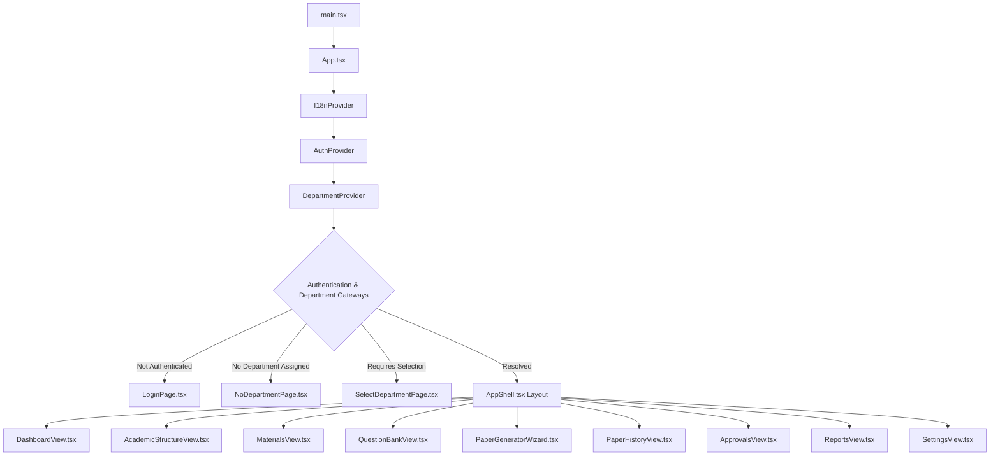

# Frontend Architecture & Component Audit: QPMS

## Purpose
This document provides a thorough architectural audit of the existing client-side React 18 application, analyzes component modularity, state management, routing paradigms, and specifies the migration path to an enterprise API-integrated frontend.

## Scope
Covers all source code within `/src`, including Context providers, components, hooks, service layers, and styling configurations.

---

## 1. Current Frontend Architecture Audit



### 1.1 Technical Stack Inventory
- **Build Tool:** Vite 5.2.13 (ESModules, fast HMR).
- **Core Library:** React 18.3.1 with TypeScript 5.4.5.
- **Styling:** Tailwind CSS 3.4.4 with custom color palette in `tailwind.config.js`.
- **Icons:** Lucide React (`lucide-react`).
- **Routing:** Custom hash-based router implemented via `window.location.hash` listeners in `src/App.tsx`.

---

## 2. Identified Strengths of the Existing Frontend
1. **Clean Visual Hierarchy:** Excellent UI aesthetics with tailored academic design tokens (`brand-primary`, `brand-title`, `brand-bg-title`), clean cards, and responsive badges.
2. **Strict Department Gateways (Requirements #6 & #7):** The 3-way conditional flow in `App.tsx` (`LoginPage` $\rightarrow$ `NoDepartmentPage` $\rightarrow$ `SelectDepartmentPage` $\rightarrow$ `AppShell`) correctly enforces institutional and departmental isolation.
3. **8-Stage Stepper UX:** The [PaperGeneratorWizard.tsx](file:///home/mohammad-ali/Projects/mj_question_paper_genrator/src/components/papers/PaperGeneratorWizard.tsx) provides an intuitive horizontal stepper guiding faculty through Academic selection, Units, Question Bank review, Blueprint design, Distribution matrix, Previous Paper recommendations, Sets, and Compilation.
4. **Visual Paper Watermark:** High-contrast, authentic examination paper preview in [PaperGeneratorWizard.tsx](file:///home/mohammad-ali/Projects/mj_question_paper_genrator/src/components/papers/PaperGeneratorWizard.tsx#L759-L800) faithfully reproduces the printed academic format.

---

## 3. Critical Frontend Architectural Gaps & Technical Debt

| Architectural Area | Current Prototype Limitation | Target Enterprise Implementation |
| :--- | :--- | :--- |
| **Routing** | Fragile `window.location.hash` parsing with regexes in `App.tsx`. | **React Router v6 / TanStack Router** with nested route layouts, lazy-loaded chunks, and navigation guards. |
| **State & Data Fetching** | Services write directly to `localStorage` with manual listener arrays. | **TanStack Query (React Query)** with automated cache invalidation, background refetching, and optimistic mutations. |
| **Form Handling & Validation** | Raw controlled React inputs with unvalidated state hooks. | **React Hook Form + Zod** schemas for type-safe validation and inline field error displays. |
| **API Integration** | Mock services (`questionService.ts`, `paperService.ts`) return hardcoded arrays. | Centralized Axios / Fetch HTTP client layer with automatic JWT cookie transmission and error interceptors. |
| **Math & Code Rendering** | Questions render plain text strings without LaTeX math parsing. | **KaTeX / MathJax** integration rendering mathematical formulas, equations, and code syntax blocks. |
| **Error Boundaries** | Zero React Error Boundaries; uncaught exceptions crash the entire view. | Granular Error Boundaries around views and wizards with friendly fallback recovery UI. |

---

## 4. Target Component Architecture & Directory Structure

```text
src/
├── api/                  # Typed REST API Client & React Query Hooks
│   ├── authApi.ts
│   ├── academicApi.ts
│   ├── questionApi.ts
│   └── paperApi.ts
├── components/           # Reusable Design System Primitives
│   ├── common/           # Buttons, Modals, Badges, Loaders
│   ├── layout/           # AppShell, Sidebar, Header, Breadcrumbs
│   └── math/             # KaTeX LaTeX renderer component
├── features/             # Feature-Scoped Modules
│   ├── auth/             # Login, Dept Selection, MFA Modals
│   ├── academic/         # Curriculum, Course, and Unit Editors
│   ├── questionBank/     # Question Form, Table, Timeline, Compare
│   ├── generator/        # 8-Stage Wizard & Blueprint Matrix
│   ├── history/          # Past Papers, Duplication, Print Modal
│   └── approvals/        # Review Queues, Rejection Modals
├── contexts/             # Global Contexts (AuthContext, DepartmentContext)
└── lib/                  # Utilities, i18n, Zod schemas
```

---

## Current State vs. Proposed State

* **Current State:** A working client-side prototype that stores state in `localStorage` and routes via hash changes.
* **Proposed State:** A modular enterprise frontend utilizing React Router, TanStack Query, React Hook Form with Zod, KaTeX mathematical rendering, and full API integration.

## Decisions
1. Preserve the visual styling, color tokens, and layout aesthetics already implemented in Tailwind CSS.
2. Upgrade from hash routing to React Router v6 to enable deep linking, route-level code splitting, and authenticated navigation guards.

## Open Questions
- None.

## Related Documents
- [UI_UX_GUIDELINES.md](file:///home/mohammad-ali/Projects/mj_question_paper_genrator/docs/UI_UX_GUIDELINES.md)
- [SCREEN_MAP.md](file:///home/mohammad-ali/Projects/mj_question_paper_genrator/docs/SCREEN_MAP.md)
- [API_SPECIFICATION.md](file:///home/mohammad-ali/Projects/mj_question_paper_genrator/docs/API_SPECIFICATION.md)
