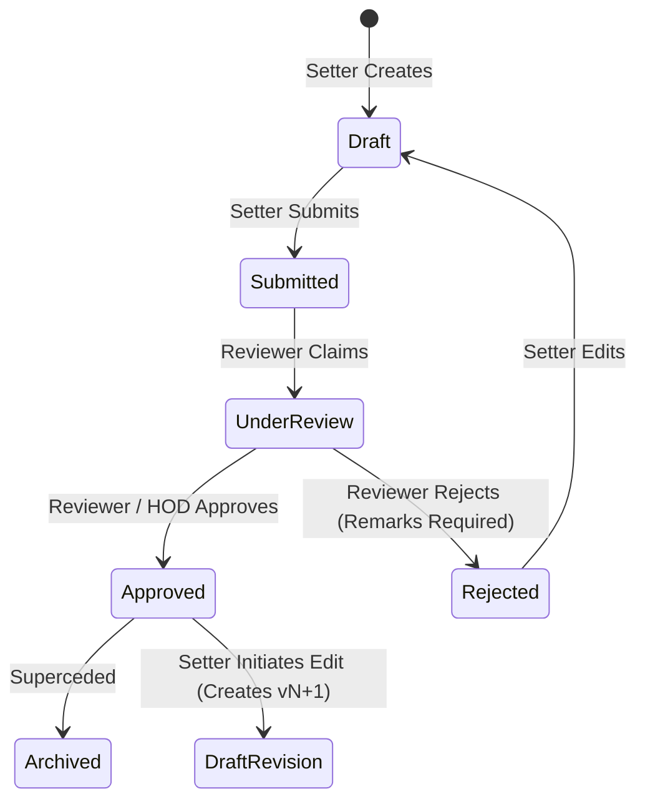

# Functional Requirements Specification: QPMS

## Purpose
This document provides an exhaustive, feature-by-feature specification of all functional requirements for the **University Question Paper Management & Generation System**.

## Scope
It details functional modules FR-01 through FR-12, defining system inputs, processing rules, business logic, boundary conditions, outputs, and user roles.

---

## FR-01: Organization & Multi-Tenancy Management

### 1.1 Scope & Description
The system must support multiple independent educational organizations and institutions within a single unified or partitioned deployment.

### 1.2 Functional Specifications
1. **Multi-Tenant Isolation:**
   - Every tenant is an `Institution` or `University System`.
   - Data belonging to Tenant A is strictly isolated from Tenant B.
   - Cross-institution queries are prohibited by default, except where a parent University administers standardized board examinations for constituent colleges.
2. **Institution Profile Management:**
   - Administrators can configure Institution Name, Code, Affiliation Type (Autonomous University, Affiliated College, Polytechnic, Board), Official Logo, Header/Footer metadata, and Examination Crest.
3. **Campus / Center Topology:**
   - Support multiple physical campuses or examination centers under a single institution.

---

## FR-02: Academic Hierarchy & Curriculum Management

### 2.1 Scope & Description
The platform must model complex, realistic university academic structures without hard-coding school-level standard/grade structures.

### 2.2 Extensible Hierarchy Model
```text
Organization / University (e.g., Gujarat Technological Apex University)
    └── Faculty / School (e.g., Faculty of Technology & Engineering)
         └── Department (e.g., Dept of Computer Science & Engineering)
              └── Program (e.g., Bachelor of Computer Applications - BCA)
                   └── Curriculum Scheme / Version (e.g., BCA Regulation 2024 Scheme)
                        └── Academic Term / Semester (e.g., Semester 3)
                             └── Course / Subject (e.g., Data Structures - CS-301)
                                  └── Syllabus Unit / Module (e.g., Unit 2: Linked Lists)
                                       └── Topic / Concept (e.g., Singly Linked List Deletion)
```

### 2.3 Detailed Specifications
1. **Dynamic Academic Units:** Departments can configure whether courses are organized by Semesters, Trimesters, or Annual Terms.
2. **Curriculum Scheme Versioning:**
   - Support overlapping curriculum schemes (e.g., 2021 CBCS Scheme and 2024 NEP Scheme coexisting concurrently for junior vs senior batches).
3. **Syllabus Units & Weightage:**
   - Courses must contain structured units with assigned percentage weightages (e.g., Unit 1 = 20%, Unit 2 = 25%).
4. **Learning Outcomes (CLO / CO):**
   - Each course defines Course Learning Outcomes (CO1 to CO6) mapped to Bloom's cognitive levels.

---

## FR-03: User Identity, Roles & Department Scope Resolution

### 3.1 Scope & Description
Manage user identities, multi-department assignments, and context-dependent active permissions.

### 3.2 Department Resolution Logic (Critical Login Flow)
1. **Zero Department Scenario:**
   - If an authenticated faculty user has 0 assigned departments, the system must block access to examination tools and display a clear contact screen directing them to the institutional administrator.
2. **Single Department Scenario:**
   - If an authenticated faculty user has exactly 1 assigned department, the system must automatically resolve the active context and navigate directly to the Dashboard.
3. **Multiple Department Scenario:**
   - If a faculty member teaches across multiple departments (e.g., teaches Discrete Math in Computer Science and Electrical Engineering), the system must prompt them with a department selection modal on login and allow dynamic context switching via the AppShell header.

---

## FR-04: Question Bank Management

### 4.1 Scope & Description
Centralized repository for curating, tagging, formatting, and cataloging questions across all academic subjects.

### 4.2 Detailed Specifications
1. **Question Types Supported (14+ Types):**
   - Single-Choice MCQ, Multiple-Select MSQ, True/False, Fill in the Blank, One Word, Short Answer, Long Descriptive, Essay, Explain/Differentiate, Problem Solving/Numerical, Coding/Programming, Case Study, Match the Following, Assertion & Reason.
2. **Rich Content & Media:**
   - Markdown, LaTeX/MathML mathematical equations, code blocks with syntax highlighting, and embedded technical diagrams/figures.
3. **Pedagogical Metadata:**
   - Difficulty Level (Easy, Medium, Hard).
   - Bloom’s Taxonomy Level (Remember, Understand, Apply, Analyze, Evaluate, Create).
   - Course Outcome Tagging (CO1, CO2, etc.).
   - Standard Marks and Negative Marks (if applicable).
   - Expected Solution / Answer Key / Marking Rubric.

---

## FR-05: Question Lifecycle & Review Workflow

### 5.1 Lifecycle State Transitions


### 5.2 Version Immutability Rules
1. Once a question reaches `Approved` status, it can NEVER be edited in place.
2. Any modification to an Approved question creates a new Draft Version `vN+1`.
3. Historical question papers that used `vN` remain locked and reference `vN` permanently.

---

## FR-06: Paper Blueprint Configuration

### 6.1 Scope & Description
Visual, rule-based blueprint designer defining the structural layout and scoring criteria of an examination paper.

### 6.2 Detailed Specifications
1. **Sectional Hierarchy:**
   - Sections (e.g., Section A: Objective, Section B: Short Analytical, Section C: Comprehensive Problem).
2. **Choice Modeling:**
   - Support "Compulsory" sections vs "Internal Choice" (e.g., Answer any 4 out of 6 questions).
3. **Real-time Mathematical Calculation:**
   - Real-time client and server validation ensuring:
     $$\text{Total Marks} = \sum (\text{Question Count} \times \text{Marks per Question})$$
   - Mismatch between configured blueprint and target exam marks triggers strict validation blocks.

---

## FR-07: Algorithmic Question Paper Generation Engine

### 7.1 Scope & Description
Deterministic constraint-satisfaction engine capable of synthesizing balanced papers according to blueprint criteria.

### 7.2 Core Generation Constraints
1. **Unit Balancing Constraint:** Questions must be proportionally drawn across all selected syllabus units; no single unit may dominate the paper.
2. **Difficulty Balancing Constraint:** Enforce target difficulty ratios (e.g., Easy 30%, Medium 50%, Hard 20%).
3. **Bloom's Cognitive Balancing:** Enforce cognitive distribution (e.g., Lower Order Thinking 40%, Higher Order Thinking 60%).
4. **Lookback Avoidance (Anti-Repetition):**
   - Configurable lookback window (1, 2, 3, or 5 academic years).
   - Questions featured in approved previous papers during the lookback period are excluded from the candidate pool.
5. **Similarity Guard:** Detect and prevent semantically near-duplicate questions from appearing in the same paper.
6. **Pool Insufficiency Detection:** If the approved question pool cannot satisfy the blueprint rules, the engine must return a detailed diagnostic report explaining the deficit (e.g., "Need 2 more Hard questions in Unit 4").

---

## FR-08: Multi-Set Permutations (Sets A, B, C, D)

### 8.1 Scope & Description
Generate multiple parallel examination sets for large hall testing to deter student copying.

### 8.2 Detailed Specifications
1. **Equivalence Invariant:** All sets (A, B, C, D) must have identical total marks, time duration, section structure, and difficulty distribution.
2. **Permutation Strategies:**
   - *Strategy 1 (Shuffled Sequence):* Same question pool, randomized question order and MCQ option keys (A $\rightarrow$ C, B $\rightarrow$ A).
   - *Strategy 2 (Parallel Pools):* Disjoint but pedagogically equivalent questions drawn from the same unit and difficulty bucket.

---

## FR-09: Question Paper Lifecycle & Custody Handover

### 9.1 Paper State Machine
```text
Draft -> Generated -> Reviewed -> Approved -> Locked -> Published -> Archived
```

### 9.2 Locking & Security Handover
1. Once approved by the HOD or Examination Committee, the paper is moved to `Locked` status.
2. Locked papers are cryptographically sealed. Content can no longer be previewed by general faculty.
3. Decryption and print privileges are restricted exclusively to authorized Exam Cell officers.

---

## FR-10: Exam Administration & Scheduling

### 10.1 Scope & Description
Management of official exam sessions, timetables, course codes, and exam center allocation.

### 10.2 Detailed Specifications
1. Bind question papers to specific Examination Sessions (e.g., "Winter 2026 Regular End-Sem Examinations").
2. Assign official Paper Codes, Subject Codes, Date of Examination, Time Slot, and Center Batch Quotas.

---

## FR-11: Secure PDF & Print Engine

### 11.1 Scope & Description
Production of print-ready, high-contrast academic examination papers with anti-leak protections.

### 11.2 Detailed Specifications
1. **Academic Typography:** Formatted in serif/sans-serif academic standards with university crest, instructions to candidates, marks right-aligned, and clear section breaks.
2. **Dynamic Watermarking:** Every downloaded or printed PDF contains a diagonal translucent watermark indicating: `Printed by: <User Name> (<User ID>) | IP: <IP> | <Timestamp> | Copy # <N>`.
3. **Verification QR Code:** Cryptographic hash encoded as a QR code in the paper header to verify physical paper authenticity during exam day inspections.

---

## FR-12: Forensic Audit Trail & Traceability

### 12.1 Scope & Description
Complete, non-repudiable audit logging for forensic compliance and accreditation auditing.

### 12.2 Detailed Specifications
1. Log every mutation: Question creation, modification, version bump, approval, rejection, blueprint change, paper generation, review, edit, lock, preview, export, and print.
2. Record: Event ID, Tenant ID, Department ID, User ID, Role, Action, Entity Type, Entity ID, Timestamp (UTC), Client IP, User Agent, and Change Diff (JSON).

---

## Current State vs. Proposed State

* **Current State:** Basic prototypes exist in the frontend for academic selection, basic blueprint editing, mock question pools, and localStorage saves. Many rules (e.g., exact lookback filtering, multi-set orthogonal generation, dynamic watermarking, locked paper crypto) are purely client-side mocks or simulated alerts.
* **Proposed State:** Full server-side execution of all 12 functional specifications backed by relational transactions, cryptographic custody, and automated validation.

## Decisions
1. Implement the 12 functional modules in phased delivery as detailed in [ROADMAP.md](file:///home/mohammad-ali/Projects/mj_question_paper_genrator/docs/ROADMAP.md).
2. Maintain strict separation between question authoring and final paper locking/printing.

## Open Questions
* Refer to [OPEN_QUESTIONS.md](file:///home/mohammad-ali/Projects/mj_question_paper_genrator/docs/OPEN_QUESTIONS.md) Q3 regarding automated answer-key PDF generation alongside exam papers.

## Related Documents
- [REQUIREMENTS.md](file:///home/mohammad-ali/Projects/mj_question_paper_genrator/docs/REQUIREMENTS.md)
- [QUESTION_PAPER_GENERATION.md](file:///home/mohammad-ali/Projects/mj_question_paper_genrator/docs/QUESTION_PAPER_GENERATION.md)
- [SECURITY.md](file:///home/mohammad-ali/Projects/mj_question_paper_genrator/docs/SECURITY.md)
- [PDF_GENERATION.md](file:///home/mohammad-ali/Projects/mj_question_paper_genrator/docs/PDF_GENERATION.md)
