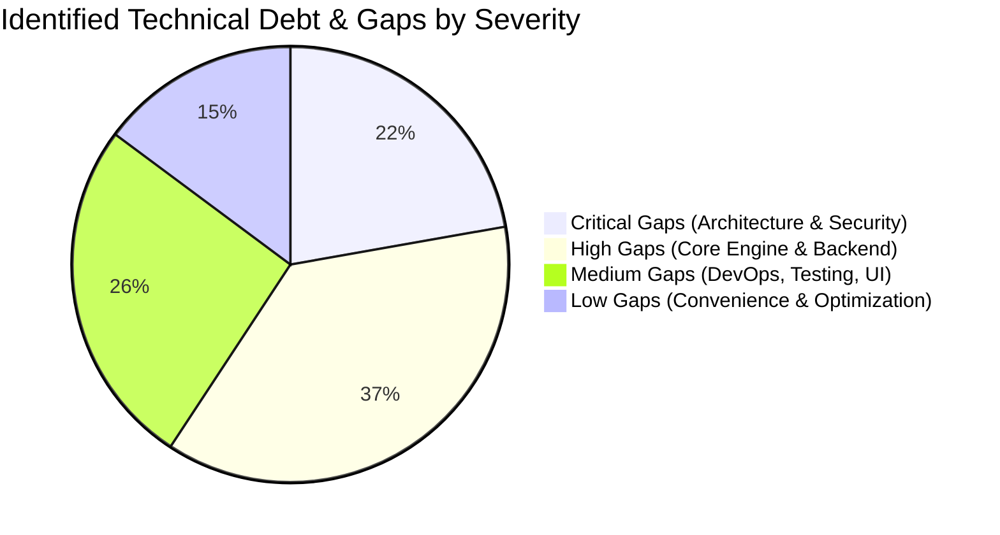

# Comprehensive Gap Analysis: Prototype vs. Enterprise Platform

## Purpose
This document provides an exhaustive, categorized delta analysis comparing the current prototype codebase in the repository against the architectural requirements of an enterprise-grade **University Question Paper Management & Generation System**.

## Scope
Audits all technical layers: Persistence, Security, Backend APIs, Generation Algorithms, Academic Modeling, Frontend, DevOps, and Compliance.

---

## 1. Gap Classification Summary

Every identified gap is evaluated by severity, operational impact, and recommended remediation:
- **Critical (CRIT):** Blocks enterprise production readiness, violates security/confidentiality, or represents architectural failure.
- **High (HIGH):** Essential core functional capability missing or simulated.
- **Medium (MED):** Important operational or usability enhancement required for scale.
- **Low (LOW):** Polish, performance optimization, or future convenience feature.

---

## 2. Detailed Gap Analysis Matrix

### 2.1 Critical Gaps (Severity: CRITICAL)

| Gap ID | Issue | Current Prototype State | Enterprise Target State | Priority | Dependencies |
| :--- | :--- | :--- | :--- | :---: | :--- |
| **GAP-CRIT-01** | **No Backend API or Server** | Pure client-side SPA. All business logic executed in browser; vulnerable to manipulation. | Decoupled Node.js/NestJS or Python/FastAPI REST backend with OpenAPI contracts. | **P0** | Foundation |
| **GAP-CRIT-02** | **No Real Database** | Data stored in in-memory JavaScript objects and browser `localStorage` (5 MB quota limit). | PostgreSQL 16+ relational database with Row-Level Security, ACID transactions, and indexes. | **P0** | Backend |
| **GAP-CRIT-03** | **No Real Authentication or MFA** | Hardcoded list of 6 personas in `mockUsers`; switching users sets plain string in localStorage. | OAuth2 / OIDC authentication with JWT in HttpOnly cookies, TOTP MFA, and password hashing (Argon2id). | **P0** | Database |
| **GAP-CRIT-04** | **No Tenant or Scope Isolation** | Multi-tenancy simulated by client string filters; any user can edit local data in browser dev tools. | Kernel-enforced PostgreSQL Row-Level Security driven by authenticated JWT tenant claims. | **P0** | Database, Auth |
| **GAP-CRIT-05** | **No Paper Secrecy Locking or Encryption** | Papers saved as plain JSON objects in localStorage; anyone can view, edit, or copy at any time. | Cryptographic custody vault: sealed papers encrypted with AES-256 envelope encryption. | **P0** | Database, Auth |
| **GAP-CRIT-06** | **Zero Automated Testing** | 0 test files in repo; `npm test` script does not exist; zero CI regression protection. | Comprehensive testing pyramid (Unit, Integration, Generation Property Tests, E2E). | **P0** | Backend |

---

### 2.2 High Gaps (Severity: HIGH)

| Gap ID | Issue | Current Prototype State | Enterprise Target State | Priority | Dependencies |
| :--- | :--- | :--- | :--- | :---: | :--- |
| **GAP-HIGH-01** | **Simulated Paper Generator** | Client array filter picks arbitrary questions without real constraint satisfaction. | Server-side Backtracking CSP solver balancing unit weightage, Bloom taxonomy, and difficulty. | **P1** | Database |
| **GAP-HIGH-02** | **No True Lookback Exclusion** | Lookback UI checkboxes exist, but historical exclusion logic is purely client-side and incomplete. | Relational lookback exclusion query filtering out questions used in approved papers over $N$ years. | **P1** | Database |
| **GAP-HIGH-03** | **No Server-Side PDF / Print Engine** | Client uses browser `window.print()` and alerts simulated PDF download; unformatted, inconsistent. | Dedicated headless Chromium (Puppeteer) worker rendering pixel-perfect A4 papers with watermarks. | **P1** | Backend |
| **GAP-HIGH-04** | **No Dynamic Watermarking or QR Tags** | Exported papers have no user metadata, IP stamp, timestamp, or authenticity verification QR code. | Dynamic semi-transparent SVG watermark layer and HMAC-SHA256 signed verification QR code. | **P1** | PDF Engine |
| **GAP-HIGH-05** | **No Immutable Audit Trail** | Inline comments array on questions; zero system-wide audit logging table. | Partitioned append-only `audit_logs` table with SHA-256 Merkle hash chaining and trigger locks. | **P1** | Database |
| **GAP-HIGH-06** | **Missing Curriculum Versioning** | Hardcoded hierarchy (`Program -> Semester -> Subject`); cannot model concurrent curriculum schemes. | `CurriculumScheme` and `CurriculumCourse` bridge entities supporting overlapping schemes (2022 vs 2025). | **P1** | Database |
| **GAP-HIGH-07** | **No LaTeX / Math Equation Support** | Questions render plain text strings; scientific formulas, fractions, and matrices render illegibly. | KaTeX client-side and server-side rendering with LaTeX math input editor. | **P1** | Frontend |
| **GAP-HIGH-08** | **No Formal Moderation Queues** | Simple status string toggle in `ApprovalsView`; no designated reviewer assignment or feedback loops. | Formal state machine with role-based transitions, mandatory rejection remarks, and notification events. | **P1** | Backend |
| **GAP-HIGH-09** | **Fragile Hash-Based Client Routing** | `App.tsx` parses `window.location.hash` using regexes; fragile navigation and no route guards. | React Router v6 / TanStack Router with nested layouts, lazy-loaded routes, and auth guards. | **P1** | Frontend |
| **GAP-HIGH-10** | **No Examination Session Administration** | Papers generated as floating items without binding to official exam timetables or paper codes. | `exam_sessions` and `exam_timetables` modules binding papers to dates, sessions, and center quotas. | **P1** | Database |

---

### 2.3 Medium Gaps (Severity: MEDIUM)

| Gap ID | Issue | Current Prototype State | Enterprise Target State | Priority | Dependencies |
| :--- | :--- | :--- | :--- | :---: | :--- |
| **GAP-MED-01** | **No CI/CD Pipelines** | No GitHub Actions workflows; manual build and verification. | Automated lint, test, security scan, and Docker build pipeline. | **P2** | DevOps |
| **GAP-MED-02** | **No Docker / Deployment Config** | No `Dockerfile`, no `docker-compose.yml`, no environment configuration. | Multi-stage Dockerfiles and Docker Compose for local/staging deployments. | **P2** | DevOps |
| **GAP-MED-03** | **Unvalidated Form Inputs** | Raw controlled inputs with no schema validation; prone to invalid states. | React Hook Form + Zod schemas validating marks, question formats, and options. | **P2** | Frontend |
| **GAP-MED-04** | **No Multi-Language Translation Pairing**| Language dropdown exists on questions, but no relational pairing of bilingual variants. | `question_translations` child table pairing English with Gujarati/Hindi/Urdu translations. | **P2** | Database |
| **GAP-MED-05** | **No Caching Layer** | Every read hits local mock arrays. | Redis L2 cache for academic structures and candidate question pools. | **P2** | Backend |
| **GAP-MED-06** | **No Error Boundaries** | Uncaught JavaScript runtime errors crash the entire web application. | React Error Boundaries with graceful fallback recovery screens. | **P2** | Frontend |
| **GAP-MED-07** | **No Monitoring or Observability** | No telemetry, metrics, or centralized error reporting. | Prometheus metrics, OpenTelemetry tracing, and Sentry exception tracking. | **P2** | DevOps |

---

## Current State vs. Proposed State

* **Current State:** A sophisticated frontend prototype demonstrating core user experience concepts, but completely missing an enterprise backend, database, security infrastructure, and CI/CD.
* **Proposed State:** A fully functional, production-ready enterprise university examination platform with all 23 identified gaps resolved in accordance with the 14-phase roadmap.

## Decisions
1. Treat Phase 1 (Foundation & Database), Phase 2 (Authentication & Tenant Isolation), and Phase 7 (Constraint Generation Engine) as non-negotiable prerequisites before launching any pilot.
2. Address all 6 Critical Gaps prior to deploying the platform in any live institutional environment.

## Open Questions
- None.

## Related Documents
- [RISKS.md](file:///home/mohammad-ali/Projects/mj_question_paper_genrator/docs/RISKS.md)
- [ROADMAP.md](file:///home/mohammad-ali/Projects/mj_question_paper_genrator/docs/ROADMAP.md)
- [IMPLEMENTATION_PLAN.md](file:///home/mohammad-ali/Projects/mj_question_paper_genrator/docs/IMPLEMENTATION_PLAN.md)
