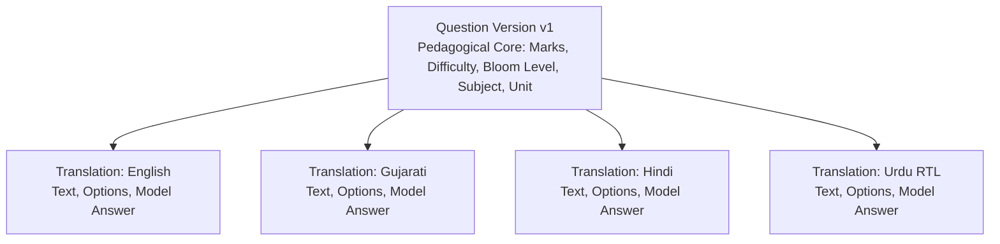

# Multilingual Architecture & Localization: QPMS

## Purpose
This document specifies the multilingual data architecture, translation pairing models, Unicode support, Indic script typography, and UI internationalization for the **University Question Paper Management & Generation System**.

## Scope
Covers multilingual question authoring, parallel language paper generation (Bilingual Papers), font embedding for print, and web interface internationalization across English, Gujarati, Hindi, and Urdu.

---

## 1. Multilingual Support Context in Indian Educational Ecosystems

In Indian state and central universities, examination regulations frequently mandate:
1. **Bilingual Question Papers:** The same question paper printed with questions presented side-by-side or stacked in two languages (e.g., English and Gujarati, or English and Hindi).
2. **Language Variant Options:** Students can choose whether to attempt the paper in English, Hindi, or the regional state language.
3. **Complex Script Rendering:** Indic scripts (Devanagari, Gujarati) and RTL Perso-Arabic scripts (Urdu) require correct complex text shaping, ligature support, and font metric alignment.

---

## 2. Relational Translation Pairing Model

To support bilingual papers without duplicating pedagogical metadata, the QPMS separates the **Pedagogical Root** from the **Linguistic Manifestations**:



### Database Schema for Translations
```sql
CREATE TABLE question_translations (
    id UUID PRIMARY KEY DEFAULT gen_random_uuid(),
    question_version_id UUID NOT NULL REFERENCES question_versions(id) ON DELETE CASCADE,
    language_code VARCHAR(10) NOT NULL, -- 'en', 'gu', 'hi', 'ur'
    text TEXT NOT NULL,
    answer TEXT NOT NULL,
    options JSONB, -- Localized option choices
    created_at TIMESTAMPTZ NOT NULL DEFAULT NOW(),
    CONSTRAINT uq_qversion_language UNIQUE (question_version_id, language_code)
);
```

---

## 3. Complex Script Font Embedding & PDF Printing

A major pitfall in academic PDF generation is missing glyphs (rendering as squares/tofu `□□□`) or broken conjunct ligatures in Gujarati and Devanagari.

### 3.1 Certified Open-Source Noto Font Stack
During server-side Puppeteer PDF rendering, the engine embeds Google Noto fonts:
- **English:** `Noto Serif` / `Times New Roman`
- **Gujarati:** `Noto Serif Gujarati` / `Shruti`
- **Hindi / Devanagari:** `Noto Serif Devanagari` / `Mangal`
- **Urdu:** `Noto Nastaliq Urdu` (with right-to-left `dir="rtl"` text shaping)

```css
@font-face {
  font-family: 'AcademicGujarati';
  src: url('/fonts/NotoSerifGujarati-Regular.ttf') format('truetype');
}
.lang-gu {
  font-family: 'AcademicGujarati', serif;
  line-height: 1.6;
}
```

---

## 4. Web Application UI Internationalization (i18n)

The existing prototype features a translation context in [src/lib/i18n.tsx](file:///home/mohammad-ali/Projects/mj_question_paper_genrator/src/lib/i18n.tsx) with JSON language bundles:
- `src/messages/en.json` (English)
- `src/messages/gu.json` (Gujarati)
- `src/messages/hi.json` (Hindi)
- `src/messages/ur.json` (Urdu)
- `src/messages/ar.json` (Arabic)

The production architecture will expand this by lazy-loading translation chunks based on user profile preferences stored in PostgreSQL.

---

## Current State vs. Proposed State

* **Current State:** The client has UI message files in `src/messages/` and a `language` dropdown on questions, but questions do not support true bilingual paired translations or specialized font embedding for PDF printing.
* **Proposed State:** A formal multi-language relational translation model, paired bilingual paper compilation, and server-side Noto font bundling guaranteeing zero glyph drops across English, Gujarati, Hindi, and Urdu.

## Decisions
1. Model translations as child entities of `question_versions` to ensure that difficulty, marks, and cognitive Bloom levels remain synchronized across all languages.
2. Bundle Google Noto TrueType fonts directly inside the headless Chromium Docker container for flawless server-side rendering.

## Open Questions
- None.

## Related Documents
- [QUESTION_BANK.md](file:///home/mohammad-ali/Projects/mj_question_paper_genrator/docs/QUESTION_BANK.md)
- [PDF_GENERATION.md](file:///home/mohammad-ali/Projects/mj_question_paper_genrator/docs/PDF_GENERATION.md)
- [QUESTION_TYPES.md](file:///home/mohammad-ali/Projects/mj_question_paper_genrator/docs/QUESTION_TYPES.md)
