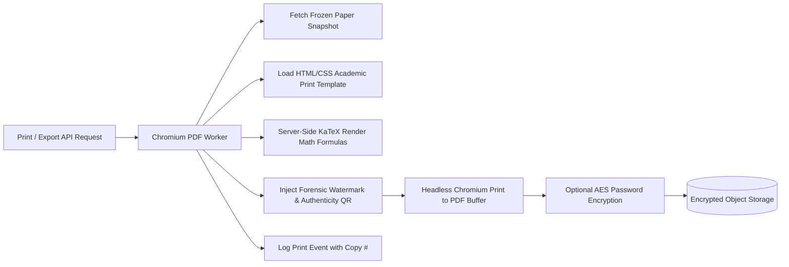

# PDF Generation & Secure Print Engine Specification: QPMS

## Purpose
This document specifies the technical architecture, layout templates, security watermarking, barcode authentication, and rendering pipeline for the PDF & Secure Print Engine within the **University Question Paper Management & Generation System**.

## Scope
Governs server-side headless Chromium rendering, academic layout styling, dynamic forensic watermarks, 2D verification QR codes, and performance optimization.

---

## 1. Document Architecture & Print Pipeline



---

## 2. Examination Paper Layout Standards (Requirements #32 & #33)

To ensure high-contrast legibility in standardized examination halls, the rendered layout strictly adheres to classical academic printing standards:

### 2.1 Page Setup & Margins
- **Paper Size:** Standard ISO A4 ($210 \times 297$ mm) or US Legal ($216 \times 356$ mm).
- **Margins:** Top: 20 mm, Bottom: 20 mm, Left: 20 mm, Right: 20 mm.
- **Header Band (First Page Only):**
  - Institutional Crest / University Logo centered.
  - University / Autonomous College Name in bold uppercase serif font.
  - Faculty / School and Department of instruction.
  - Examination Session Title (e.g., "Bachelor of Computer Applications — Semester 3 Examinations").
  - 4-Quadrant Metadata Grid: Subject Code, Academic Year, Duration, Max Marks, Paper Set Code, and Language.
  - Instructions to Candidates (e.g., "1. Answer all questions from Section A. 2. Non-programmable calculators permitted.").
- **Running Headers & Footers (Subsequent Pages):**
  - Running Header: `Subject Code (CS-301) — Paper Set A`.
  - Running Footer: `Page X of Y` centered with verification hash right-aligned.

---

## 3. Dynamic Forensic Watermarking

Every exported PDF features a non-removable, dynamic watermark stamped across each page at a $45^\circ$ angle:

```text
CONFIDENTIAL — EXAM CELL COPY
Authorized Print Custodian: Prof. Sunita Sharma (ID: u-sunita)
IP: 192.168.10.45 | Timestamp: 2026-03-24 14:32:10 UTC | Copy # 003
```

### Technical Implementation: SVG Background Layer
```html
<div class="watermark-layer">
  <svg width="100%" height="100%" xmlns="http://www.w3.org/2000/svg">
    <text x="50%" y="50%" fill="rgba(15, 23, 42, 0.08)" font-family="sans-serif" font-size="22" font-weight="bold" text-anchor="middle" transform="rotate(-45, 400, 500)">
      CONFIDENTIAL — APEX UNIVERSITY EXAM CELL | Printed by u-sunita (192.168.10.45) | 2026-03-24 14:32:10 UTC | Copy #003
    </text>
  </svg>
</div>
```

---

## 4. Verification QR Code & Tamper Defense

In the top-right corner of Page 1, the engine renders a high-density 2D QR Code containing a cryptographically signed verification payload:
```text
QPMS-VERIFY:QP-2026-001:SET-A:HASH=7f83b165...:TIMESTAMP=1774348800:SIG=3045022...
```
During examination hall inspections, proctors or flying squads can scan the QR code using a verified institutional inspection tablet to instantly confirm that the paper in the student's hand matches the official signed manifest in the university database.

---

## Current State vs. Proposed State

* **Current State:** The client triggers `window.print()` and alerts a simulated PDF download. There is no server-side rendering, no dynamic watermarking, and no verification QR code.
* **Proposed State:** A dedicated server-side headless Chromium worker rendering pixel-perfect A4 academic examination papers with forensic dynamic watermarks, KaTeX mathematical formulas, and anti-leak QR tags.

## Decisions
1. Execute all official PDF rendering server-side via Puppeteer running in isolated worker containers.
2. Embed the print custodian's name, user ID, IP address, and timestamp as a semi-transparent watermark on every printed page.

## Open Questions
- None.

## Related Documents
- [SECURITY.md](file:///home/mohammad-ali/Projects/mj_question_paper_genrator/docs/SECURITY.md)
- [AUDIT_LOGGING.md](file:///home/mohammad-ali/Projects/mj_question_paper_genrator/docs/AUDIT_LOGGING.md)
- [ADR-009-pdf-generation-strategy.md](file:///home/mohammad-ali/Projects/mj_question_paper_genrator/docs/adr/ADR-009-pdf-generation-strategy.md)
