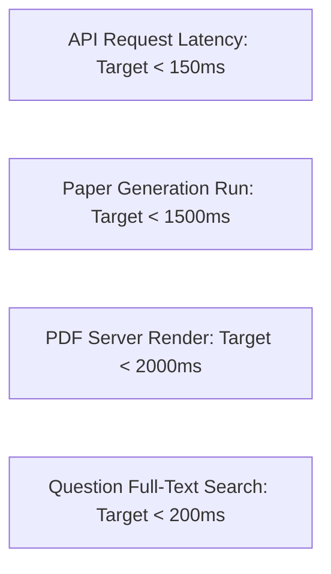
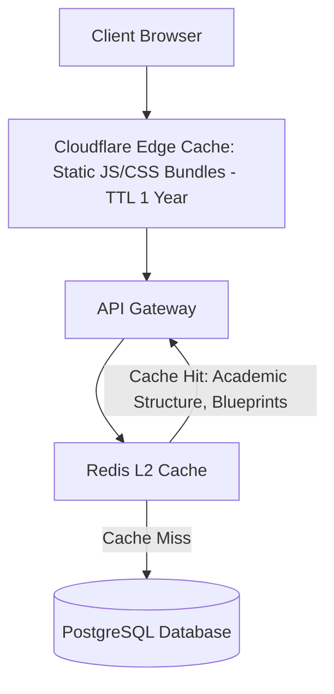

# Performance Engineering & Optimization: QPMS

## Purpose
This document specifies the performance budgets, algorithmic time complexity bounds, database query optimization guidelines, caching strategies, and frontend bundle optimization for the **University Question Paper Management & Generation System**.

## Scope
Covers frontend rendering performance, backend API response times, constraint-satisfaction generation execution, PDF compilation latency, and database throughput.

---

## 1. Latency Budgets & SLA Thresholds



### Granular SLA Targets
- **Core CRUD Operations:** $P_{95} < 100$ ms, $P_{99} < 250$ ms.
- **Complex Question Search (500k bank):** $P_{95} < 200$ ms.
- **Paper Generator Execution (100 marks, Sets A-D):** $P_{95} < 1,500$ ms, Max allowable 5,000 ms.
- **High-Resolution PDF Compilation & Watermark:** $P_{95} < 2,000$ ms, Max allowable 5,000 ms.

---

## 2. Algorithmic Time & Space Complexity Bounds

The paper generation engine solves a multi-objective constraint satisfaction problem. Unchecked backtracking can degrade to exponential time $O(b^d)$ where $b$ is the branching factor and $d$ is the number of question slots.

### Heuristic Optimization Strategies
1. **Pre-Stratification in Linear Time $O(N)$:**
   Before initiating backtracking, the candidate pool of $N$ questions is partitioned into a hash-indexed lookup table keyed by `(unit, type, marks, difficulty)`. This reduces subsequent lookup operations to $O(1)$.
2. **Most Constrained Variable (MCV) Ordering:**
   Slots with the smallest candidate pool are assigned first, pruning non-viable combinatorial branches early.
3. **Memoized Sub-Problem Knapsack Formulation:**
   Sectional mark distributions are validated using dynamic programming in $O(K \cdot W)$ time (where $K$ is the question count and $W$ is the target section marks).

---

## 3. Database Optimization & Indexing Strategy

1. **Covering Indexes for Generation Queries:**
   ```sql
   CREATE INDEX idx_qversions_gen_filter ON question_versions 
     (status, marks, difficulty, bloom_level) 
     INCLUDE (id, question_root_id, type);
   ```
2. **Full-Text Search Pre-Computation:**
   Avoid on-the-fly `to_tsvector()` calls during searches; rely on the stored generated `text_search_vector` column indexed with GIN.
3. **Read/Write Splitting with PgBouncer:**
   - Write operations (approvals, question creation) directed to the PostgreSQL Primary.
   - High-throughput read operations (candidate pool searches, history browsing) directed to PostgreSQL Read Replicas via PgBouncer connection pooling.

---

## 4. Multi-Layered Caching Strategy (Redis)



### Cache Key Invalidation Rules
- **Academic Hierarchy:** Cached in Redis with a 24-hour TTL; invalidated explicitly on `admin:academic:manage` mutations.
- **Approved Question Candidate Pools:** Cached per course with a 1-hour TTL; invalidated upon any new `QBANK_QUESTION_APPROVE` event for that course.

---

## 5. Frontend Bundle Optimization

- **Route-Based Code Splitting:** Heavy views (`PaperGeneratorWizard`, `ReportsView`, `AcademicStructureView`) are lazy-loaded via `React.lazy()` and `Suspense`, keeping the initial entry bundle $< 150$ KB gzipped.
- **Tree-Shaking:** Ensure modular icon imports from `lucide-react`.
- **KaTeX Pre-Compilation:** Render math formulas using lightweight KaTeX CSS/fonts rather than loading full MathJax bundles.

---

## Current State vs. Proposed State

* **Current State:** Single unoptimized bundle (Vite build produces ~400 KB JS). In-memory JavaScript arrays filter questions with no indexing, no server-side caching, and no query performance profiling.
* **Proposed State:** A rigorous performance architecture featuring stratified $O(1)$ candidate bucketing, Redis L2 caching, read-replica scaling, GIN full-text indexing, and sub-150 KB initial frontend bundle sizes.

## Decisions
1. Implement Redis caching for academic course structures and candidate question pools to achieve sub-100 ms query times.
2. Partition the generation candidate pool into memory buckets prior to running recursive backtracking.

## Open Questions
- None.

## Related Documents
- [SCALABILITY.md](file:///home/mohammad-ali/Projects/mj_question_paper_genrator/docs/SCALABILITY.md)
- [QUESTION_PAPER_GENERATION.md](file:///home/mohammad-ali/Projects/mj_question_paper_genrator/docs/QUESTION_PAPER_GENERATION.md)
- [NON_FUNCTIONAL_REQUIREMENTS.md](file:///home/mohammad-ali/Projects/mj_question_paper_genrator/docs/NON_FUNCTIONAL_REQUIREMENTS.md)
