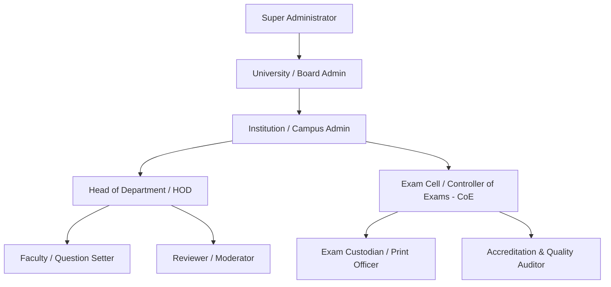

# Project Overview: University Question Paper Management & Generation System

## Purpose
This document provides a comprehensive executive and technical summary of the Question Paper Management & Generation System (QPMS). It defines the strategic business drivers, core objectives, target personas, product vision, and operational scope of the platform.

## Scope
This document covers the entire QPMS domain, spanning multi-institution management, academic hierarchy modeling, curriculum versioning, question bank governance, automated blueprint-driven paper generation, multi-set randomization, approval workflows, exam session administration, secure printing, and historical auditability.

---

## 1. Product Vision & Problem Statement

### 1.1 The Problem in Modern Academic Institutions
In collegiate and university systems (particularly in large public, private, and autonomous educational ecosystems), question paper management is fraught with critical challenges:
1. **Confidentiality Leaks:** Manual handling of Word/PDF documents via unencrypted emails, USB drives, or physical papers creates severe vulnerability to paper leaks.
2. **Quality & Syllabus Imbalance:** Papers often over-represent specific modules or fail to balance Bloom’s Taxonomy levels (e.g., heavily skewed toward simple recall rather than analytical problem-solving).
3. **Question Repetition:** Without cross-year historical tracking, examiners routinely repeat questions from immediate preceding years, encouraging rote memorization.
4. **Rigid Academic Structures:** Many software tools assume a simplistic `School -> Grade -> Subject` model, failing completely to reflect universities with Autonomous Colleges, Faculties, Multi-disciplinary Departments, Program Curriculums with elective buckets, and credit-based semester systems.
5. **No Version Integrity:** Modifications made during moderation or review do not leave a clean, immutable audit trail, making retrospective accreditation reviews (e.g., NAAC, NBA, ABET) difficult and unverified.

### 1.2 The QPMS Solution
The **University-level Multi-Institution Question Paper Management & Generation System** solves these challenges through:
- **Strict Multi-Tenancy & Extensible Hierarchies:** Supporting multiple autonomous institutions, university affiliations, constituent schools, departments, and evolving curriculum versions.
- **Controlled Question Bank Governance:** Multi-authoring, versioned revisions, Bloom’s taxonomy tagging, learning outcome mapping, and multi-tier approval workflows.
- **Algorithmic Paper Generation:** Mathematical constraint-satisfaction engine ensuring syllabus unit coverage, difficulty balancing, cognitive distribution, and lookback avoidance (anti-repetition).
- **Multi-Set Permutation:** Automated synthesis of Sets A, B, C, and D with identical blueprint rigor and difficulty weights, but distinct randomized question permutations.
- **Zero-Trust Secrecy & Auditability:** Cryptographic custody, role-based boundary isolation, dynamic watermarking, and tamper-evident audit trails.

---

## 2. Target Personas & Stakeholder Ecosystem

### Detailed Persona Descriptions

1. **Super Administrator (Platform Operator):**
   - Manages platform tenants, infrastructure health, global policy templates, and system audit logs.
2. **University / Board Administrator (Affiliating Body):**
   - Oversees university-wide policies, standard degree programs, common board examinations, and cross-college curriculum frameworks.
3. **Institution / Campus Administrator (College Principal / Dean):**
   - Configures local institution profile, binds departments, manages institutional faculty rosters, and monitors institutional exam readiness.
4. **Head of Department (HOD) / Academic Chair:**
   - Supervises departmental curriculum, approves subject assignments, assigns question setters/reviewers, reviews paper blueprints, and authorizes departmental question pools.
5. **Faculty / Question Setter:**
   - Drafts curriculum-aligned questions with options, solutions, marks, Bloom's levels, and unit tags. Submits revisions and builds paper generation contexts.
6. **Reviewer / Scrutinizer / Subject Moderator:**
   - Audits draft questions for clarity, scientific correctness, difficulty rating, and formatting. Approves or returns questions with feedback.
7. **Exam Cell / Controller of Examinations (CoE):**
   - Configures official exam sessions, generates final paper sets (A/B/C/D), locks final papers, schedules decryption/print windows, and authorizes distribution to exam centers.
8. **Exam Custodian / Print Officer:**
   - Authorized personnel permitted to decrypt and print paper batches within strict time windows under camera surveillance with personalized watermarking.
9. **Accreditation & Quality Auditor (Internal/External):**
   - Read-only access to historical papers, outcome mappings (CO-PO attainment), difficulty distributions, and audit trails for compliance validation.

---

## 3. Product Boundaries & Architecture Invariants

1. **Multi-Tenancy Without Leakage:** No faculty or administrator from Institution A may view, search, or reference question papers or draft questions from Institution B unless explicitly configured as a shared university board pool.
2. **Department Isolation:** Within an institution, faculty members assigned exclusively to Computer Science cannot view or modify Electrical Engineering exam materials unless granted cross-departmental coordinator privileges.
3. **Historical Immutability:** Once a question paper is marked `Approved` or `Locked` and utilized in an examination, it can NEVER be edited in place. Any change requires a formal revision generating a distinct version number or cloned draft.
4. **Audit Trail Completeness:** Every mutation (creation, review, edit, approval, rejection, generation run, preview, print, export) must record timestamp, actor, role, IP address, user agent, and contextual delta.
5. **Print-Ready Perfection:** Exported papers must render in clean, academic-standard typography conforming to university exam formats, including institution crests, time/mark headers, section instructions, and page numbering (e.g., "Page 1 of 4").

---

## 4. Current State vs. Proposed State

| Architectural Dimension | Current State in Repository | Proposed Production State |
| :--- | :--- | :--- |
| **System Architecture** | Single-tier client-side Single Page Application (SPA). | Multi-tier distributed microservices / modular monolith with API backend, database, cache, and worker services. |
| **Persistence Layer** | In-memory JavaScript arrays and browser `localStorage`. | PostgreSQL with Row-Level Security (RLS), connection pooling, and multi-tenant isolation. |
| **Authentication & Auth** | Hardcoded personas in `mockUsers` list, pseudo-login. | OIDC / OAuth2 / SAML SSO with JWT in HttpOnly secure cookies, fine-grained RBAC/ABAC middleware. |
| **Academic Hierarchy** | Hardcoded: Institution -> Department -> Program -> Semester -> Subject -> Unit. | Extensible dynamic hierarchy supporting Curriculum Versions, Elective groups, Academic calendars, and Modules. |
| **Question Bank** | Mock questions, limited types (MCQ, Short, Long), basic version history. | Robust bank supporting 14+ question types, LaTeX/MathML math formulas, image diagrams, Bloom's cognitive taxonomy, and translation pairing. |
| **Paper Generation** | Front-end static filter matching with basic alerts. | Server-side constraint-satisfaction solver guaranteeing balanced unit weightage, cognitive distribution, and 1-5 year lookback exclusion. |
| **PDF / Print Export** | Browser `window.print()` and client alert simulation. | Server-side Puppeteer/Chromium engine producing encrypted, password-protected, dynamically watermarked PDFs with verification QR codes. |
| **Testing & CI/CD** | 0 test suites, no CI/CD configuration. | Full testing pyramid (Unit, Integration, Generation Property tests, Security tests) running in GitHub Actions with Dockerized deployments. |

---

## Decisions
1. Maintain the existing React/Tailwind frontend components as a high-fidelity design baseline while building a robust REST API backend.
2. Transition from client-side state simulation to an enterprise REST API architecture backed by PostgreSQL.

## Open Questions
- What level of institutional autonomy is permitted when multiple constituent colleges share a parent university syllabus? (See [OPEN_QUESTIONS.md](file:///home/mohammad-ali/Projects/mj_question_paper_genrator/docs/OPEN_QUESTIONS.md) Q1).

## Related Documents
- [REQUIREMENTS.md](file:///home/mohammad-ali/Projects/mj_question_paper_genrator/docs/REQUIREMENTS.md)
- [FUNCTIONAL_REQUIREMENTS.md](file:///home/mohammad-ali/Projects/mj_question_paper_genrator/docs/FUNCTIONAL_REQUIREMENTS.md)
- [ARCHITECTURE.md](file:///home/mohammad-ali/Projects/mj_question_paper_genrator/docs/ARCHITECTURE.md)
- [DOMAIN_MODEL.md](file:///home/mohammad-ali/Projects/mj_question_paper_genrator/docs/DOMAIN_MODEL.md)
