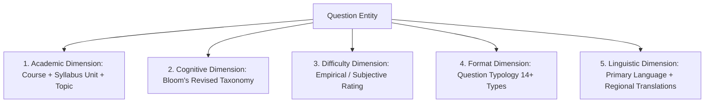

# Question Bank Architecture & Taxonomy: QPMS

## Purpose
This document specifies the technical architecture, taxonomy classification, indexing strategies, pedagogical tagging, and search capabilities of the Question Bank within the **University Question Paper Management & Generation System**.

## Scope
Covers question structuring, Bloom's cognitive taxonomy, Course Learning Outcomes (CLO) mapping, difficulty calibration, tagging, mathematical formula rendering, and search performance.

---

## 1. Pedagogical Taxonomy & Classification Model

Every question in the Question Bank is categorized across five orthogonal dimensions:



### 1.1 Bloom's Revised Taxonomy Mapping
The system mandates cognitive classification to ensure balanced intellectual rigor:

| Bloom Level | Cognitive Action Verbs | Expected Question Styles | Typical Marks Weight |
| :--- | :--- | :--- | :--- |
| **L1: Remember** | Define, list, state, identify, recall, name. | MCQs, True/False, Fill in blanks, Direct definition. | 1 to 2 Marks |
| **L2: Understand** | Describe, explain, summarize, compare, illustrate. | Short descriptive, explain differences, flow diagrams. | 2 to 5 Marks |
| **L3: Apply** | Calculate, solve, demonstrate, construct, implement. | Numerical problems, code implementation, circuit solving. | 4 to 8 Marks |
| **L4: Analyze** | Differentiate, breakdown, investigate, contrast, audit. | Comparative analysis, case study debugging, system profiling. | 5 to 10 Marks |
| **L5: Evaluate** | Judge, critique, justify, recommend, validate, prove. | Proofs, architectural critiques, protocol evaluation. | 7 to 15 Marks |
| **L6: Create** | Design, formulate, synthesize, plan, architect. | System design, comprehensive algorithm design, schema design. | 10 to 20 Marks |

---

## 2. Rich Content, Equations & Scientific Notation

### 2.1 Mathematical Formulas & Equations
Questions support mixed-mode input:
- Plain Markdown for structural styling (bold, italics, bullet lists, tables).
- Inline LaTeX enclosed in `$ ... $` (e.g., `$O(n \log n)$`, `$\int_{0}^{\pi} \sin(x) dx$`).
- Display block LaTeX enclosed in `$$ ... $$`:
  $$\sum_{i=1}^{n} i = \frac{n(n+1)}{2}$$
- Frontend rendering is accelerated via **KaTeX** or **MathJax 3** with server-side pre-compilation during PDF generation.

### 2.2 Diagrammatic & Graphical Content
- Image assets (circuit schematics, ER diagrams, data flowcharts) are uploaded to S3-compatible object storage.
- File integrity: SHA-256 hash verified upon upload.
- Format restrictions: Vector SVG (preferred for print sharpness) or high-resolution PNG (minimum 300 DPI for print legibility).
- Referenced within question text via standard Markdown: ``.

---

## 3. Indexing & Search Architecture

To ensure sub-second search times across banks with 500,000+ items, the system utilizes a multi-tiered indexing strategy in PostgreSQL:

1. **Full-Text Search (FTS):**
   - A generated `tsvector` column on question text and answers:
     ```sql
     ALTER TABLE question_versions ADD COLUMN text_search_vector tsvector
       GENERATED ALWAYS AS (to_tsvector('english', coalesce(text, '') || ' ' || coalesce(answer, ''))) STORED;
     CREATE INDEX idx_qversions_fts ON question_versions USING GIN (text_search_vector);
     ```
2. **Composite Filtering Indexes:**
   - Index on `(course_id, unit_id, difficulty, bloom_level, status)` to accelerate candidate pool extraction for the generator engine.
3. **Keyword & Tag Searches:**
   - GIN index on PostgreSQL text arrays: `CREATE INDEX idx_qversions_tags ON question_versions USING GIN (tags);`.

---

## Current State vs. Proposed State

* **Current State:** Basic questions stored in memory in `src/mock/questionData.ts` with simplistic fields (`subjectId`, `unitId`, `text`, `marks`). No LaTeX rendering, no Bloom's taxonomy enforcement, and no Course Learning Outcome mapping.
* **Proposed State:** Comprehensive pedagogical question bank with Bloom's taxonomy levels, KaTeX/LaTeX mathematical rendering, Course Outcome (CLO) mappings, and GIN-indexed full-text searching.

## Decisions
1. Enforce mandatory Bloom's taxonomy level selection for every newly created question.
2. Standardize on LaTeX for all scientific and mathematical notation, rendered client-side via KaTeX and server-side via Puppeteer.

## Open Questions
- None.

## Related Documents
- [QUESTION_TYPES.md](file:///home/mohammad-ali/Projects/mj_question_paper_genrator/docs/QUESTION_TYPES.md)
- [QUESTION_LIFECYCLE.md](file:///home/mohammad-ali/Projects/mj_question_paper_genrator/docs/QUESTION_LIFECYCLE.md)
- [QUESTION_PAPER_GENERATION.md](file:///home/mohammad-ali/Projects/mj_question_paper_genrator/docs/QUESTION_PAPER_GENERATION.md)
