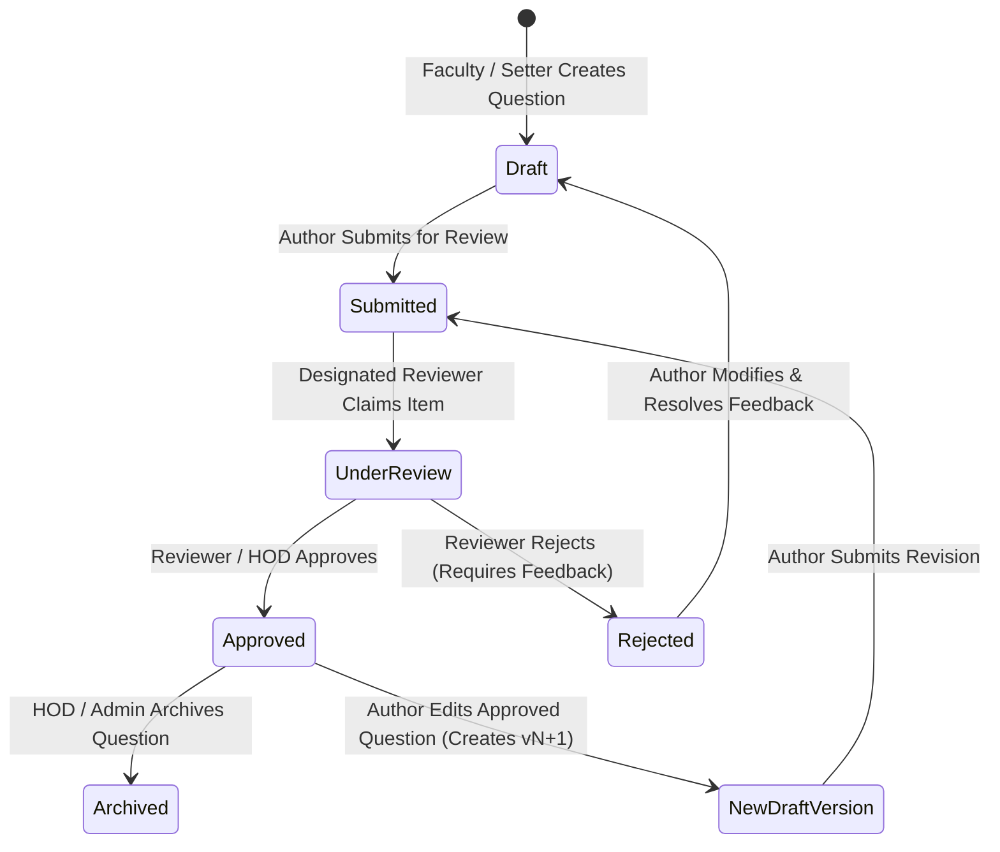

# Question Lifecycle & Moderation Workflow: QPMS

## Purpose
This document specifies the state machine, role-based transitions, moderation rules, rejection handling, and version-bumping mechanics governing Question Bank items in the **University Question Paper Management & Generation System**.

## Scope
Covers the entire question lifecycle: Creation, Peer Review, Moderation Board Review, Approval, Deprecation/Archival, and Revision Branching.

---

## 1. Complete Question State Machine



---

## 2. Transition Guard Conditions & Authorization Rules

| Current State | Target State | Triggering Action | Permitted Roles | Required Preconditions & Guards |
| :--- | :--- | :--- | :--- | :--- |
| `[None]` | `Draft` | Create Question | `teacher`, `hod`, `coordinator` | Must provide valid Course, Syllabus Unit, Question Text, Bloom Level, and Marks. |
| `Draft` | `Submitted` | Submit for Review | Author (`teacher`), `hod` | Marks must be $>0$; text cannot be empty; MCQs must define valid option list and correct answer. |
| `Submitted` | `UnderReview` | Claim for Review | `reviewer`, `hod` | Reviewer must belong to the same department as the subject; reviewer cannot be the sole author if self-review is disabled. |
| `UnderReview` | `Approved` | Approve Question | `reviewer`, `hod` | Question passes syllabus correctness, clarity, and difficulty calibration checks. |
| `UnderReview` | `Rejected` | Reject Question | `reviewer`, `hod` | Reviewer must submit non-empty textual rejection remarks and improvement suggestions. |
| `Rejected` | `Draft` | Revise Item | Original Author (`teacher`) | Author modifies draft content to address reviewer feedback. |
| `Approved` | `NewDraftVersion`| Edit Approved Item | `teacher`, `hod` | Automatically bumps `version_number = max + 1`; status set to `Draft`; original approved version remains active. |
| `Approved` | `Archived` | Archive Question | `hod`, `inst_admin` | Question is removed from future generation pools; historical papers referencing this version remain unaffected. |

---

## 3. Version Bumping Mechanics (Requirement #18 & #19 Enforcement)

When an authorized faculty member edits an existing question, the system determines the versioning behavior based on the current version's status:

```mermaid
flowchart TD
    EditAction[User Initiates Edit on Question Q-ID]
    CheckStatus{Is Current Version Status == 'Approved'?}

    CheckStatus -->|No (Draft / Rejected)| InPlace[Update Current Draft In-Place: Version remains vN]
    CheckStatus -->|Yes (Approved)| VersionBump[Create New Draft Version: Version becomes vN+1]

    VersionBump --> InsertRow[Insert row in question_versions with version = vN+1, status = 'Draft']
    InsertRow --> PreserveOld[Original vN remains 'Approved' & active in generation pool]
    InPlace --> SaveChanges[Save text, marks, options, answer diff]
```

### Versioning Integrity Guarantees
1. **Zero Retroactive Disruption:** An approved question used in an exam last year (e.g., Question `Q-1024 v1` in Midterm 2025) will NEVER have its text or marks modified by a revision initiated today.
2. **Side-by-Side Version Diffing:** Reviewers possess a visual comparison tool (e.g., [VersionCompareModal.tsx](file:///home/mohammad-ali/Projects/mj_question_paper_genrator/src/components/questionBank/VersionCompareModal.tsx)) highlighting additions and deletions between `vN` and `vN+1`.
3. **Audit Imprint:** Every version row records:
   - `created_by_user_id` (Author)
   - `approved_by_user_id` (Approver)
   - `rejection_reason` (if applicable)
   - `created_at`, `approved_at` timestamps.

---

## Current State vs. Proposed State

* **Current State:** Basic version bump logic exists in `src/services/questionService.ts` updating a client-side array in localStorage. No real reviewer assignment queues, no automated notification triggers, and no formal moderation board sign-offs.
* **Proposed State:** A formal server-side workflow engine with role-based transition guards, automated departmental notification events, rejection feedback tracking, and visual version diffing.

## Decisions
1. Prohibit in-place mutation of any question version once it achieves `Approved` status.
2. Maintain previous approved versions as active in the candidate generation pool until a newer version achieves formal approval.

## Open Questions
- None.

## Related Documents
- [QUESTION_BANK.md](file:///home/mohammad-ali/Projects/mj_question_paper_genrator/docs/QUESTION_BANK.md)
- [VERSIONING.md](file:///home/mohammad-ali/Projects/mj_question_paper_genrator/docs/VERSIONING.md)
- [ADR-003-question-versioning-strategy.md](file:///home/mohammad-ali/Projects/mj_question_paper_genrator/docs/adr/ADR-003-question-versioning-strategy.md)
