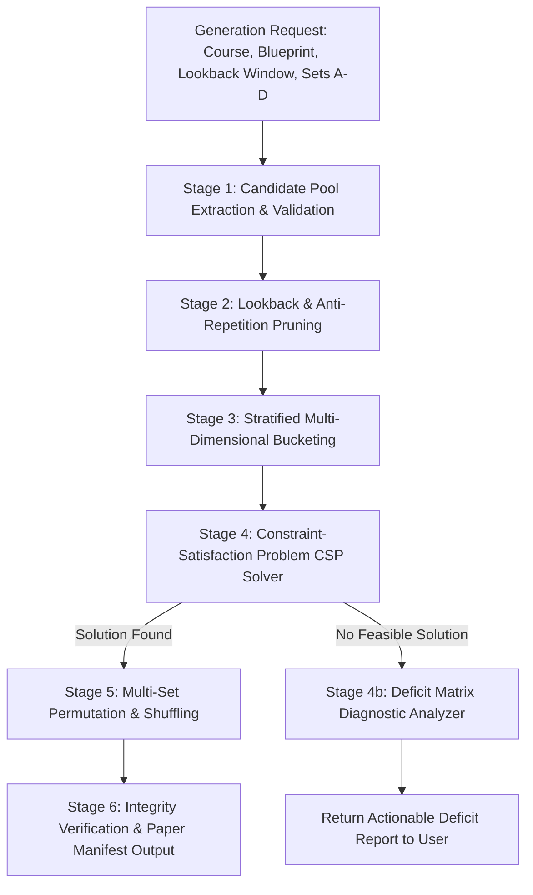

# Question Paper Generation Engine: Algorithmic Specification

## Purpose
This document specifies the algorithmic architecture, mathematical formulation, constraint satisfaction models, balancing heuristics, and diagnostic engines for the **University Question Paper Management & Generation System**.

## Scope
Covers the core synthesis pipeline: candidate pool extraction, lookback anti-repetition filtering, constraint satisfaction problem (CSP) solver, multi-unit balancing, difficulty distribution, and multi-set generation.

---

## 1. Algorithmic Pipeline Architecture

The paper generation engine operates as a multi-stage sequential pipeline:



---

## 2. Mathematical Formulation as a Multi-Constrained Optimization Problem

Let $Q = \{q_1, q_2, \dots, q_N\}$ be the eligible candidate questions for Course $C$.
Each question $q_i$ has attributes:
- Marks $m_i \in \mathbb{N}^+$
- Syllabus Unit $u_i \in \{1, 2, \dots, U\}$
- Difficulty Level $d_i \in \{\text{Easy}, \text{Medium}, \text{Hard}\}$
- Bloom Level $b_i \in \{L_1, L_2, \dots, L_6\}$
- Question Type $t_i \in \{\text{mcq}, \text{short}, \text{long}, \dots\}$

Let $x_i \in \{0, 1\}$ be the binary decision variable indicating whether question $q_i$ is selected for the paper.

### 2.1 The Hard Constraints (Mandatory Invariants)

1. **Total Marks Constraint:**
   $$\sum_{i=1}^{N} x_i \cdot m_i = M_{\text{target}}$$
2. **Sectional Count & Typology Constraints:**
   For each section $s \in S$, let $T_s$ be the required question type, $K_s$ be the question count, and $W_s$ be the mark per question:
   $$\sum_{i \in Q \mid t_i = T_s \land m_i = W_s} x_i = K_s$$
3. **No Duplicate Question Roots (Zero Re-use within same paper):**
   For each question root $R$, at most one version may appear:
   $$\sum_{i \in Q \mid \text{root}(q_i) = R} x_i \le 1$$
4. **Lookback Exclusion Constraint:**
   Let $H_{\text{lookback}}$ be the set of question version IDs used in approved papers for Course $C$ within the last $Y$ academic years (e.g., $Y = 3$ years):
   $$x_i = 0 \quad \forall i \in H_{\text{lookback}}$$

### 2.2 The Soft Constraints (Balanced Distribution Objectives)

1. **Syllabus Unit Balancing (Requirement #27: Never all from one unit!):**
   Let $U$ be the number of active syllabus units. The target mark allocation per unit is:
   $$M_{\text{unit}}^{\text{target}} = \frac{M_{\text{target}}}{U}$$
   The solver minimizes the variance across unit allocations:
   $$\min \sum_{u=1}^{U} \left| \sum_{i \in Q \mid u_i = u} (x_i \cdot m_i) - M_{\text{unit}}^{\text{target}} \right|$$
2. **Target Difficulty Distribution:**
   Given target percentages $(P_{\text{Easy}}, P_{\text{Medium}}, P_{\text{Hard}})$ summing to 100%:
   $$\text{Minimize} \quad \left| \frac{\sum_{\text{Easy}} x_i m_i}{M_{\text{target}}} - P_{\text{Easy}} \right| + \left| \frac{\sum_{\text{Medium}} x_i m_i}{M_{\text{target}}} - P_{\text{Medium}} \right| + \left| \frac{\sum_{\text{Hard}} x_i m_i}{M_{\text{target}}} - P_{\text{Hard}} \right|$$
   Tolerance threshold: $\pm 5\%$.

---

## 3. Backtracking Solver with Forward Checking & Heuristics

The solver employs recursive backtracking with:
1. **Most Constrained Variable (MCV) First:** Sections with the fewest eligible candidate questions in the bank are filled first.
2. **Least Constraining Value (LCV):** Within a bucket, prioritize questions whose selection leaves the maximum diversity of units for subsequent sections.
3. **Forward Checking:** After each question assignment, the solver validates whether remaining unassigned units can still reach their minimum required weightage. If not, the branch is immediately pruned.

---

## 4. Multi-Set Permutations (Sets A, B, C, D)

When generating multiple examination sets (Requirement #31):
- **Set Equivalence:** All sets share identical blueprint sectional structures, total marks, time duration, and difficulty ratings.
- **Permutation Strategy:**
  1. *Section-Preserving Question Shuffling:* Within each section, question positions are randomly permuted using the cryptographically secure Fisher-Yates algorithm.
  2. *MCQ Option Key Permutation:* For single-choice MCQs, option positions are permuted and the corresponding answer key is updated dynamically (e.g., Option A in Set A becomes Option C in Set B).

---

## 5. Pool Insufficiency Diagnostics (Requirement #29)

If the solver proves that no combination of questions can satisfy the blueprint constraints, it terminates gracefully in $< 500$ ms and generates an actionable **Deficit Matrix**:

```json
{
  "status": "INSUFFICIENT_POOL",
  "message": "Not enough approved questions available to satisfy blueprint.",
  "deficitSummary": [
    {
      "unit": 4,
      "unitName": "Unit 4 — Trees & Binary Search Trees",
      "questionType": "long",
      "marks": 5,
      "difficulty": "Hard",
      "availableCount": 1,
      "requiredMinimum": 3,
      "shortfall": 2
    }
  ],
  "recommendation": "Add 2 more Hard Long Answer questions in Unit 4 or relax difficulty constraints."
}
```

This diagnostic payload is consumed by the frontend to render the exact alert shown in [PaperGeneratorWizard.tsx](file:///home/mohammad-ali/Projects/mj_question_paper_genrator/src/components/papers/PaperGeneratorWizard.tsx#L340-L365).

---

## Current State vs. Proposed State

* **Current State:** A simple client-side array filter simulating paper generation with static mock data. No real backtracking algorithm, no multi-set orthogonal permutation, and no true lookback anti-repetition calculations.
* **Proposed State:** A production-grade server-side CSP backtracking engine with forward checking, mathematical unit balancing, configurable 1-5 year lookback exclusion, and automated deficit diagnostics.

## Decisions
1. Execute the paper generation engine server-side in isolated compute workers to prevent browser thread freeze.
2. Provide explicit deficit matrices whenever generation fails so faculty know exactly what questions must be authored to succeed.

## Open Questions
- None.

## Related Documents
- [PAPER_BLUEPRINT.md](file:///home/mohammad-ali/Projects/mj_question_paper_genrator/docs/PAPER_BLUEPRINT.md)
- [QUESTION_PAPER_LIFECYCLE.md](file:///home/mohammad-ali/Projects/mj_question_paper_genrator/docs/QUESTION_PAPER_LIFECYCLE.md)
- [ADR-008-question-generation-strategy.md](file:///home/mohammad-ali/Projects/mj_question_paper_genrator/docs/adr/ADR-008-question-generation-strategy.md)
