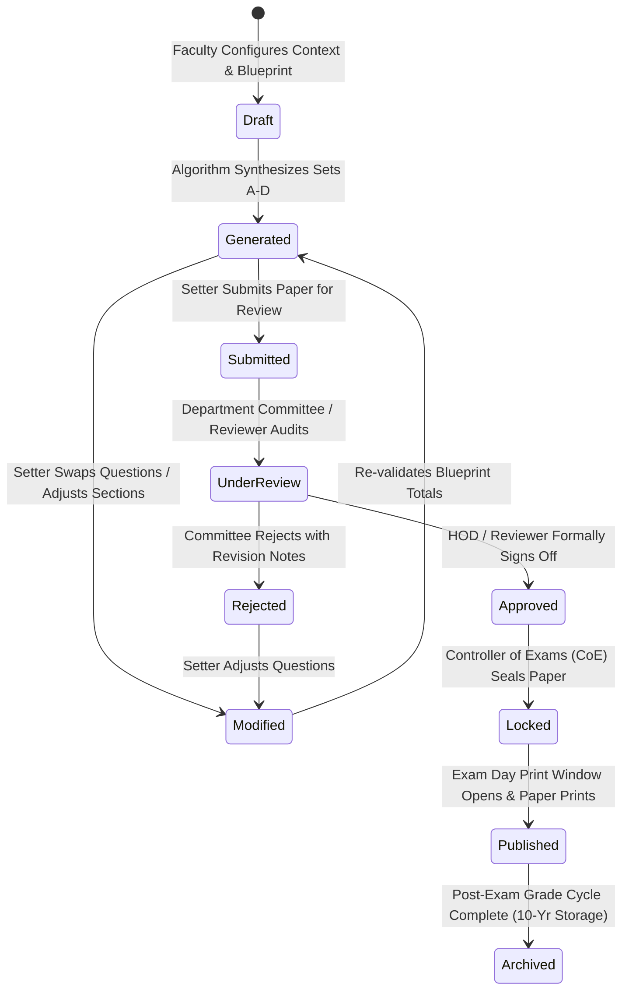

# Question Paper Lifecycle & Secrecy Custody: QPMS

## Purpose
This document specifies the complete operational lifecycle, state transitions, moderation flows, custody transfer protocols, and locking mechanisms for Question Papers in the **University Question Paper Management & Generation System**.

## Scope
Covers the paper lifecycle from initial Blueprint configuration to Draft compilation, Departmental Review, Approval, Secrecy Vault Locking, Examination Session Distribution, and Historical Archival.

---

## 1. Complete Question Paper State Machine

---

## 2. Transition Guard Conditions & Custody Protocols

| State Transition | Triggering Action | Permitted Roles | Required Conditions & Security Guards |
| :--- | :--- | :--- | :--- |
| `Draft` $\rightarrow$ `Generated` | Execute Generator | `teacher`, `hod`, `coordinator` | Blueprint marks equal target marks; candidate question pool is sufficient. |
| `Generated` $\rightarrow$ `Submitted`| Submit for Review | Original Author (`teacher`) | All sections filled; total marks match target; no duplicate questions present. |
| `Submitted` $\rightarrow$ `Approved` | Formally Approve Paper | `hod`, `inst_admin` | HOD signs off on syllabus coverage, unit balance, and difficulty calibration. |
| `Submitted` $\rightarrow$ `Rejected` | Return with Remarks | `hod`, `reviewer` | Mandatory remarks explaining reasons for rejection (e.g., "Unit 2 questions too hard"). |
| `Approved` $\rightarrow$ `Locked` | Seal Paper Custody | `exam_cell` (CoE) | Generates immutable `paper_snapshots` JSON manifest; computes SHA-256 hash; encrypts payload with Master Examination Key (MEK). |
| `Locked` $\rightarrow$ `Published`| Decrypt & Print | `print_officer`, `exam_cell` | Valid only within configured print window ($\le 2$ hours before exam start time); injects dynamic forensic watermark. |
| `Published` $\rightarrow$ `Archived`| Archive Paper | System / `exam_cell` | Exam session concluded; marks recorded; paper moved to cold read-only storage. |

---

## 3. Paper Secrecy & Vault Locking Mechanics

### 3.1 The "Locked" Security Barrier
The transition to `LOCKED` represents the primary security firewall in the QPMS:
1. **Content Evacuation from Cache:** The rendered HTML/text of the paper is immediately flushed from Redis and memory caches.
2. **Payload Envelope Encryption:**
   $$\text{Ciphertext} = \text{AES-256-GCM}(\text{PaperSnapshotJSON}, \text{DEK})$$
   $$\text{EncryptedDEK} = \text{KMS-Encrypt}(\text{DEK}, \text{MasterExamKey})$$
3. **Revocation of Academic Access:** The faculty author, reviewer, and HOD can no longer preview the paper text in the UI. The dashboard displays status badge: `SEALED IN COE CUSTODY`.
4. **Time-Locked Decryption Window:**
   - The API strictly blocks decryption until the server clock reaches:
     $$\text{CurrentTime} \ge \text{ExamStartTime} - \text{DecryptionLeadTime (e.g., 120 minutes)}$$

---

## 4. Paper Duplication & Revision (Cloning Drafts)

If an approved or archived paper needs to be adapted for a supplementary examination or subsequent academic year:
1. The user selects **"Duplicate as New Draft"** (as implemented in [DuplicatePaperModal.tsx](file:///home/mohammad-ali/Projects/mj_question_paper_genrator/src/components/history/DuplicatePaperModal.tsx)).
2. The system creates an entirely new `question_papers` record with a distinct ID (e.g., `QP-2026-089`), status `draft`, and the new academic year.
3. The original historic paper remains 100% frozen and untouched.

---

## Current State vs. Proposed State

* **Current State:** Basic status strings in `src/mock/previousPaperData.ts` and in-memory updates in `src/services/paperService.ts`. No cryptographic locking, no time-gated decryption windows, and no CoE vault security.
* **Proposed State:** A hardened state machine backed by relational integrity triggers, envelope encryption, time-locked decryption APIs, and cryptographic custody handover.

## Decisions
1. Enforce time-gated decryption windows on all locked papers to prevent pre-exam leaks.
2. Ensure that cloning an existing paper always generates a new draft with a fresh operational ID.

## Open Questions
- None.

## Related Documents
- [QUESTION_PAPER_GENERATION.md](file:///home/mohammad-ali/Projects/mj_question_paper_genrator/docs/QUESTION_PAPER_GENERATION.md)
- [SECURITY.md](file:///home/mohammad-ali/Projects/mj_question_paper_genrator/docs/SECURITY.md)
- [ADR-004-question-paper-versioning-strategy.md](file:///home/mohammad-ali/Projects/mj_question_paper_genrator/docs/adr/ADR-004-question-paper-versioning-strategy.md)
