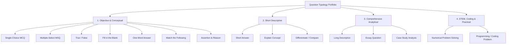

# Question Typology & Schema Specification: QPMS

## Purpose
This document provides the exhaustive specification for all 15 question types supported within the **University Question Paper Management & Generation System**, including schema definitions, validation rules, rendering guidelines, and evaluation rubrics.

## Scope
Covers all supported question formats across objective, descriptive, analytical, mathematical, and practical/programming domains.

---

## 1. Supported Question Typology Overview



---

## 2. Detailed Schema & Validation Rules per Type

### 2.1 Single-Choice Multiple Choice Question (`mcq`)
- **Description:** Stem with 4 or 5 mutually exclusive choices; exactly one correct answer.
- **Marks Range:** 1 to 2 Marks.
- **JSON Options Schema:**
  ```json
  [
    { "key": "A", "text": "FIFO Queue" },
    { "key": "B", "text": "LIFO Stack" },
    { "key": "C", "text": "Binary Min-Heap" },
    { "key": "D", "text": "B-Tree" }
  ]
  ```
- **Validation Rule:** Must contain at least 2 and at most 5 options. `correct_option` must match a valid option key.

### 2.2 Multiple-Select Question (`msq`)
- **Description:** Stem with multiple correct answers; candidate must select all applicable items.
- **Marks Range:** 2 to 4 Marks.
- **Validation Rule:** `correct_options` array containing two or more valid keys. Supports partial marking configuration.

### 2.3 True / False (`true_false`)
- **Description:** Declarative statement evaluated as strictly True or False.
- **Marks Range:** 1 Mark.
- **Validation Rule:** `correct_option` must be strictly `"TRUE"` or `"FALSE"`.

### 2.4 Fill in the Blank (`fill_blank`)
- **Description:** Sentence with one or more blanks represented as `[blank1]`, `[blank2]`.
- **Marks Range:** 1 to 2 Marks per blank.
- **Validation Rule:** Number of entries in `accepted_answers` array must equal number of blanks in text.

### 2.5 Short Answer (`short`)
- **Description:** Brief technical definition, property list, or 2-3 sentence concept explanation.
- **Marks Range:** 2 to 3 Marks.
- **Answer Key:** Bulleted rubric indicating key technical terms required for full marks.

### 2.6 Long Descriptive (`long`)
- **Description:** Detailed architectural description, multi-step derivation, or comprehensive explanation.
- **Marks Range:** 5 to 8 Marks.
- **Answer Key:** Detailed model response and step-by-step mark distribution rubric.

### 2.7 Numerical Problem Solving (`numerical`)
- **Description:** Quantitative problem requiring mathematical calculations, formula application, and units.
- **Marks Range:** 4 to 10 Marks.
- **Validation Schema:**
  ```json
  {
    "target_value": 42.5,
    "tolerance_percent": 2.0,
    "unit": "kHz",
    "step_rubric": [
      { "step": "Formula identification", "marks": 2 },
      { "step": "Substitution", "marks": 2 },
      { "step": "Final answer with unit", "marks": 1 }
    ]
  }
  ```

### 2.8 Coding / Programming Problem (`coding`)
- **Description:** Algorithmic programming task specifying inputs, outputs, constraints, and edge cases.
- **Marks Range:** 5 to 15 Marks.
- **Metadata:** Target programming language (e.g., C, C++, Java, Python), test cases (visible and hidden), time/space complexity constraints.

### 2.9 Case Study Analysis (`case_study`)
- **Description:** Scenario narrative followed by 2 to 4 multi-part sub-questions evaluating analytical judgment.
- **Marks Range:** 10 to 20 Marks.
- **Validation Rule:** Sub-questions must have explicit mark breakdown summing to total question marks.

### 2.10 Match the Following (`match_following`)
- **Description:** Two parallel columns (Column I and Column II) to be paired correctly.
- **Marks Range:** 3 to 5 Marks.
- **JSON Schema:**
  ```json
  {
    "column_left": [
      { "id": "1", "text": "Quick Sort" },
      { "id": "2", "text": "Dijkstra Algorithm" }
    ],
    "column_right": [
      { "id": "A", "text": "Shortest Path" },
      { "id": "B", "text": "Divide and Conquer" }
    ],
    "correct_pairs": { "1": "B", "2": "A" }
  }
  ```

### 2.11 Assertion & Reason (`assertion_reason`)
- **Description:** An Assertion statement (A) paired with a Reason statement (R), evaluating logical correlation.
- **Marks Range:** 1 to 2 Marks.
- **Standard Options:**
  - A: Both A and R are true, and R is the correct explanation of A.
  - B: Both A and R are true, but R is not the correct explanation of A.
  - C: A is true, but R is false.
  - D: A is false, but R is true.

---

## Current State vs. Proposed State

* **Current State:** The prototype type union in `src/types/index.ts` lists several question type strings (`mcq`, `short`, `long`, `essay`), but only basic MCQs and Short Answers are actually rendered or validated in UI components.
* **Proposed State:** Comprehensive 15-type portfolio with strict JSON schema definitions, KaTeX mathematical formatting, multi-column matching grids, and step-by-step marking rubrics.

## Decisions
1. Store type-specific structured data (options, match columns, test cases) in a standardized PostgreSQL JSONB column (`options`) to preserve relational normalization while allowing rich polymorphism.
2. Provide step-by-step marking rubrics for all questions carrying $\ge 5$ marks to assist external evaluators.

## Open Questions
- None.

## Related Documents
- [QUESTION_BANK.md](file:///home/mohammad-ali/Projects/mj_question_paper_genrator/docs/QUESTION_BANK.md)
- [QUESTION_PAPER_GENERATION.md](file:///home/mohammad-ali/Projects/mj_question_paper_genrator/docs/QUESTION_PAPER_GENERATION.md)
- [PAPER_BLUEPRINT.md](file:///home/mohammad-ali/Projects/mj_question_paper_genrator/docs/PAPER_BLUEPRINT.md)
