# Requirements Master Specification: QPMS

## Purpose
This document establishes the master requirements baseline, classification system, prioritization methodology, and traceability governance for the **Question Paper Management & Generation System**.

## Scope
This specification encompasses all business requirements, functional modules (FR-01 to FR-12), non-functional requirements (NFR-01 to NFR-10), architectural constraints, and compliance mandates.

---

## 1. Requirements Classification Framework

Requirements in the QPMS are classified into distinct structural categories to ensure complete lifecycle coverage:

```mermaid
graph TD
    REQ[Master Requirements Baseline]
    REQ --> FR[Functional Requirements - FR]
    REQ --> NFR[Non-Functional Requirements - NFR]
    REQ --> SEC[Security & Confidentiality - SEC]
    REQ --> ACAD[Academic & Pedagogical - PED]
    REQ --> COMP[Statutory & Compliance - COM]

    FR --> FR_ORG[FR-01: Organization & Multi-Tenancy]
    FR --> FR_ACAD[FR-02: Academic Hierarchy & Curriculum]
    FR --> FR_USER[FR-03: User Identity & Dept Resolution]
    FR --> FR_BANK[FR-04: Question Bank Management]
    FR --> FR_QLIFE[FR-05: Question Review & Approval]
    FR --> FR_BLUE[FR-06: Paper Blueprint Configuration]
    FR --> FR_GEN[FR-07: Algorithmic Generation Engine]
    FR --> FR_SETS[FR-08: Multi-Set Permutations]
    FR --> FR_PLIFE[FR-09: Paper Lifecycle & Locking]
    FR --> FR_EXAM[FR-10: Exam Administration]
    FR --> FR_PRINT[FR-11: Secure PDF & Print Engine]
    FR --> FR_AUDIT[FR-12: Audit & Tamper Traceability]
```



### Prioritization Methodology: MoSCoW
Each requirement is evaluated using the industry-standard MoSCoW prioritization model:
- **Must Have (M):** Mandatory for system integrity, legal exam validity, confidentiality, or baseline operation.
- **Should Have (S):** Critical feature expected in production, but workarounds exist for initial alpha pilot.
- **Could Have (C):** High-value enhancement implemented if time and resources permit.
- **Won't Have This Release (W):** Explicitly deferred to future phases (e.g., AI auto-grading).

---

## 2. Master Requirements Summary Matrix

| Req ID | Module / Category | Requirement Title | Priority | Core Business Driver |
| :--- | :--- | :--- | :--- | :--- |
| **REQ-ORG-01** | Multi-Tenancy | Multi-Institution Isolation & Federation | **Must** | Prevent data leaks between independent universities/colleges. |
| **REQ-ACAD-01** | Academic Structure | Extensible Academic Hierarchy | **Must** | Accommodate diverse university faculty/dept/course topologies. |
| **REQ-ACAD-02** | Curriculum | Versioned Curriculum & Syllabus Tracking | **Must** | Handle curriculum revision cycles (e.g., 2022 vs 2025 scheme). |
| **REQ-USER-01** | Identity & Access | Multi-Department Membership & Scope Resolution | **Must** | Support faculty teaching across multiple departments. |
| **REQ-USER-02** | Authorization | Fine-Grained Role-Based Access Control (RBAC) | **Must** | Strict role boundaries (Setter, Reviewer, HOD, CoE). |
| **REQ-QBNK-01** | Question Bank | Comprehensive Question Typology (14+ Types) | **Must** | Support MCQs, Short, Long, Numerical, Coding, and Case Studies. |
| **REQ-QBNK-02** | Question Bank | Rich Formatting, LaTeX Math, and Diagrams | **Must** | STEM questions requiring equations and circuit/graph diagrams. |
| **REQ-QBNK-03** | Pedagogical | Bloom's Taxonomy & Course Outcome Mapping | **Should** | Accreditation compliance (NBA/NAAC outcome attainment). |
| **REQ-QBNK-04** | Multilingual | Multilingual Variants & Translation Pairing | **Should** | Regional language examinations (Gujarati, Hindi, Urdu). |
| **REQ-QLIFE-01**| Lifecycle | Immutable Question Versioning | **Must** | Approved questions cannot be mutated in place; create vN+1. |
| **REQ-QLIFE-02**| Workflow | Multi-Tier Review, Rejection & Moderation | **Must** | Formal peer review and department approval workflow. |
| **REQ-PGEN-01** | Paper Engine | Visual Blueprint with Dynamic Marks Balancing | **Must** | Sectional division, question count, and marks validation. |
| **REQ-PGEN-02** | Paper Engine | Syllabus Unit & Module Balanced Coverage | **Must** | Ensure questions are distributed across all selected units. |
| **REQ-PGEN-03** | Paper Engine | Previous Paper Lookback & Anti-Repetition | **Must** | Exclude questions used in last 1 to 5 academic years. |
| **REQ-PGEN-04** | Paper Engine | Multi-Set Permutations (Sets A, B, C, D) | **Must** | Identical difficulty/blueprint with permuted items. |
| **REQ-PLIFE-01**| Lifecycle | Paper Locking, Confidentiality & Handover | **Must** | Lock papers post-approval; restrict decryption to CoE. |
| **REQ-EXAM-01** | Exam Admin | Examination Session & Paper Code Tracking | **Should** | Bind papers to official dates, sessions, and center quotas. |
| **REQ-PDF-01**  | Export | High-Contrast Academic Standard PDF Generation | **Must** | Clean typography, university crest, page numbering. |
| **REQ-PDF-02**  | Security | Dynamic Watermarking & Anti-Tamper Barcode | **Must** | Print tracking with actor name, timestamp, and verification hash. |
| **REQ-AUDIT-01**| Compliance | Forensic Audit Trail of All Paper Accesses | **Must** | Immutable logging of every preview, download, and print action. |

---

## 3. Requirements Traceability Framework

To guarantee that no requirement is lost during technical implementation, every feature must maintain unbroken end-to-end traceability across all engineering artifacts:

```text
Business Requirement (REQ-xxx)
       ↓
Functional Requirement (FR-xxx)
       ↓
Database Entity / DDL (Table + Constraints)
       ↓
Backend API Route (/api/v1/...)
       ↓
Frontend Screen / Component (View / Modal)
       ↓
Automated Test Suite (Unit + Integration Test)
```

Detailed mapping tables connecting each requirement to its concrete code and test artifacts are maintained in [IMPLEMENTATION_PLAN.md](file:///home/mohammad-ali/Projects/mj_question_paper_genrator/docs/IMPLEMENTATION_PLAN.md).

---

## Current State vs. Proposed State

* **Current State:** Requirements were partially expressed in code comments and prototype UI behaviors (e.g., "Requirement #6", "Requirement #10", "Requirement #30"). There was no centralized requirements specification or formal traceability.
* **Proposed State:** A formal, indexed requirements baseline with strict MoSCoW prioritization, architectural constraints, and traceability across domain models, database tables, API contracts, UI screens, and test plans.

## Decisions
1. Adopt the MoSCoW classification scheme across all requirements.
2. Require every new pull request to cite a corresponding `REQ-xxx` or backlog item `TICK-xxx`.

## Open Questions
* Are student-facing mock tests within scope for subsequent releases, or is the platform exclusively dedicated to high-stakes institutional exam generation? (Refer to [OPEN_QUESTIONS.md](file:///home/mohammad-ali/Projects/mj_question_paper_genrator/docs/OPEN_QUESTIONS.md) Q2).

## Related Documents
- [FUNCTIONAL_REQUIREMENTS.md](file:///home/mohammad-ali/Projects/mj_question_paper_genrator/docs/FUNCTIONAL_REQUIREMENTS.md)
- [NON_FUNCTIONAL_REQUIREMENTS.md](file:///home/mohammad-ali/Projects/mj_question_paper_genrator/docs/NON_FUNCTIONAL_REQUIREMENTS.md)
- [IMPLEMENTATION_PLAN.md](file:///home/mohammad-ali/Projects/mj_question_paper_genrator/docs/IMPLEMENTATION_PLAN.md)
