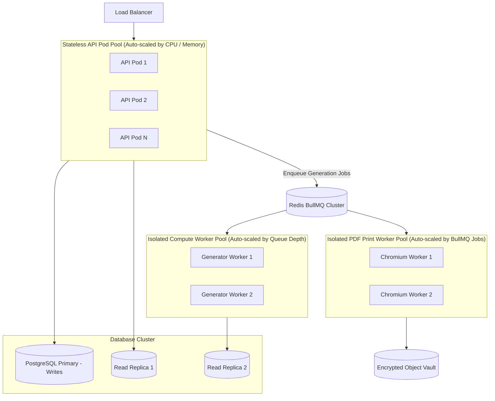

# Scalability & Multi-University Capacity Planning: QPMS

## Purpose
This document specifies the horizontal and vertical scaling architecture, multi-tenant partitioning strategies, database sharding limits, and long-term archival capacity planning for the **University Question Paper Management & Generation System**.

## Scope
Covers growth projections for multi-university systems supporting 50+ affiliated colleges, 500+ departments, 1,000+ concurrent exam setters, 500,000+ question bank items, and 10-year historical archives.

---

## 1. Scale-Out Architecture & Workload Decoupling

---

## 2. Capacity Projections (5-Year Growth Model)

| Dimension / Metric | Year 1 Baseline (Pilot) | Year 3 Expansion | Year 5 Enterprise Scale |
| :--- | :--- | :--- | :--- |
| **Affiliated Institutions / Colleges** | 5 Institutions | 20 Institutions | 50+ Institutions |
| **Academic Departments** | 40 Departments | 180 Departments | 500+ Departments |
| **Faculty & Examination Users** | 300 Users | 2,500 Users | 10,000+ Users |
| **Active Courses / Subjects** | 200 Courses | 1,200 Courses | 4,000+ Courses |
| **Question Bank Repository Size** | 25,000 Questions | 150,000 Questions | 500,000+ Questions |
| **Generated Examination Papers** | 1,000 Papers / Year | 10,000 Papers / Year | 50,000+ Papers / Year |
| **Relational DB Storage Volume** | ~10 GB | ~60 GB | ~250 GB |
| **Encrypted PDF / Asset Storage**| ~50 GB | ~350 GB | ~1.5 TB |

---

## 3. Database Scaling & Sharding Strategies

### Phase 1: Shared Database with Row-Level Security (Current - Up to 50 Institutions)
- Single multi-AZ PostgreSQL primary with 2 read replicas.
- Kernel-enforced Row-Level Security on `institution_id`.
- Total database size remains comfortably below 500 GB, easily managed by modern cloud RDS / on-premise NVMe hardware.

### Phase 2: Horizontal Read Scaling with CQRS (50 to 150 Institutions)
- Separate Read operations from Write operations via dedicated read replicas.
- ElasticSearch / Meilisearch cluster introduced for multi-lingual full-text question bank discovery.

### Phase 3: Tenant Sharding / Citus Distributed Database (150+ Institutions)
- Sharding by `institution_id` using Citus or CockroachDB if scaling across multiple state university boards simultaneously.

---

## 4. Archival & Cold Storage Tiering (10-Year Statutory Compliance)

To prevent database bloat while maintaining strict 10-year accreditation compliance:
1. **Active Hot Tier (Current & Previous 2 Academic Years):**
   - Stored in primary PostgreSQL tables. Instant sub-second retrieval for lookback avoidance and duplicate checks.
2. **Warm Tier (Years 3 to 5):**
   - Retained in PostgreSQL partitioned tables.
3. **Cold Archival Tier (Years 6 to 10+):**
   - Question papers, snapshots, and audit log partitions older than 5 years are exported to compressed, read-only Parquet / JSON formats and transferred to encrypted AWS S3 Glacier / MinIO with WORM compliance locking.
   - Retrievable via Athena / ClickHouse within 15 minutes for accreditation audits.

---

## Current State vs. Proposed State

* **Current State:** The client prototype stores all data in browser memory. Browser `localStorage` has a strict 5 MB quota, making it incapable of storing more than ~50 questions or ~20 papers before failing.
* **Proposed State:** A horizontally scalable enterprise cloud/hybrid architecture supporting up to 50 institutions, 500,000+ questions, auto-scaled compute worker pools, and 10-year WORM archival tiering.

## Decisions
1. Decouple memory-intensive Chromium PDF workers into a separate auto-scaling pool driven by Redis queue depth.
2. Enforce 3-tier storage (Hot, Warm, Cold) to preserve query performance across a decade of historical records.

## Open Questions
- None.

## Related Documents
- [PERFORMANCE.md](file:///home/mohammad-ali/Projects/mj_question_paper_genrator/docs/PERFORMANCE.md)
- [DEPLOYMENT.md](file:///home/mohammad-ali/Projects/mj_question_paper_genrator/docs/DEPLOYMENT.md)
- [AUDIT_LOGGING.md](file:///home/mohammad-ali/Projects/mj_question_paper_genrator/docs/AUDIT_LOGGING.md)
