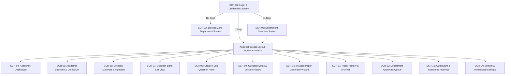

# Comprehensive Screen Map & Navigation Flows: QPMS

## Purpose
This document provides the exhaustive screen inventory, route mappings, view hierarchies, modal interactions, and permission-aware visibility rules for the **University Question Paper Management & Generation System**.

## Scope
Covers all user-facing views in the web application across Authentication, Administration, Academic Structure, Question Bank, Paper Generator, Paper History, Approvals, Reports, and Settings.

---

## 1. Application Screen Hierarchy

---

## 2. Complete Screen Inventory

### 2.1 Authentication & Gateways
| Screen ID | Screen Title | Route Path | File Implementation | Access Scope |
| :--- | :--- | :--- | :--- | :--- |
| **SCR-01** | User Authentication | `/login` | [LoginPage.tsx](file:///home/mohammad-ali/Projects/mj_question_paper_genrator/src/components/auth/LoginPage.tsx) | Public |
| **SCR-02** | Zero Department Blocked | `/no-department` | [NoDepartmentPage.tsx](file:///home/mohammad-ali/Projects/mj_question_paper_genrator/src/components/auth/NoDepartmentPage.tsx) | Auth (0 Depts) |
| **SCR-03** | Active Department Selector | `/select-department` | [SelectDepartmentPage.tsx](file:///home/mohammad-ali/Projects/mj_question_paper_genrator/src/components/auth/SelectDepartmentPage.tsx) | Auth (>1 Depts)|

### 2.2 Academic & Curriculum Management
| Screen ID | Screen Title | Route Path | File Implementation | Access Scope |
| :--- | :--- | :--- | :--- | :--- |
| **SCR-04** | Academic Executive Dashboard | `/dashboard` | [DashboardView.tsx](file:///home/mohammad-ali/Projects/mj_question_paper_genrator/src/components/dashboard/DashboardView.tsx) | All Active Users |
| **SCR-05** | Academic Hierarchy Manager | `/academic` | [AcademicStructureView.tsx](file:///home/mohammad-ali/Projects/mj_question_paper_genrator/src/components/academic/AcademicStructureView.tsx) | HOD, Admins |
| **SCR-06** | Syllabus Materials Ingestion | `/materials` | [MaterialsView.tsx](file:///home/mohammad-ali/Projects/mj_question_paper_genrator/src/components/materials/MaterialsView.tsx) | Teachers, HOD |

### 2.3 Question Bank Management
| Screen ID | Screen Title | Route Path | File Implementation | Access Scope |
| :--- | :--- | :--- | :--- | :--- |
| **SCR-07** | Question Bank Repository | `/questions` | [QuestionBankView.tsx](file:///home/mohammad-ali/Projects/mj_question_paper_genrator/src/components/questionBank/QuestionBankView.tsx) | Teachers, Reviewers, HOD |
| **SCR-08** | Question Authoring & Edit | `/questions/create`, `/questions/:id/edit` | [QuestionEditForm.tsx](file:///home/mohammad-ali/Projects/mj_question_paper_genrator/src/components/questionBank/QuestionEditForm.tsx) | Teachers, HOD |
| **SCR-09** | Question Inspection & Audit | `/questions/:id` | [QuestionDetailsView.tsx](file:///home/mohammad-ali/Projects/mj_question_paper_genrator/src/components/questionBank/QuestionDetailsView.tsx) | Teachers, Reviewers, HOD |

### 2.4 Question Paper Synthesis & Administration
| Screen ID | Screen Title | Route Path | File Implementation | Access Scope |
| :--- | :--- | :--- | :--- | :--- |
| **SCR-10** | Paper Generation Wizard | `/generator` | [PaperGeneratorWizard.tsx](file:///home/mohammad-ali/Projects/mj_question_paper_genrator/src/components/papers/PaperGeneratorWizard.tsx) | Teachers, HOD, CoE |
| **SCR-11** | Paper History & Archives | `/history` | [PaperHistoryView.tsx](file:///home/mohammad-ali/Projects/mj_question_paper_genrator/src/components/history/PaperHistoryView.tsx) | Teachers, HOD, CoE, Auditor |
| **SCR-12** | Moderation & Approvals Queue | `/approvals` | [ApprovalsView.tsx](file:///home/mohammad-ali/Projects/mj_question_paper_genrator/src/components/approvals/ApprovalsView.tsx) | Reviewers, HOD, CoE |
| **SCR-13** | Curriculum & Outcome Reports | `/reports` | [ReportsView.tsx](file:///home/mohammad-ali/Projects/mj_question_paper_genrator/src/components/reports/ReportsView.tsx) | HOD, Admins, Auditor |
| **SCR-14** | System & Institution Settings| `/settings` | [SettingsView.tsx](file:///home/mohammad-ali/Projects/mj_question_paper_genrator/src/components/settings/SettingsView.tsx) | Admins |

---

## 3. Modal Dialogs & Overlay Catalog

1. **[DuplicatePaperModal.tsx](file:///home/mohammad-ali/Projects/mj_question_paper_genrator/src/components/history/DuplicatePaperModal.tsx):**
   - Triggered from Paper History list. Clones an existing historical paper as a new editable draft for an upcoming academic year.
2. **[ReferenceConfirmationModal.tsx](file:///home/mohammad-ali/Projects/mj_question_paper_genrator/src/components/generator/ReferenceConfirmationModal.tsx):**
   - Triggered in the generator wizard. Confirms using an existing paper as a blueprint template.
3. **[PaperPreviewModal.tsx](file:///home/mohammad-ali/Projects/mj_question_paper_genrator/src/components/generator/PaperPreviewModal.tsx):**
   - High-contrast modal displaying the rendered examination paper format with watermark and section breakdowns.
4. **[VersionCompareModal.tsx](file:///home/mohammad-ali/Projects/mj_question_paper_genrator/src/components/questionBank/VersionCompareModal.tsx):**
   - Visual side-by-side diff comparing two version iterations of a question.
5. **[UnsavedChangesModal.tsx](file:///home/mohammad-ali/Projects/mj_question_paper_genrator/src/components/common/UnsavedChangesModal.tsx):**
   - Warns users when attempting to navigate away from an active question authoring form or uncompiled paper wizard.

---

## Current State vs. Proposed State

* **Current State:** Screens are mapped via custom hash changes in `src/App.tsx` and state flags. URL sharing for specific question IDs requires regex matching on hash fragments.
* **Proposed State:** A formal React Router v6 route configuration with parameterized URLs (`/courses/:courseId/questions/:qId`), nested layout outlets, and automated authentication/scope guards.

## Decisions
1. Maintain the current screen inventory and layout structure while migrating the underlying routing mechanism to React Router.
2. Ensure that deep-linking to specific questions or paper previews requires an active session in the correct department scope.

## Open Questions
- None.

## Related Documents
- [FRONTEND_ARCHITECTURE.md](file:///home/mohammad-ali/Projects/mj_question_paper_genrator/docs/FRONTEND_ARCHITECTURE.md)
- [UI_UX_GUIDELINES.md](file:///home/mohammad-ali/Projects/mj_question_paper_genrator/docs/UI_UX_GUIDELINES.md)
- [ROLES_PERMISSIONS.md](file:///home/mohammad-ali/Projects/mj_question_paper_genrator/docs/ROLES_PERMISSIONS.md)
