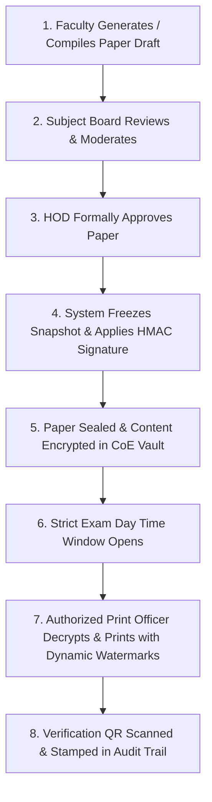

# Security & Confidentiality Architecture: QPMS

## Purpose
This document specifies the security controls, threat models, encryption standards, examination confidentiality protocols, and vulnerability mitigation strategies for the **University Question Paper Management & Generation System**.

## Scope
Covers threat modeling (STRIDE), network security, session defense, data-at-rest encryption, question paper custody handover, secure printing, and disaster recovery.

---

## 1. Threat Modeling (STRIDE Analysis)

| Threat Category | Specific System Vulnerability | Potential Impact | Concrete Engineering Mitigation |
| :--- | :--- | :--- | :--- |
| **Spoofing** | Attacker impersonates HOD to approve compromised questions or generate unauthorized papers. | Examination invalidation, question leakage. | Multi-Factor Authentication (MFA), Argon2id password hashing, and cryptographically verified JWTs. |
| **Tampering** | Rogue user modifies questions or paper contents after official approval. | Compromised exam grading, unfair bias. | Immutable question versions, signed JSON snapshots in `paper_snapshots`, and trigger locks. |
| **Repudiation** | Examiner denies generating or downloading a leaked question paper. | Inability to establish legal liability. | Cryptographically chained audit logs recording user ID, IP address, user-agent, and SHA-256 state hash. |
| **Information Disclosure** | Interception of examination papers in transit or unauthorized database queries by staff. | Mass paper leak, rescheduled exams. | TLS 1.3 in-transit, AES-256 envelope encryption at-rest, PostgreSQL Row-Level Security. |
| **Denial of Service** | Flooding generation endpoint with complex combinatorial constraints during exam morning. | Examination hall delays. | Rate limiting per IP/user (Redis Token Bucket), offloading generation and PDF export to isolated background queues. |
| **Elevation of Privilege** | Faculty member in Department of Physics accesses Computer Science exam papers. | Cross-department leaks. | Scoped RBAC/ABAC guards verifying active department ID against resource ownership on every API call. |

---

## 2. Examination Paper Confidentiality & Custody Handover

The journey of an examination paper from draft compilation to physical hall distribution follows a strict zero-trust cryptographic chain:



### Secrecy Invariants
1. **The Pre-Lock Phase (Academic Work):**
   - Visible only to assigned teachers, designated reviewers, and the departmental HOD.
   - Questions can be swapped or edited.
2. **The Sealed Phase (Institutional Custody):**
   - At `LOCKED` status, the paper payload is encrypted using a Master Examination Key (MEK) managed via AWS KMS / HashiCorp Vault.
   - General faculty access is immediately revoked. The paper cannot be viewed in the UI.
3. **The Decryption / Print Window:**
   - Decryption is permitted only within a configured pre-exam window (e.g., 2 hours prior to the official exam start time).
   - Only users holding the `print_officer` or `exam_cell` role with active MFA authentication can trigger the decrypt-and-print job.

---

## 3. Cryptographic Standards & Key Management

### 3.1 Encryption Hierarchy
- **Transport Security:** TLS 1.3 with forward secrecy (ECDHE-RSA-AES128-GCM-SHA256).
- **Storage Volume Encryption:** AES-256-XTS at the block storage layer.
- **Field-Level Sensitive Payload Encryption:**
  - AES-256-GCM envelope encryption.
  - Data Encryption Key (DEK) generated per examination paper.
  - Key Encryption Key (KEK) stored securely in a Hardware Security Module (HSM) or cloud KMS.
- **Integrity & Checksums:** SHA-256 hash chaining on audit logs and paper manifests.

---

## 4. Web Application Security & OWASP Top 10 Defenses

1. **Injection (SQLi, NoSQLi):**
   - 100% parameterized queries via modern ORM (Prisma / Drizzle / TypeORM / SQLAlchemy). Raw string concatenation in SQL queries is strictly prohibited by CI lint rules.
2. **Cross-Site Scripting (XSS):**
   - Input sanitization via DOMPurify on all rich text, Markdown, and LaTeX prompts.
   - Strict Content Security Policy (CSP):
     ```http
     Content-Security-Policy: default-src 'self'; script-src 'self'; style-src 'self' 'unsafe-inline'; img-src 'self' data: https://cdn.university.edu; font-src 'self'; object-src 'none'; frame-ancestors 'none';
     ```
3. **Cross-Site Request Forgery (CSRF):**
   - Cookies configured with `SameSite=Strict`.
   - Double Submit Cookie or custom `X-CSRF-Token` header verification on all mutating requests (`POST`, `PUT`, `DELETE`).
4. **Broken Access Control:**
   - Multi-tenant Row-Level Security (RLS) policies at the PostgreSQL database kernel level guarantee that application-level authorization bugs cannot leak cross-tenant records.

---

## Current State vs. Proposed State

* **Current State:** The client-side prototype has no encryption at rest, no session timeouts, plain localStorage persistence, no CORS/CSP enforcement, and no zero-trust custody handover.
* **Proposed State:** A defense-in-depth security model featuring envelope encryption for sealed papers, KMS key custody, Row-Level Security, automated forensic watermarking, and OWASP Top 10 hardening.

## Decisions
1. Enforce automated AES-256 encryption on all question papers upon transition to `LOCKED` state.
2. Require dual-authorization (HOD approval + Exam Cell locking) before any paper can be cleared for printing.

## Open Questions
- None.

## Related Documents
- [AUTHENTICATION_AUTHORIZATION.md](file:///home/mohammad-ali/Projects/mj_question_paper_genrator/docs/AUTHENTICATION_AUTHORIZATION.md)
- [ROLES_PERMISSIONS.md](file:///home/mohammad-ali/Projects/mj_question_paper_genrator/docs/ROLES_PERMISSIONS.md)
- [AUDIT_LOGGING.md](file:///home/mohammad-ali/Projects/mj_question_paper_genrator/docs/AUDIT_LOGGING.md)
- [PDF_GENERATION.md](file:///home/mohammad-ali/Projects/mj_question_paper_genrator/docs/PDF_GENERATION.md)
