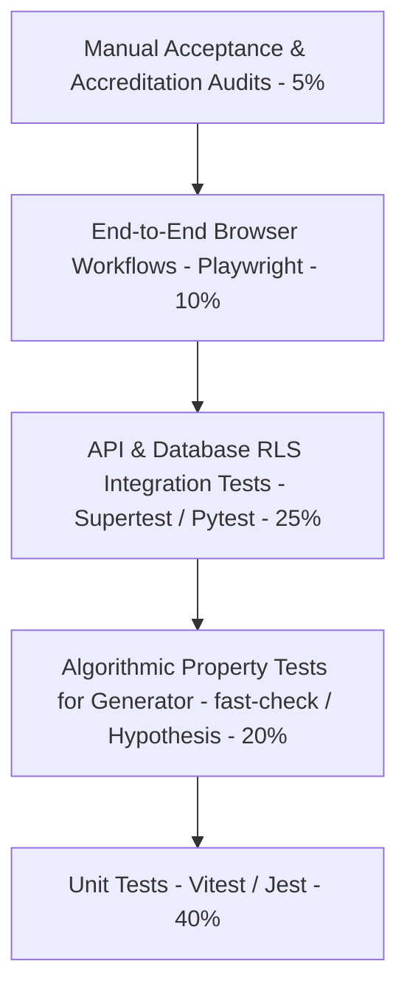

# Quality Assurance & Testing Strategy: QPMS

## Purpose
This document establishes the comprehensive quality assurance, verification, validation, and testing strategy for the **University Question Paper Management & Generation System**.

## Scope
Covers the entire testing pyramid: Unit Testing, Integration Testing, Database Integrity Testing, Algorithmic Property-Based Solver Testing, Security/Penetration Testing, and End-to-End (E2E) Browser Testing.

---

## 1. Testing Pyramid & Verification Layers

---

## 2. Testing Methodologies by Subsystem

### 2.1 Question Paper Generation Correctness (Critical Verification Area)
The paper generator represents the most critical algorithmic component in the system. Standard unit tests with static sample data are insufficient; the engine must undergo **Property-Based Invariant Testing** (using `fast-check` in TypeScript or `Hypothesis` in Python):

1. **Total Marks Invariant Test:**
   *Property:* For any randomly generated blueprint configuration, the sum of marks of all selected questions in every generated set must strictly equal target marks.
2. **Lookback Exclusion Invariant Test:**
   *Property:* For 1,000 randomized generation runs with a 3-year lookback window, zero selected questions may intersect with the set of question IDs in the 3-year history.
3. **Unit Coverage Invariant Test:**
   *Property:* In all successful generation runs where $U$ units are selected, every selected unit must have $\ge 1$ question assigned.
4. **Duplicate Prevention Invariant Test:**
   *Property:* Within any single paper set, no two questions may share the same `question_root_id`.

### 2.2 Security & Authorization Testing
- **Cross-Tenant Attack Simulation:** Automated test attempts by a Tenant A authenticated client to query `/api/v1/questions?institutionId=TenantB`. Expected: strict `403 Forbidden` or empty dataset due to Row-Level Security.
- **Cross-Department Boundary Test:** A teacher in Department of CS attempting to approve or edit a question in Department of EE. Expected: `403 Forbidden`.
- **Secrecy Lock Test:** Verification that once a paper enters `LOCKED` status, standard teacher tokens receive `403 Forbidden` when attempting to fetch question texts.

### 2.3 Database Relational & Migration Testing
- Automated migrations tested against clean PostgreSQL instances using Testcontainers.
- Verification that audit table triggers block `UPDATE` and `DELETE` operations even when executed by database application users.

### 2.4 Frontend End-to-End (E2E) Testing
- **Tool:** Playwright executing across Chromium, Firefox, and WebKit.
- **Scenarios:**
  - Login as Dr. Rahul Patel (1 assigned department) $\rightarrow$ Verify auto-redirect to Dashboard.
  - Login as Prof. Amit Shah (2 assigned departments) $\rightarrow$ Verify prompt to choose department.
  - Login as Dr. Neha Sharma (0 assigned departments) $\rightarrow$ Verify blocked access screen.
  - Full paper generation wizard: Complete Stages 1 to 8 $\rightarrow$ verify compiled preview and history save.

---

## 3. Test Automation & CI/CD Quality Gates

Every pull request must pass strict automated gates before merging:
1. **Linting & Typecheck:** `tsc --noEmit` and `eslint` (0 errors allowed).
2. **Unit & Property Tests:** Minimum **85% code coverage** on core services and generator algorithms.
3. **Integration Tests:** Testcontainers PostgreSQL integration suite with RLS policies enabled.
4. **Security Vulnerability Scan:** `npm audit` / `trivy` with zero critical or high vulnerabilities.

---

## Current State vs. Proposed State

* **Current State:** Zero automated test files exist in the repository (`npm test` is not configured in `package.json`).
* **Proposed State:** A complete testing framework combining Vitest, Supertest, Testcontainers PostgreSQL, fast-check property testing for the generator, and Playwright for E2E user flows.

## Decisions
1. Mandate property-based invariant testing for the paper generation engine to guarantee mathematical correctness across all edge cases.
2. Integrate Testcontainers in the CI pipeline to validate real PostgreSQL Row-Level Security policies against regression.

## Open Questions
- None.

## Related Documents
- [NON_FUNCTIONAL_REQUIREMENTS.md](file:///home/mohammad-ali/Projects/mj_question_paper_genrator/docs/NON_FUNCTIONAL_REQUIREMENTS.md)
- [QUESTION_PAPER_GENERATION.md](file:///home/mohammad-ali/Projects/mj_question_paper_genrator/docs/QUESTION_PAPER_GENERATION.md)
- [DEVOPS.md](file:///home/mohammad-ali/Projects/mj_question_paper_genrator/docs/DEVOPS.md)
