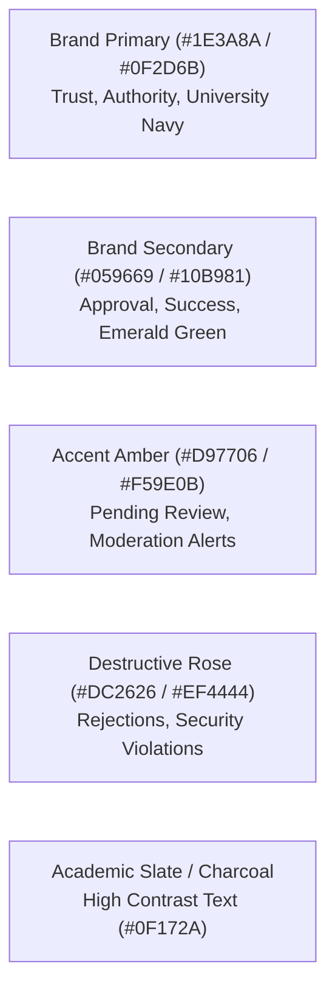

# UI/UX Design System & Accessibility Guidelines: QPMS

## Purpose
This document specifies the design tokens, typography, accessibility mandates, color palettes, responsive layouts, and interaction patterns for the **University Question Paper Management & Generation System**.

## Scope
Applies to all web application components, modals, form controls, data tables, and print preview canvases.

---

## 1. Design Tokens & Color Palette

The QPMS interface employs an authoritative, high-contrast academic palette configured in `tailwind.config.js`:

### Color Token Reference Table
| Token Name | Hex Code | Semantic Role |
| :--- | :--- | :--- |
| `brand-primary` | `#0284c7` / `#0369a1` | Primary action buttons, active navigation indicator, wizard progress. |
| `brand-primary-light` | `#f0f9ff` / `#e0f2fe` | Active card backgrounds, selected stepper rings. |
| `brand-title` | `#0f172a` | High-contrast page headers, table headers, and question prompts. |
| `brand-paragraph` | `#334155` | Supporting descriptions, instructional texts, and modal bodies. |
| `brand-font` | `#64748b` | Muted metadata, timestamps, and secondary labels. |
| `brand-bg-title` | `#f8fafc` | Table header bands, zebra striping, and card headers. |

---

## 2. Typography Hierarchy

The system standardizes on clean sans-serif typography for software controls and high-contrast classic serif typography for printed examination papers:

- **System UI Font:** Inter / System Sans (`ui-sans-serif, system-ui, sans-serif`).
  - H1 Page Title: `text-2xl font-bold tracking-tight text-brand-title`
  - H2 Section Header: `text-lg font-bold text-brand-title`
  - H3 Card Header: `text-sm font-bold text-brand-title`
  - Body Text: `text-xs text-brand-paragraph leading-relaxed`
  - Meta & Labels: `text-[11px] font-semibold text-brand-font uppercase`
- **Printed Examination Paper Font:** Academic Serif (`Cambria, Times New Roman, serif`).
  - Institution Header: `text-xl font-bold uppercase tracking-wider font-serif`
  - Question Prompt: `text-sm font-serif text-slate-900 leading-normal`
  - Marks Indicator: `text-xs font-bold font-sans text-slate-700`

---

## 3. Accessibility Standards (WCAG 2.1 AA)

1. **Color Contrast:** All body text maintains a minimum contrast ratio of **4.5:1** against the background. Headers and large text maintain **3:1**.
2. **Keyboard Navigation:**
   - All interactive elements (buttons, inputs, selects, tabs) possess visible focus rings (`focus:ring-2 focus:ring-brand-primary`).
   - Modal dialogs trap focus and close upon `Escape` keypress.
3. **Screen Reader Accessibility:**
   - Form inputs have associated `<label>` tags with matching `htmlFor` and `id`.
   - Dynamic alert states (e.g., generator insufficiency alerts) utilize `role="alert"` and `aria-live="polite"`.
4. **Touch Target Size:** Interactive controls on mobile/tablet viewports have a minimum target size of $44 \times 44$ pixels.

---

## 4. Component Interaction Guidelines

### 4.1 Data Tables
- Always provide sorting indicators on column headers.
- Implement sticky table headers for long question lists.
- Display clear empty states with actionable buttons when no records match filter criteria.

### 4.2 Stepper Navigation
- In multi-stage wizards (e.g., [PaperGeneratorWizard.tsx](file:///home/mohammad-ali/Projects/mj_question_paper_genrator/src/components/papers/PaperGeneratorWizard.tsx)), previous completed stages must remain clickable for easy backward navigation.
- If a future stage depends on unfulfilled validation in the current stage, visually disable the future step and explain why in an inline tooltip.

### 4.3 Destructive Actions
- Deleting a question, archiving an approved item, or rejecting a submitted paper requires a dedicated **Confirmation Modal** requiring a confirmation click or textual reason input before execution.

---

## Current State vs. Proposed State

* **Current State:** The prototype achieves strong visual aesthetics, but lacks comprehensive keyboard focus trap utilities, screen reader ARIA live tags, and accessible form labels on some custom inputs.
* **Proposed State:** Full WCAG 2.1 Level AA compliance across all components with accessibility audits integrated into CI/CD automated testing.

## Decisions
1. Maintain the current Tailwind design system tokens as the permanent corporate design language.
2. Standardize on Cambria/Times New Roman serif typography for all generated paper preview and print outputs.

## Open Questions
- None.

## Related Documents
- [FRONTEND_ARCHITECTURE.md](file:///home/mohammad-ali/Projects/mj_question_paper_genrator/docs/FRONTEND_ARCHITECTURE.md)
- [SCREEN_MAP.md](file:///home/mohammad-ali/Projects/mj_question_paper_genrator/docs/SCREEN_MAP.md)
- [NON_FUNCTIONAL_REQUIREMENTS.md](file:///home/mohammad-ali/Projects/mj_question_paper_genrator/docs/NON_FUNCTIONAL_REQUIREMENTS.md)
