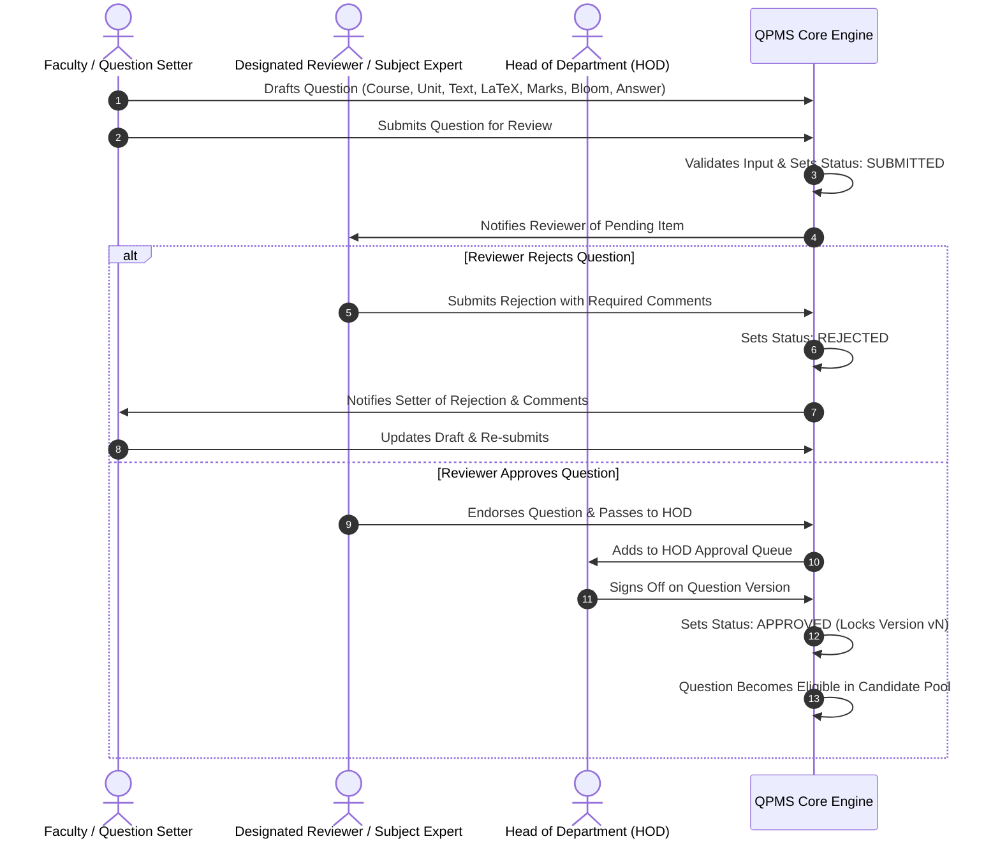
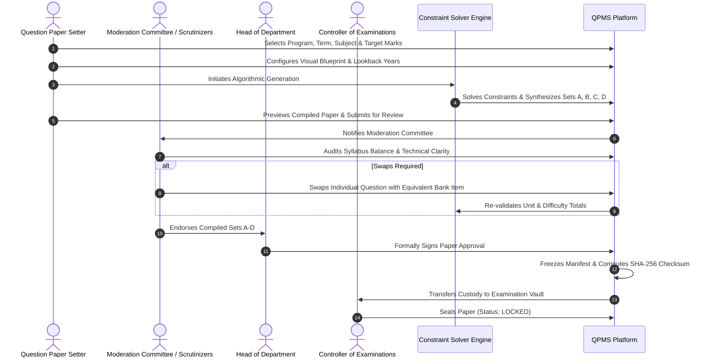
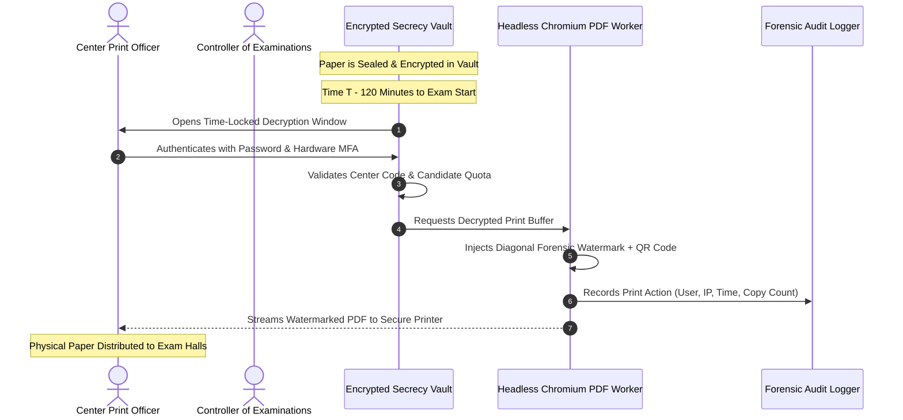

# Multi-Role Academic Workflows: QPMS

## Purpose
This document specifies the end-to-end multi-party academic workflows, collaboration patterns, moderation procedures, and approval handovers within the **University Question Paper Management & Generation System**.

## Scope
Covers the three primary academic workflow chains:
1. Question Authoring, Peer Review & Department Approval Workflow.
2. Blueprint Design, Algorithmic Synthesis & Examination Paper Approval Workflow.
3. Secrecy Custody, Print Handover & Reconciliation Workflow.

---

## 1. Workflow 1: Question Bank Authoring & Moderation Chain

---

## 2. Workflow 2: Examination Paper Generation & Approval Chain

---

## 3. Workflow 3: Secrecy Custody & Exam Day Printing Chain

---

## Current State vs. Proposed State

* **Current State:** Basic UI buttons exist in [ApprovalsView.tsx](file:///home/mohammad-ali/Projects/mj_question_paper_genrator/src/components/approvals/ApprovalsView.tsx) that update in-memory status strings. There are no multi-step state guards, no notification triggers, and no separation between moderation and secrecy custody.
* **Proposed State:** Fully orchestrated multi-party workflows powered by an event-driven architecture with email/push notifications, role-based transitions, and audit-logged handovers.

## Decisions
1. Enforce three distinct stages of approval: Peer Review $\rightarrow$ HOD Endorsement $\rightarrow$ CoE Secrecy Locking.
2. Require mandatory textual improvement comments for every rejected question or paper.

## Open Questions
- None.

## Related Documents
- [ROLES_PERMISSIONS.md](file:///home/mohammad-ali/Projects/mj_question_paper_genrator/docs/ROLES_PERMISSIONS.md)
- [QUESTION_LIFECYCLE.md](file:///home/mohammad-ali/Projects/mj_question_paper_genrator/docs/QUESTION_LIFECYCLE.md)
- [QUESTION_PAPER_LIFECYCLE.md](file:///home/mohammad-ali/Projects/mj_question_paper_genrator/docs/QUESTION_PAPER_LIFECYCLE.md)
- [AUDIT_LOGGING.md](file:///home/mohammad-ali/Projects/mj_question_paper_genrator/docs/AUDIT_LOGGING.md)
