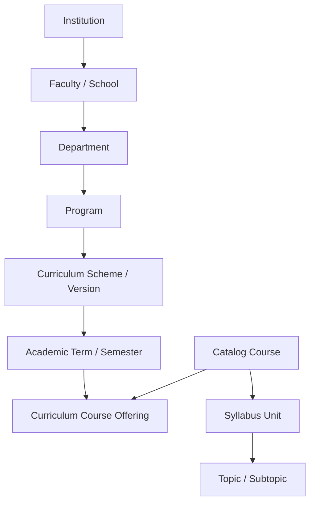

# ADR-002: Flexible Academic Hierarchy & Curriculum Versioning

## Purpose
Specify the architectural strategy for modeling multi-tier, extensible university academic hierarchies and curriculum scheme versioning without hardcoding simplistic school structures.

## Scope
Covers universities, faculties, schools, departments, degree programs, curriculum schemes, terms/semesters, courses, modules, units, and learning outcomes.

## Current State
The prototype models a fixed chain: `Institution -> Department -> Program -> Semester -> Subject -> Unit -> Chapter`. It lacks Curriculum Versioning (e.g., 2021 vs 2024 regulations) and does not support varying term cadences (trimesters, annual).

## Proposed State
An extensible, decoupled relational hierarchy where `CurriculumVersion` sits between `Program` and `Course`, and academic organization levels are modeled as flexible entities with self-referential or polymorphic organizational units.

---

## Context
Collegiate academic structures vary widely:
- A Technological University has `Faculties -> Schools -> Departments`.
- A Medical University has `Institutes -> Specialties -> Clinical Rotations`.
- Curriculums evolve every 3-4 years (e.g., NEP 2020 Scheme, CBCS 2022 Scheme, AICTE Model 2024 Scheme). A senior batch may study under Curriculum 2022 while a fresher batch studies under Curriculum 2025.

## Problem
How to model the academic domain so that new levels can be introduced, courses can belong to multiple programs (shared electives), and curriculum updates do not break historical examination archives?

## Options Considered
1. **Hardcoded Relational Chain (Current Prototype Model):**
   - Direct FKs: `Program -> Semester -> Subject`.
   - *Flaw:* Cannot handle multiple concurrent curriculum versions; breaks when a course is shared across programs (e.g., "Engineering Mathematics" taken by CS, EE, and Mech).
2. **Pure Adjacency List / Graph Model:**
   - Single `academic_nodes` table with `parent_id` and `node_type`.
   - *Flaw:* Poor query performance, difficult to enforce business constraints, loss of strong relational typing.
3. **Structured Domain Entity Hierarchy with Curriculum Versioning Bridge (Selected):**
   - Explicit domain entities: `Institution`, `Faculty`, `Department`, `Program`.
   - Introduce `CurriculumScheme` (e.g., "BCA Regulation 2024").
   - Introduce `CurriculumCourse` association table binding `Course` to `CurriculumScheme`, specifying `term_number`, `is_elective`, and `credits`.
   - Courses own `SyllabusUnits` which own `Topics`.

## Decision
Adopt Option 3: **Structured Domain Hierarchy with Explicit Curriculum Versioning**:

## Reasoning
This architecture completely decouples the *Catalog Course* (e.g., "Data Structures") from its *Program Curriculum Offering* (e.g., "Offered in Semester 3 of BCA 2024 Scheme with 4 Credits"). When a curriculum changes, a new `CurriculumScheme` is created without mutating existing course question banks, preserving 100% of historical paper validity.

## Consequences
- **Positive:** Supports coexisting curriculum versions, shared inter-departmental courses, and flexible term structures.
- **Negative:** Requires an extra join table (`curriculum_courses`) when querying subject details.

## Status
**Approved**

## Open Questions
- None.

## Related Documents
- [DOMAIN_MODEL.md](file:///home/mohammad-ali/Projects/mj_question_paper_genrator/docs/DOMAIN_MODEL.md)
- [DATA_MODEL.md](file:///home/mohammad-ali/Projects/mj_question_paper_genrator/docs/DATA_MODEL.md)
- [DATABASE_DESIGN.md](file:///home/mohammad-ali/Projects/mj_question_paper_genrator/docs/DATABASE_DESIGN.md)
