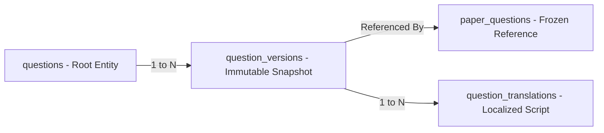

# ADR-003: Immutable Question Versioning & Translation Model

## Purpose
Define the versioning, mutation semantics, and multilingual translation data architecture for Question Bank items.

## Scope
Governs question creation, edits, version history tracking, approval freezing, and bilingual/multilingual variant management.

## Current State
The prototype uses a single `Question` interface with an embedded array of `QuestionVersion` objects stored inside the question in `localStorage`. Translations are stored as independent questions or flat string keys.

## Proposed State
A dual-table relational model (`questions` root parent table and `question_versions` immutable snapshot child table) with a dedicated `question_translations` table for localized variants.

---

## Context
In university examination systems, questions move through multiple hands:
1. Setter creates a draft question.
2. Reviewer suggests revisions.
3. Setter updates the text.
4. HOD or Subject Board approves the question.
5. The approved question is pulled into an official examination paper.

If a faculty member subsequently modifies an approved question (e.g., fixing a typo or changing numerical values), this edit MUST NOT silently alter past question papers that already printed or evaluated students based on the original wording.

## Problem
How to allow continuous question improvement and review while guaranteeing that past papers remain permanently immutable and auditable?

## Options Considered
1. **In-Place Mutation with Audit Log:**
   - Overwrite question row; record old values in an audit log table.
   - *Flaw:* Foreign keys from paper items point to the updated text; reconstructing an old paper requires replaying audit diffs, which is brittle and slow.
2. **Embedded Version Array (Current Prototype Approach):**
   - Store version snapshots inside a JSONB column on the question row.
   - *Flaw:* Poor indexing capability on past versions; high write amplification when updating; difficult to enforce relational constraints on foreign keys.
3. **Normalized Root Question with Immutable Version Rows (Selected):**
   - `questions` (Root entity: `id`, `institution_id`, `course_id`, `unit_id`, `current_version_id`, `created_at`).
   - `question_versions` (Immutable snapshots: `id`, `question_id`, `version_number`, `text`, `answer`, `marks`, `difficulty`, `status`, `options`, `bloom_level`, `created_by`, `approved_by`).
   - `paper_questions` references `question_version_id` directly, NOT `question_id`.

## Decision
Adopt Option 3: **Normalized Immutable Versioning**.

### Version Mutation Rules
1. A row in `question_versions` with status `APPROVED` is **read-only / immutable**.
2. Any user action to "Edit" an Approved question automatically inserts a new row into `question_versions` with:
   $$\text{version\_number} = \text{max\_version} + 1$$
   $$\text{status} = \text{'DRAFT'}$$
3. The previous approved version remains active and eligible for paper generation until the new version is formally approved by a moderator.

## Reasoning
This ensures 100% historical reproducibility. When viewing an exam paper from 2023, the query resolves the exact `question_version_id` frozen at print time, completely immune to edits made in 2026.

## Consequences
- **Positive:** Unbreakable audit integrity, transparent version diffing, and zero risk of retroactive paper corruption.
- **Negative:** Increased row count in `question_versions` (mitigated by table partitioning on `created_at`).

## Status
**Approved**

## Open Questions
- None.

## Related Documents
- [QUESTION_BANK.md](file:///home/mohammad-ali/Projects/mj_question_paper_genrator/docs/QUESTION_BANK.md)
- [QUESTION_LIFECYCLE.md](file:///home/mohammad-ali/Projects/mj_question_paper_genrator/docs/QUESTION_LIFECYCLE.md)
- [VERSIONING.md](file:///home/mohammad-ali/Projects/mj_question_paper_genrator/docs/VERSIONING.md)
