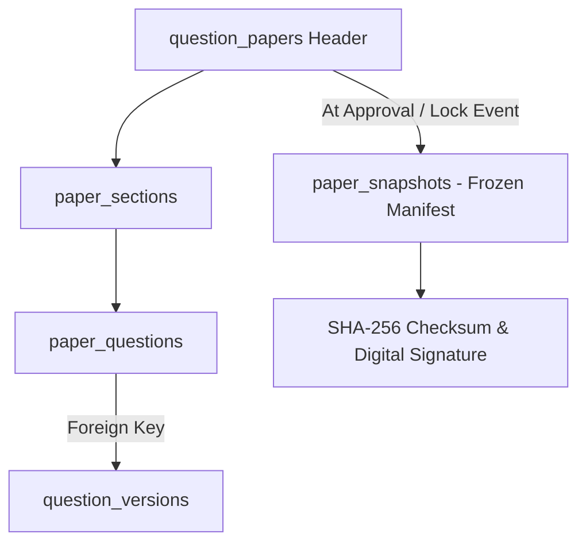

# ADR-004: Question Paper Versioning & Snapshotting

## Purpose
Specify how Question Papers are modeled, versioned, locked, snapshot, and archived to ensure statutory compliance and lifelong historical reproducibility.

## Scope
Governs paper compilation, draft editing, moderation revisions, final locking, multi-set snapshots, and archival storage.

## Current State
The prototype represents papers via a `PreviousPaper` interface stored in `localStorage`. Papers have a status (`draft`, `submitted`, `approved`, `archived`) and embedded `sections` with cloned question objects. Duplication generates a new draft with a randomized ID.

## Proposed State
A two-level relational snapshot model:
1. `question_papers` (Operational Header: ID, Title, Term, Session, Status, Blueprint Specs).
2. `paper_snapshots` (Frozen Immutable Manifest: Complete JSON payload of the paper as approved/printed, cryptographic signature, and hash).

---

## Context
Accreditation agencies (NAAC, NBA, ABET) and statutory examination guidelines require universities to retain physical and digital custody of examination papers for at least 7 to 10 years. During RTI (Right to Information) audits or court litigation regarding disputed questions, the university must be able to prove beyond doubt the exact wording, options, marks, and diagrams administered to candidates on the exam day.

## Problem
If an examination paper references questions that are updated or if course metadata changes, how can the system guarantee that the historical paper can be reproduced with 100% cryptographic fidelity years later?

## Options Considered
1. **Dynamic Re-Querying by Foreign Key:**
   - Store foreign keys to `question_versions`.
   - *Flaw:* If question diagrams, formulas, or course codes are deleted or purged from the database, the paper render breaks.
2. **Pure JSON Document Store:**
   - Store papers entirely as standalone JSON files in object storage.
   - *Flaw:* Inefficient to query for statistics (e.g., "Find all papers where Question Q-1024 was used across the last 5 years").
3. **Hybrid Relational Mapping with Frozen Document Snapshot (Selected):**
   - Maintain relational mapping (`paper_sections`, `paper_questions`) for fast relational querying, lookback filtering, and duplicate checking.
   - At the moment of `APPROVED` or `LOCKED`, serialize the complete rendered paper (including all instructions, question texts, options, diagrams as base64/hash, and answer keys) into an immutable `paper_snapshots` record with an SHA-256 integrity hash.

## Decision
Adopt Option 3: **Hybrid Relational Mapping with Cryptographic Document Snapshot**.

### Paper State Lifecycle Rules
1. **Draft / Generated:** Paper can be modified, re-ordered, and regenerated by authorized setters.
2. **Submitted / Under Review:** Read-only for setters; reviewers can comment and suggest question swaps.
3. **Approved:** Paper structure is locked; snapshot is generated and signed.
4. **Locked / Sealed:** Paper content is encrypted; custody moves to Controller of Examinations (CoE). Content cannot be viewed except during authorized print windows.
5. **Archived:** Preserved in read-only cold storage.

## Reasoning
This hybrid architecture provides the best of both worlds: high-performance relational querying for the lookback avoidance engine (e.g., `WHERE question_version_id = :id AND academic_year >= :year`), combined with absolute, tamper-evident archival fidelity through the frozen snapshot.

## Consequences
- **Positive:** Complete protection against data loss or subtle database schema shifts over a 10-year lifespan.
- **Negative:** Small storage overhead per paper snapshot (~100 KB JSON payload per exam paper).

## Status
**Approved**

## Open Questions
- None.

## Related Documents
- [QUESTION_PAPER_LIFECYCLE.md](file:///home/mohammad-ali/Projects/mj_question_paper_genrator/docs/QUESTION_PAPER_LIFECYCLE.md)
- [VERSIONING.md](file:///home/mohammad-ali/Projects/mj_question_paper_genrator/docs/VERSIONING.md)
- [SECURITY.md](file:///home/mohammad-ali/Projects/mj_question_paper_genrator/docs/SECURITY.md)
