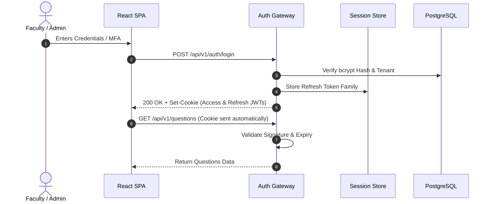

# ADR-005: Authentication & Session Security Strategy

## Purpose
Define the authentication architecture, token lifecycle, session management, and institutional SSO integration for the QPMS platform.

## Scope
Governs user identity verification, multi-factor authentication (MFA), password security, token issuance and refresh, institutional SSO (SAML 2.0 / OIDC), and active department context binding.

## Current State
The prototype relies on simulated login via a dropdown of 6 pre-configured user objects in `src/mock/academicData.ts`, storing `qpms_active_user` in browser `localStorage`. No actual password hashing, token validation, or session management exists.

## Proposed State
A standards-compliant OAuth2 / OIDC authentication backend with JWT tokens stored in `HttpOnly`, `SameSite=Strict`, `Secure` cookies, multi-factor authentication for exam officers, and automated active department context verification.

---

## Context
Question papers represent sensitive institutional assets. Unauthorized access or leaked credentials can compromise university-wide examinations, causing massive reputational and financial harm.

## Problem
How to implement an authentication mechanism that is secure against XSS, CSRF, and session hijacking, while supporting both internal university credential stores and external institutional Single Sign-On (SAML/Google Workspace/Microsoft Entra ID)?

## Options Considered
1. **Client-Side Stored JWT (in localStorage):**
   - *Flaw:* Extremely vulnerable to Cross-Site Scripting (XSS). Any third-party script or injected dependency can steal tokens.
2. **Stateful Server-Side Sessions (in Redis):**
   - *Pros:* Instant revocation.
   - *Cons:* Requires a Redis lookup on every API call; higher server memory overhead for large user bases.
3. **Short-Lived JWT in HttpOnly Cookies with Refresh Token Rotation in Redis (Selected):**
   - Access token lifespan: 15 minutes.
   - Stored in `HttpOnly`, `Secure`, `SameSite=Strict` cookie.
   - Refresh token stored in database/Redis with family rotation (detects token reuse and revokes entire session chain).
   - In-memory claims include `user_id`, `tenant_id`, `roles`, and `active_department_id`.

## Decision
Adopt Option 3: **Short-Lived JWTs in HttpOnly Cookies with Refresh Token Rotation**.

### Department Context Switch
When a user switches active departments (for faculty assigned to >1 department), the client calls:
`POST /api/v1/auth/switch-department { departmentId }`
The server validates that the user is legitimately assigned to that department and re-issues an updated access token containing the newly active `dept_id`.

## Reasoning
HttpOnly cookies make access tokens completely inaccessible to JavaScript, eliminating token theft via XSS. Short 15-minute expiration minimizes the impact of temporary token leaks, while refresh token rotation stops unauthorized reuse immediately.

## Consequences
- **Positive:** High security, standard enterprise compliance, and transparent session refresh for users.
- **Negative:** Requires strict CORS and CSRF token verification for non-idempotent state-changing requests (`POST`, `PUT`, `DELETE`).

## Status
**Approved**

## Open Questions
- None.

## Related Documents
- [AUTHENTICATION_AUTHORIZATION.md](file:///home/mohammad-ali/Projects/mj_question_paper_genrator/docs/AUTHENTICATION_AUTHORIZATION.md)
- [SECURITY.md](file:///home/mohammad-ali/Projects/mj_question_paper_genrator/docs/SECURITY.md)
- [ROLES_PERMISSIONS.md](file:///home/mohammad-ali/Projects/mj_question_paper_genrator/docs/ROLES_PERMISSIONS.md)
