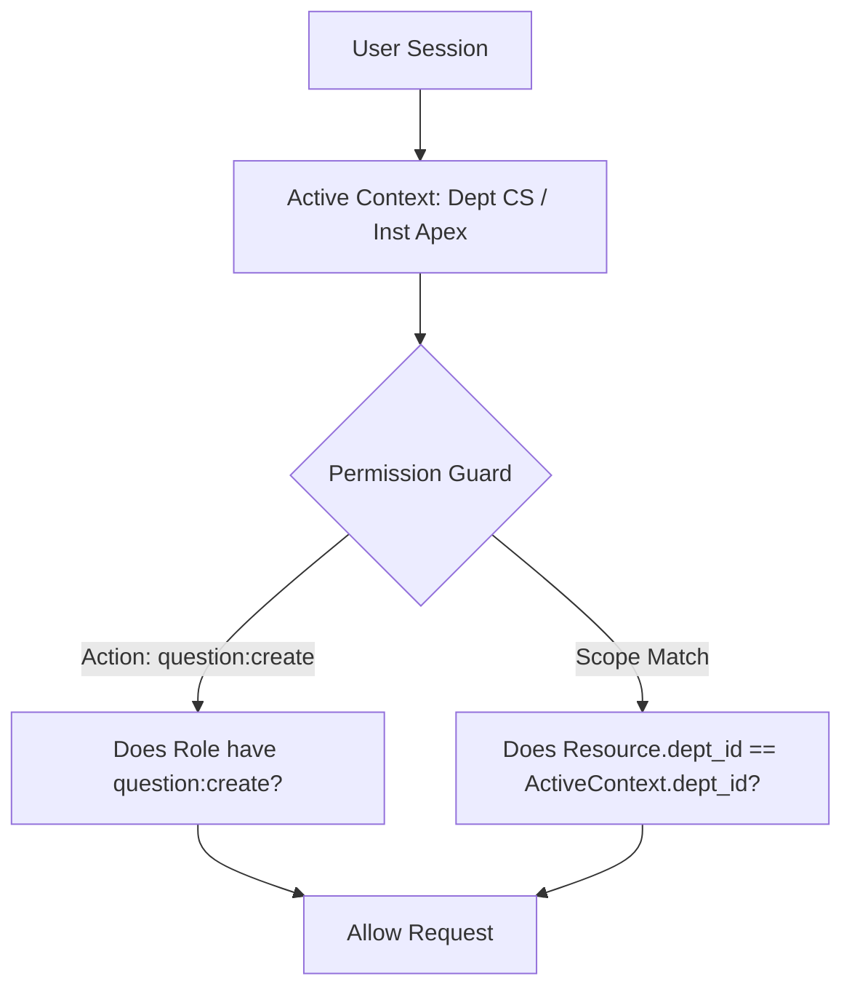

# ADR-006: Fine-Grained Role & Scope-Based Authorization

## Purpose
Define the authorization model, permission taxonomy, and context-dependent access control rules across institutions, departments, and examination resources.

## Scope
Covers Role-Based Access Control (RBAC), Attribute-Based Access Control (ABAC), departmental boundary enforcement, paper custody rules, and API authorization guards.

## Current State
The prototype enforces basic checks via a client-side utility `src/lib/permissions/permissionService.ts` testing static string roles (`teacher`, `hod`, `coordinator`, `institution_admin`, `university_admin`).

## Proposed State
A hybrid **RBAC + ABAC (Scope-Based Context)** engine enforced at the backend middleware layer and mirrored in the frontend for UI visibility.

---

## Context
Educational institutions possess distinct administrative layers:
- A Teacher in Computer Science can set questions for CS-301, but cannot view pending questions in Electrical Engineering.
- A Teacher who is also HOD in Department A possesses elevated approval rights in Department A, but behaves as an ordinary teacher if assigned to teach an elective in Department B.
- The Controller of Examinations (CoE) has cross-departmental access to lock and print papers, but cannot modify question text or syllabus units.

## Problem
How to implement authorization so that permissions are strictly bound to the active organizational scope (Institution + Department), preventing horizontal privilege escalation across departments and vertical privilege escalation across roles?

## Options Considered
1. **Simple Role-Based Access Control (RBAC):**
   - User has global roles: `ROLE_TEACHER`, `ROLE_HOD`.
   - *Flaw:* Fails when a user has different roles in different departments, or when checks depend on department ownership.
2. **Access Control Lists (ACL) per Object:**
   - Every question and paper has an explicit list of authorized user IDs.
   - *Flaw:* Extremely high administrative burden; impossible to manage when faculty assignments change semester by semester.
3. **Hybrid RBAC + Scoped Context (Selected):**
   - Users are assigned roles *within a scope*:
     `UserRoleAssignment(user_id, role_id, institution_id, department_id)`
   - Each action checks:
     $$\text{IsAuthorized}(\text{User}, \text{Action}, \text{Resource}) \iff \text{HasRoleWithPermission}(\text{Action}) \land \text{Resource.DepartmentId} == \text{User.ActiveDepartmentId}$$

## Decision
Adopt Option 3: **Hybrid Scoped RBAC + Contextual ABAC**.

### Granular Permission Taxonomy
Permissions follow the standard syntax: `<domain>:<entity>:<action>`.
- `qbank:question:create`
- `qbank:question:edit_draft`
- `qbank:question:review`
- `qbank:question:approve`
- `paper:blueprint:configure`
- `paper:generator:execute`
- `paper:approval:sign`
- `paper:secrecy:lock`
- `paper:custody:print`
- `audit:logs:view`

## Reasoning
This model cleanly solves the multi-department faculty problem (e.g., Prof. Amit Shah who teaches both CSE and AIDS). When Prof. Shah switches context to CSE, his permissions and queries automatically restrict to CSE.

## Consequences
- **Positive:** Zero risk of accidental cross-department data leakage; flexible assignment of administrative roles.
- **Negative:** Backend API middleware must resolve and validate scope headers on every secured request.

## Status
**Approved**

## Open Questions
- None.

## Related Documents
- [ROLES_PERMISSIONS.md](file:///home/mohammad-ali/Projects/mj_question_paper_genrator/docs/ROLES_PERMISSIONS.md)
- [AUTHENTICATION_AUTHORIZATION.md](file:///home/mohammad-ali/Projects/mj_question_paper_genrator/docs/AUTHENTICATION_AUTHORIZATION.md)
- [SECURITY.md](file:///home/mohammad-ali/Projects/mj_question_paper_genrator/docs/SECURITY.md)
