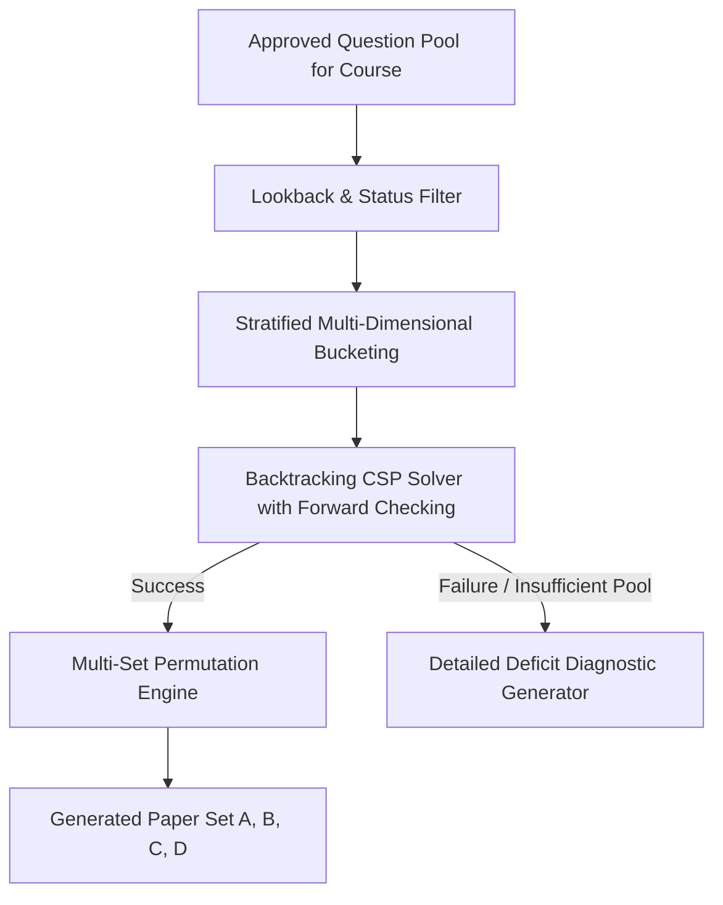

# ADR-008: Constraint-Satisfaction Paper Generation Engine

## Purpose
Define the algorithmic architecture, optimization strategy, and boundary conditions for automated question paper generation.

## Scope
Governs the mathematical generation algorithm, constraint satisfaction problem (CSP) modeling, unit balancing, difficulty distribution, cognitive level targeting, lookback anti-repetition filtering, and multi-set generation.

## Current State
The frontend prototype uses a static JavaScript array filter in `PaperGeneratorWizard.tsx` that selects questions based on active department and subject, with hardcoded distribution previews and alert notifications.

## Proposed State
A server-side deterministic Constraint Satisfaction Problem (CSP) solver utilizing heuristic backtracking and Knapsack optimization to synthesize mathematically balanced examination papers.

---

## Context
Generating an examination paper is a complex multi-constrained combinatorial problem:
- Total marks must equal exactly the target (e.g., 100 marks).
- Every section must satisfy specific question counts and per-question mark values.
- Questions must be drawn evenly across all selected syllabus units (no single unit can be omitted or over-represented).
- Difficulty ratios (e.g., 30% Easy, 50% Medium, 20% Hard) must be satisfied within a small tolerance margin ($\pm 5\%$).
- Bloom's cognitive taxonomy levels must match pedagogical intent.
- No question used in the last $N$ years (lookback window) can be included.
- For multi-set examinations (Sets A, B, C, D), papers must share identical difficulty profiles while presenting randomized sequences or disjoint candidate questions.

## Problem
How to design an algorithm that satisfies all constraints deterministically and rapidly (sub-2 seconds), while providing clear diagnostics if the question bank pool is insufficient?

## Options Considered
1. **Naive Pure Random Selection with Retry Loop:**
   - Pick questions randomly; check if constraints pass; if not, retry.
   - *Flaw:* Combinatorial explosion. In dense constraint environments, it frequently times out or enters infinite loops.
2. **Genetic Algorithm / Simulated Annealing:**
   - Stochastic search optimizing a fitness function.
   - *Flaw:* Non-deterministic; may produce suboptimal edge cases; difficult to explain why a specific paper failed to generate.
3. **Deterministic Constraint Satisfaction with Heuristic Backtracking & Diagnostic Pruning (Selected):**
   - Partition candidate questions into stratified buckets by `(Unit, Type, Marks, Difficulty, BloomLevel)`.
   - Filter out ineligible questions (lookback period, pending approval).
   - Use recursive backtracking with Most Constrained Variable (MCV) heuristic and forward checking.
   - If no valid combination exists, calculate the exact deficit matrix (e.g., "Deficit: Need 2 more Medium questions for Unit 3 in Short Answer format").

## Decision
Adopt Option 3: **Deterministic Constraint Satisfaction Problem (CSP) Solver**.

## Reasoning
This approach guarantees mathematical correctness, operates within predictable latency bounds ($< 1,500$ ms for standard papers), and provides actionable feedback to faculty when the question pool needs replenishment.

## Consequences
- **Positive:** Deterministic, reproducible, fast, and transparent.
- **Negative:** Requires careful calibration of constraint relaxation rules when faculty request "relaxed" generation modes.

## Status
**Approved**

## Open Questions
- None.

## Related Documents
- [QUESTION_PAPER_GENERATION.md](file:///home/mohammad-ali/Projects/mj_question_paper_genrator/docs/QUESTION_PAPER_GENERATION.md)
- [PAPER_BLUEPRINT.md](file:///home/mohammad-ali/Projects/mj_question_paper_genrator/docs/PAPER_BLUEPRINT.md)
- [PERFORMANCE.md](file:///home/mohammad-ali/Projects/mj_question_paper_genrator/docs/PERFORMANCE.md)
