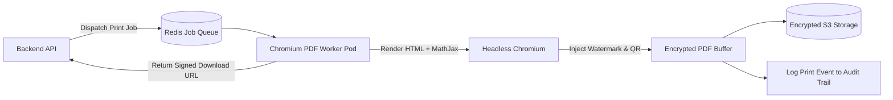

# ADR-009: Server-Side PDF & Print Engine with Dynamic Watermarking

## Purpose
Define the architectural strategy for generating print-ready, tamper-evident, dynamically watermarked examination question paper PDFs.

## Scope
Governs PDF layout rendering, server-side document generation, anti-leak watermarking, QR code verification tags, and print custody tracking.

## Current State
The prototype relies on client-side browser `window.print()` and JavaScript `alert()` dialogs simulating PDF downloads. This offers zero dynamic watermarking, zero security, and inconsistent layout across different browsers and printers.

## Proposed State
A dedicated server-side headless Chromium rendering worker (Puppeteer / Playwright) producing pixel-perfect, academic-standard PDFs with dynamic user watermarking, encryption, and embedded verification QR codes.

---

## Context
High-stakes university examination papers are physically printed at centralized printing facilities or confidential campus exam cells. Leaks often occur when someone photographs or steals physical copies. If a printed paper is leaked, forensic investigators must immediately identify the specific user, terminal, and exact timestamp associated with the printed document.

## Problem
How to generate standardized, beautiful academic examination PDFs that look identical across all operating systems while embedding non-removable forensic tracking watermarks?

## Options Considered
1. **Client-Side HTML-to-Canvas / jsPDF Rendering:**
   - *Flaw:* Severely limited CSS support; math formulas (LaTeX) render blurry; easily bypassed by users opening developer tools; cannot enforce forensic logging.
2. **Server-Side Python ReportLab / LaTeX CLI Compilation:**
   - *Pros:* Clean mathematical typesetting.
   - *Cons:* Heavy LaTeX distribution dependencies (~4 GB Docker image); slow startup; difficult to share visual styling tokens with the web application.
3. **Server-Side Headless Chromium via Puppeteer / Playwright (Selected):**
   - *Pros:* Full CSS3 print media support; flawless rendering of MathJax/KaTeX math formulas; exact visual fidelity matching the web preview; supports dynamic SVG background watermarks and barcode stamping; fast execution.
   - *Cons:* Chromium worker processes consume noticeable RAM (~150 MB per render worker), requiring dedicated queue workers.

## Decision
Adopt Option 3: **Server-Side Headless Chromium Engine (Puppeteer) Running in Dedicated Worker Pods**.


### Forensic Watermarking Specifications
Every rendered page features a diagonal, semi-transparent (12% opacity) watermark repeating across the content:
```text
CONFIDENTIAL — EXAM CELL COPY
Authorized To: Prof. Sunita Sharma (ID: u-sunita) | IP: 192.168.10.45
Session: Winter 2026 Regular | Printed: 2026-03-24 14:32:10 UTC | Copy # 004
```
A 2D QR code in the header encodes an HMAC-SHA256 signature verifying the paper's genuine origin.

## Reasoning
Headless Chromium guarantees 100% typography consistency regardless of whether the faculty member uses macOS, Windows, or Linux. Processing on the server guarantees that watermarks cannot be removed by client manipulation.

## Consequences
- **Positive:** Uncompromising visual quality, forensic traceability, and zero client dependency.
- **Negative:** Requires provisioning background worker pods with sufficient memory allocations.

## Status
**Approved**

## Open Questions
- None.

## Related Documents
- [PDF_GENERATION.md](file:///home/mohammad-ali/Projects/mj_question_paper_genrator/docs/PDF_GENERATION.md)
- [SECURITY.md](file:///home/mohammad-ali/Projects/mj_question_paper_genrator/docs/SECURITY.md)
- [AUDIT_LOGGING.md](file:///home/mohammad-ali/Projects/mj_question_paper_genrator/docs/AUDIT_LOGGING.md)
