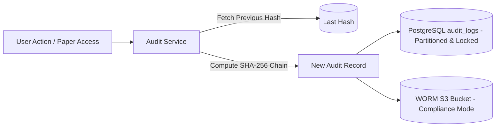

# ADR-010: Cryptographic Tamper-Evident Audit Logging

## Purpose
Define the architecture, storage, and cryptographic integrity mechanisms for forensic audit logging across all examination operations.

## Scope
Governs the logging of question creation/edits/approvals, paper generation runs, paper previews, moderation overrides, paper locking, prints, and downloads.

## Current State
The prototype does not maintain a real audit log table or file. It only maintains brief inline `comments` inside the question version array and paper `remarks`.

## Proposed State
An append-only, partitioned PostgreSQL audit log table reinforced with cryptographic SHA-256 hash chaining (Merkle-style verification) and streaming to immutable remote log storage.

---

## Context
High-stakes academic examinations require absolute non-repudiation. If an exam paper is leaked or an unauthorized modification occurs, the administration must conduct forensic investigations to answer:
- Who viewed or exported the paper?
- When did they access it?
- What was the client IP address and device fingerprint?
- Did any administrator alter the paper after it was approved?
- Can a rogue database administrator secretly alter the audit log to cover their tracks?

## Problem
How to implement an audit trail that is tamper-evident, high-performance, legally defensible, and incapable of being covertly rewritten?

## Options Considered
1. **Application-Level Log Files (JSON/Text Files):**
   - *Pros:* Simple to write.
   - *Cons:* Prone to truncation, rotation loss, and unauthorized modification by root server operators.
2. **Standard Relational Audit Table with Triggers:**
   - *Pros:* Easy SQL queries.
   - *Cons:* Vulnerable to `UPDATE` or `DELETE` queries executed by superusers.
3. **Append-Only Table with Cryptographic Hash Chaining & PostgreSQL Trigger Locks (Selected):**
   - Each audit record includes:
     $$\text{current\_hash} = \text{SHA256}(\text{previous\_hash} + \text{event\_payload} + \text{timestamp} + \text{actor\_id})$$
   - Database triggers strictly block `UPDATE` and `DELETE` on the `audit_logs` table:
     ```sql
     CREATE RULE no_update_audit AS ON UPDATE TO audit_logs DO INSTEAD NOTHING;
     CREATE RULE no_delete_audit AS ON DELETE TO audit_logs DO INSTEAD NOTHING;
     ```
   - Asynchronous streaming of signed audit batches to an immutable, write-once-read-many (WORM) cloud storage bucket (AWS S3 Object Lock in Compliance Mode).

## Decision
Adopt Option 3: **Cryptographically Chained Append-Only Audit Table with WORM Archival**.


## Reasoning
Hash chaining ensures that if an unauthorized party attempts to insert, delete, or modify an old audit row, the entire subsequent hash chain breaks immediately, alerting the system to tampering. WORM storage provides independent legal verification.

## Consequences
- **Positive:** Irrefutable forensic evidence, compliance with government/university exam security standards, and protection against insider threats.
- **Negative:** Small computational overhead for SHA-256 calculation on each audit write.

## Status
**Approved**

## Open Questions
- None.

## Related Documents
- [AUDIT_LOGGING.md](file:///home/mohammad-ali/Projects/mj_question_paper_genrator/docs/AUDIT_LOGGING.md)
- [SECURITY.md](file:///home/mohammad-ali/Projects/mj_question_paper_genrator/docs/SECURITY.md)
- [NON_FUNCTIONAL_REQUIREMENTS.md](file:///home/mohammad-ali/Projects/mj_question_paper_genrator/docs/NON_FUNCTIONAL_REQUIREMENTS.md)
